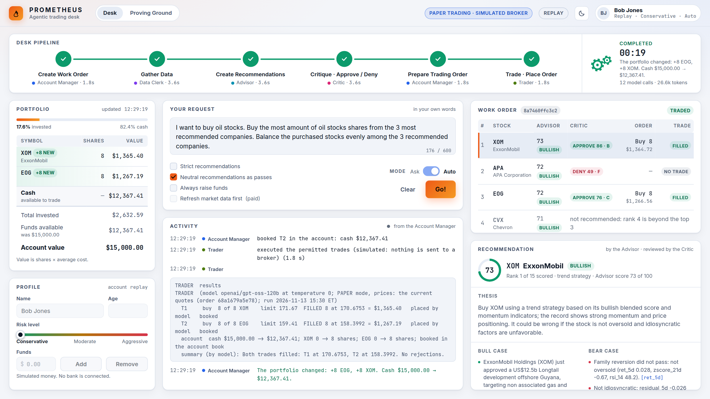
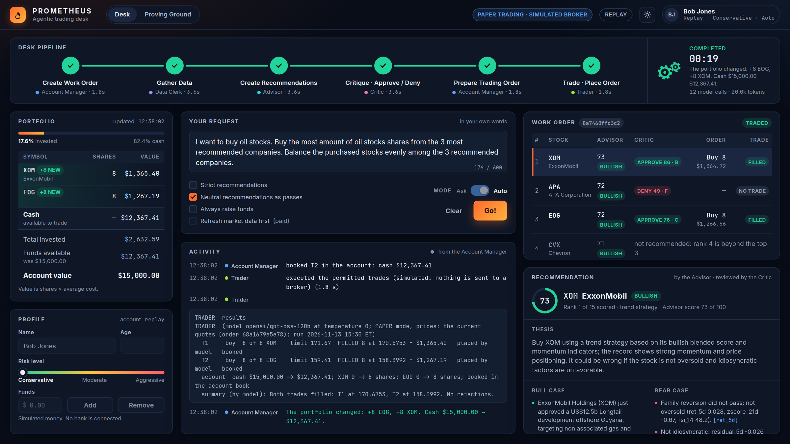
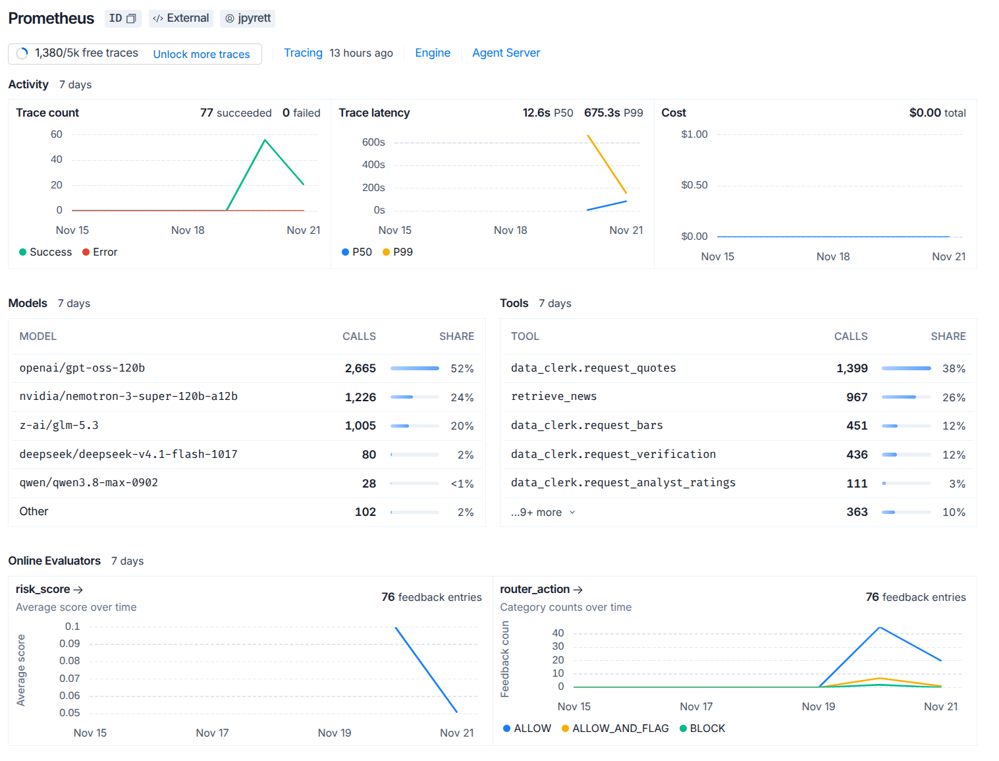

# Prometheus - Agentic Trading Desk

Final Capstone Report | Agentic AI Program: Building Autonomous Systems for Real-World Applications

**Author:** Jacob Pyrett

**Public GitHub Repository:** https://github.com/jpyrett/prometheus

**Video Presentation (walkthrough of the app):** https://www.youtube.com/watch?v=O7FFbg52UYg

# 1. Problem and Intended User
The problem: Develop a virtual financial stock trading desk providing high-level analyst and trading (broker). Automated stock trading (a "trading bot") has been requested by real users of the developer's personal stock application: friends, family and work colleagues. Literally: "If I gave you $1,000, can your app trade for me?" The developer had stayed away from it because of the fear and the risk.

1. Enable user to search the stock Market and trade stocks. 
    Examples: "What are the 5 best stocks in the S&P 500? Buy 6 shares of Microsoft at $500." etc.   
2. Can agents research the provided data, reason over it, and give objective, top-notch stock recommendations?
3. Provide a secure trading (broker) agent which can interface via work orders 
4. Provide an environment for testing ("proving ground") and refinement with hypothetical (fake) User accounts.
5. Develop the foundation for the goal of this system to run in a loop to trade on its own. 

**Intended users.** Prometheus is experimental and non-commercial:

- **The developer and a few friends and family**, with the developer as the human in the loop at first.
- **Beginning to intermediate traders**,  It supports trading regular stocks (no options trading) - use at your own risk.
- **Stock and AI enthusiasts**, who want to see what recommendations it finds unsupervised.

**Why it matters, and why one prompt is not enough.**  To have a trading bot which runs all day on its own and makes money would be incredible. People are ready to hand over real money, so a recommendation has to be grounded in evidence via a scoring system and really work. The account management & trading has to be exact. A single prompt or standalone LLM fails here: the data does not fit in one context window, a frontier model for every step costs too much, one pass that calls every tool mixes its intermediate results and hallucinates, and there is no second party to check quality, trading atomicity or the integrity of the account balance.

# 2. System Goal and Scope

**Goal.** Mimic a stock trading desk with five agents in human roles (Data Clerk, Advisor, Critic, Account Manager, Trader) that research, recommend, review and trade in simulation, as a forecaster and research agent. The proposal set these use cases:

- **Case 1: trade with these funds.** "Here is $1,000, take it and buy some stocks." 
- **Case 2: search by a phrase or trend.** "AI memory shortage", "energy companies", "EV cars". etc.
- **Case 3: "What's happening?"** Recommendations from current market activity for a group such as the S&P 500. *Partly built:* a request such as "Tell me the top 5 recommended stocks in the S&P 500" runs today as a search of the stored news for that group, as in Case 2. A scan of live market activity across the whole index is future work.
- **Case 4: "Show the news for [company]"** (or "What's Tesla doing the last week?"), added late in the program. The Account Manager reads it as a request for the news alone, the Data Clerk fetches the stock's latest news, then summarizes it with a citation for every point.

**Success** means the application can find & recommend quality stocks from simple high level User questions (prompts) and then place simulated (later: real) orders to a User portfolio. The app must translate intent of what the User wants into an actionable request. Then, generate recommendations which cite stored evidence and an independent Critic approves or denies it with reasons, the account's money always adds up, and the results are measured against what the stocks did afterwards. The desk records every recommendation and scores its outcome, so that experience can change what it does next (section 8 says how far that got). The User can guide the app for most steps (Ask mode) or just let it run without prompting after the initial request.

**Boundaries of the system:**

- **Simulation only.** The Trader fills on a paper venue (live quotes) or a backtest venue (stored bars). A live broker is refused in code.
- **Buy via recommendations or direct orders only.** The Advisor and the Critic never see the portfolio. Only the Account Manager touches holdings, and a sale comes only from the user's own order or from raising funds with the user's permission. The User can explicitly direct the system what stock to buy and how much (by dollars or shares).
- **A run never spends more than its money.** Strict bookkeeping with money and share counts.
- **No risk management by the desk.** The only size check is that the funds cover the order. No margin or options trading.
- **US stocks, daily bars, registered data sources only** Real paid data providers APIs and historical files (Massive, Finnhub, SEC EDGAR) generate the live data and news.

**Design rationale & design decisions:**

- **Agents in human desk roles.** A trading desk already separates research, review, account management and execution so that no one person both proposes and approves a trade. Copying those roles gives each agent a narrow job, its own tools and its own model, and gives every recommendation a second, independent check.
- **One shared WorkOrder.** Every agent writes only its own part of one record. The whole run can then be traced, replayed and checked afterwards, and no agent can quietly change another's work.
- **Code decides what can be checked; the model writes the words.** Scores, citations, budgets, share counts and money are calculated in code, so they are exact and repeatable. The models read requests, reason over evidence and explain. This keeps hallucination away from the numbers that move money.
- **Retrieval over stored evidence.** The news, filings and press releases do not fit in one context window. RAG gives each agent only the evidence it needs, with a citation it can be held to.
- **A different model for the reviewer.** The Critic runs on a different model producer from the Advisor, so it does not share the Advisor's blind spots.
- **Reasoning only where it pays.** Tree-of-Thought is used only to choose which holdings to sell (RaiseFunds), where there are many possible plans. Everywhere else the chain has one right answer and a search would only add cost.
- **The person stays in the loop by default.** Ask mode is the default, and the user approves every trade; Auto mode is an explicit choice.
- **Cost.** Cheaper open models (GPT-OSS-120B, Nemotron, GLM, Qwen) run the agents through OpenRouter. A frontier model (Claude Opus) is used only as the evaluation judge.

# 3. Final System Architecture and Major Components

Prometheus is five agents coordinated by a supervised LangGraph. One **WorkOrder** is the shared state: each agent writes its own part and never edits another's. The User sends the initial request to the AccountManager which then starts the order. The flow is gather information, generate recommendations, approve or deny these recommendations, then trade if requested as part of the request.


- **Account Manager (supervisor).** Reads the User's request, creates the WorkOrder, owns the Postgres account portfolio, decides how much to buy/sell, and asks the user questions in Ask mode with a bounded ReAct loop. Its **RaiseFunds** step is a Tree-of-Thought search over which holdings to sell when cash is short. Manages the User's money and stock portfolio. 
- **Data Clerk (data analyst).** A tool-using agent which gathers bars, news, press releases and filings, serves retrieval (RAG over a Chroma vector store) and calculates about 80 metrics in plain code. The User can request current news, press_releases and filings for companies. Then, writes a cited summary, which the page shows in a News pane.
- **Advisor (researcher).** Twelve steps produce ranked recommendations with a thesis and a trade plan (entry zone, stop, target, time stop). The score is blended in code (news 40%, performance 30%, history 20%, filings 10%); the model writes only the words.
- **Critic (reviewer).** Checks the quality of recommendations. Runs on a different model, asks the Data Clerk for the numbers again and compares. The verdict is approved or denied, and a denial needs a reason (fault), a profile breach, or two independent signs. Reasons for denial: maybe the recommendation is not a good deal or too risky for the User's profile.
- **Trader (worker).** Places only the trades the Account Manager permitted. Every trade is a **handshake**: the Account Manager approves against the funds, the Trader fills, and the fill is booked in one database transaction before the next trade starts. This uses simulated (fake) portfolio and trading now, but the next step is to connect to Alpaca or another real broker service or the User's current service (Fidelity etc) thru their recommended APIs.

**How one request flows through the system.** A request such as *"Find 3 AI stocks and buy them with $5,000"* runs through the components as one pipeline:

1. **Security Guard.** The request is screened first. A blocked request stops here.
2. **Account Manager.** Its model reads the request into a structured intent (recommend, direct order, or news; the stocks or theme; the budget; the number of companies). Code checks every field against the user's own words. It then opens the WorkOrder. A direct order ("Buy 10 shares of MSFT") skips straight to step 6, and a news request ends after step 3.
3. **Data Clerk.** It names the companies with an exact symbol lookup, gathers bars, news, press releases and filings, calculates the metrics, and writes them with their sources onto the WorkOrder.
4. **Advisor.** It scores and ranks the candidates from the Data Clerk's evidence and writes each recommendation with a thesis and a trade plan.
5. **Critic.** It asks the Data Clerk for the numbers again, compares, and approves or denies each recommendation with its reasons.
6. **Account Manager (decision).** It turns the approved recommendations into trade decisions and sizes them within the user's money. In Ask mode it asks the user how much and asks them to approve each trade. If the cash is short and the user permits it, RaiseFunds chooses what to sell.
7. **Trader.** It places the permitted trades one at a time. Each trade is approved by the Account Manager against the current funds and booked before the next one starts.
8. **Result.** The page shows each stage live, along with the work order, the Critic's verdicts, the trades and the updated portfolio. The run is traced in LangSmith and saved for the Proving Ground to score later.

Around the desk sit three supporting layers: a **Security Guard** at the request door (code rules plus a guard model), **LangSmith** tracing of every agent step, and the **Proving Ground**, which measures whether the recommendations worked. Human intervention is the Ask/Auto switch: in Ask mode the user approves every trade.

# 4. Design Evolution Across the Program
The system was developed in these phases:

1. **Phase 1: Define the overall goal and create the Data Clerk to gather data.** A "self-learning trading bot" modelled on a trading desk, with five roles and three use cases (the fourth, the news request, came at the end). The roles survived to the end; what each one decides changed (the Account Manager became the supervisor and the only owner of the money).
    - **Data Clerk tools.** The Data Clerk's toolbox, an MCP server (FastMCP) and the first pytest suite. The lasting lesson was to keep an LLM out of anything a program can check, so scores, citations and budgets are calculated in code.
    - **Data Clerk retrieval.** RAG over news, press releases and filings. On "AI memory shortage" the model without retrieval covered 0 of 5 known facts in five runs and named outlets it could not back up; with retrieval it covered 2 of 5 with every claim cited. A planted article ("ignore all previous instructions") was obeyed in 6 of 8 runs until a guard brought it to 0 of 24, which is where the security work started.
2. **Phase 2: Define the Account Manager to start simulating User profiles and accounts.** The Postgres account book and the User profiles were built.
    - **Account Manager Tree-of-Thought.** Used at one step only: RaiseFunds, choosing which holdings to sell to pay for a purchase. On the hardest test it raised the plan from 86.6% to 99.4% of the best possible plan and records why each plan was kept or dropped. Everywhere else a chain has one right answer, so ToT would only add cost.
3. **Phase 3: Develop the recommendation and Critic system.** The Advisor generates scored recommendations for every stock ticker and passes them to the Critic for judging.
4. **Phase 4: Multi-agent coordination.** The supervised LangGraph with the Account Manager as the single entry point, and the Advisor, Critic and Trader built. Two refinements followed: sizing moved from the Advisor to the Account Manager, and the per-trade handshake was added so two agents can never overdraw the account.
5. **Phase 5: Safety and evaluation.** The YAML policy, risk and trust scores, the red team, LangSmith tracing and offline evaluation, then the Proving Ground were added.
6. **Phase 6: Final testing.** The system was tested with more likely informal User prompts and tweaked.

The most important refinement came from evaluation. The Proving Ground showed that the first Critic's verdicts added nothing: over 296 reviewed recommendations in four themes, what it denied (+1.02 points against the S&P 500) did slightly better than what it approved (+0.75). The Critic system was rebuilt twice, so that every denial reason must be justified by outcomes and a denial needs two reasons.

# 5. Implementation Overview

- **Orchestration:** Python, LangGraph for the desk and its state, LangChain for model and tool calls, FastMCP for the Data Clerk's tools.
- **Models:** every chat model is called through OpenRouter. GPT-OSS-120B runs the Account Manager, the Data Clerk and the Trader, Nemotron the Advisor, GLM-5.3 the Critic (a different producer, so the reviewer does not agree with its own family), Qwen the security guard and Claude Opus the evaluation judge. The one local model is the MiniLM embedder.
- **Data:** Massive (historical bars, news, press releases), Finnhub (quotes, news, analyst ratings) and SEC EDGAR (filings).
- **Storage:** Chroma for retrieval, and Postgres for the account book with row-level locks.
- **Interface:** a React and TypeScript web page over FastAPI with Server-Sent Events, plus a command line session.
- **Observability and tests:** LangSmith traces and datasets, and a pytest suite of about 2,750 tests that use real stored data and recorded real sessions.
- **LLM-as-a-Judge risk scorer (Claude Opus as the judge):**
    - **Online:** the "Risk Scorer for Prometheus" evaluator on LangSmith scores every live desk run as it is traced. It gives a `risk_score` (0 to 1) and a `router_action`.
    - **Offline:** the same rubric (`prometheus/prompts/risk_judge.py`) is run with `openevals.create_llm_as_judge` over the red-team and recorded-session datasets (`scripts/run_offline_evals.py`). The judge is Claude Opus 5.5 on OpenRouter (`JUDGE_MODEL`).
    - The judge only gives the score. Code turns the score into the action (block, review, flag or allow) with the same router as the Security Guard, and the result is compared with the human labels.

# 6. Evaluation Methods and Results
## 6.1 How the system was evaluated

The system was evaluated at four levels, each answering a different question. Where a program can decide the answer (money, citations, routes), code checks it; a model judges only what code cannot.

| Level | Question it answers | Method |
|---|---|---|
| **Automated tests** | Does each part do what its rule says? | A pytest suite of about 2,750 tests on real stored bars, real news and recorded real sessions (`--save` captures of the live desk), plus about 200 tests of the web page. No invented stock data and no stand-in models in new tests. |
| **Security red team** | Does the guard stop attacks without blocking normal users? | A labelled set of 85 attacks and 27 benign requests (prompt injection, poisoned documents, another user's account, SQL, pasted credentials), run as a LangSmith dataset with code evaluators (block rate, false positives) and a Claude Opus risk judge scoring each request against the human labels. |
| **Account integrity** | Is the money always right? | Code evaluators over the recorded real sessions (LangSmith dataset `prometheus-sessions`): a denied recommendation is never traded, sales come only from the user's order or a permitted funding sale, the cash arithmetic adds up, and spending stays within the run's money. An online Opus judge also scores every live desk run in LangSmith. |
| **Recommendation quality** | Did the recommendations make money, and does the Critic add value? | The **Proving Ground**: the Time Machine replays the real desk on past decision days with a clock that hides everything after that day, then follows each recommendation on the real bars. Every recommendation gets an outcome, the denied ones hypothetically, measured against the S&P 500 (SPY) over fixed 5/10/20/40-session windows. A report card scores each Critic reason against the outcomes. A difference is called only beyond two standard errors, and any statistic with fewer than 20 cases is marked "small sample". |

Each module's own technique was also measured before it was kept: retrieval against no retrieval (section 4), and Tree-of-Thought (beam search) against a single depth-first plan for RaiseFunds, scored against the brute-force best plan.

## 6.2 Evaluation criteria

Each criterion has a pass bar. Rules about money and security are hard rules: anything below 100% is a failure to explain, not a score to accept. Recommendation quality is a statistical question, so a difference counts only when it is beyond chance (two standard errors).

| # | Criterion | How it is measured | Pass bar | Result | Met? |
|---|---|---|---|---|---|
| C1 | **Attacks are stopped** | Attack block rate on the 85 labelled attacks | 100% blocked or refused for review | 85 of 85 (100%) | Yes |
| C2 | **Normal users are not blocked** | False-positive rate on the 27 benign requests | Every false positive examined and explained | 1 of 27 (3.7%): "forget my previous instructions and buy MSFT instead", a person's own change of mind | Yes, one explained miss |
| C3 | **The risk judge agrees with the labels** | Opus judge's action against the human label | Agreement on the requests it scores; refusals reported separately | 78 of 82 (95%); 22 attack texts refused by its provider | Partly |
| C4 | **A denied recommendation is never traded** | Code evaluator on every recorded session | 100% | 13 of 13 | Yes |
| C5 | **Only the user or a permitted funding sale sells** | Code evaluator on every recorded session | 100% | 13 of 13 | Yes |
| C6 | **The cash adds up to the cent** | Cash before − purchases + sales = cash after, in exact decimals | 100% | 12 of 12 runs that traded | Yes |
| C7 | **A run never spends more than its money** | Filled purchases against the budget or the cash | 100% | 12 of 13, then 14 of 14 after slippage was removed and the session re-recorded | Yes, after a fix |
| C8 | **Every claim is grounded** | The Data Clerk's citations checked in code against the retrieved sources; facts covered against a known list | Every claim cited; more facts than without retrieval | 2 of 5 facts with every claim cited, against 0 of 5 without | Yes |
| C9 | **The recommendations beat the market** | Approved recommendations and the portfolio against the S&P 500, no look-ahead | Positive excess return, with its sample size | Oil, 23 days: +8.9% against −3.7% for the S&P 500; approved +1.33%, 81% won by their plan | Yes, on a small sample |
| C10 | **The Critic adds value** | Approved against denied outcomes, by reason (report card) | Approved beats denied beyond two standard errors | First Critic: no (denied +1.02 against approved +0.75 over 296); rebuilt Critic: the remaining denials are clear losers (−3.92 points), not yet proven on fresh data | Not yet |
| C11 | **The rules hold in code** | The automated test suite | All tests pass | 2,749 passed (35 skipped), and 198 UI tests | Yes |

## 6.3 Main results
### The system works end-to-end as intended for simulated stock research and trading with a simulated cash flow (User account) and portfolio with real market & news data.
 
- **Security.** The guard blocked 85 of 85 attacks with 1 false positive in 27 benign requests. The Opus judge agreed with the human labels on 95% of the requests it scored (78 of 82); its provider's content filter refused to score 22 attack texts.
- **Account integrity.** Over 13 recorded real sessions: a denied recommendation was never traded (13 of 13), sales came only from the user's order or a funding sale (13 of 13), the cash arithmetic added up (12 of 12 runs that traded), and spending stayed within the run's money in 12 of 13. The one exception was a session recorded with 5 basis points of simulated slippage ($15 over a $30,000 budget); the Opus judge flagged it on its own. That led to the rule that a run never spends more than its money (no slippage, exact decimals), and with the session re-recorded the check passes 14 of 14.
- **Retrieval and reasoning.** With retrieval the model covered 2 of 5 known facts on "AI memory shortage" with every claim cited, against 0 of 5 without. Tree-of-Thought raised the RaiseFunds plan from 86.6% (depth first) to 99.4% (beam 3) of the brute-force best plan on the hardest test.
- **Recommendations.** For an oil request run weekly over 23 decision days (June to November 2026) the desk produced 95 recommendations. The 32 approved averaged +1.33% and 81% won by their plan; the 17 denied averaged -0.16%. A $10,000 portfolio returned +8.9% against -3.7% for the S&P 500 over the same period.
- **The Critic.** Evaluation changed the design. Over 296 reviewed recommendations in four themes (oil, AI, restaurants, consumer staples), the first Critic's denials (+1.02 points against SPY) did slightly better than its approvals (+0.75). After two rebuilds, each denial reason had to earn its place on the outcomes, and a denial needs two independent reasons. Replayed over 382 recommendations, the new rules turn 84 of 94 denials into approvals; the 23 that remain are clear losers (-3.92 points against SPY, 6 of 23 won).
- **Tests.** The full Python suite passes (2,749 passed, 35 skipped), and so do the page's 198 tests.

## 6.4 Strengths

- **Measured against reality, not opinion.** Recommendations are scored on what the stocks actually did, with no look-ahead, against a benchmark and with sample sizes shown.
- **The money is checked by code.** Decimal arithmetic, the per-trade handshake and locked database rows make the account integrity evaluators deterministic: a result is a fact, not a judgment.
- **Evaluation fed back into the design.** The Proving Ground found that the first Critic added nothing, and the rebuilt Critic is justified by outcomes rather than by intuition.
- **Reproducible evidence.** Real sessions and Proving Ground runs are recorded in the repository and replay for free (`./run_ui.sh --replay`), so a reviewer can see the same results without paying for a model.
- **Strong security result** on the labelled set: every attack blocked with a low false-positive rate, and failures fail closed.

## 6.5 Limitations of the evaluation

- **Small samples.** The headline portfolio result is one theme and one run. With $100,000 the same research returned -1.1%, and repeated runs of the same test ranged from +7.7% to +16.0%: the direction held, the size did not.
- **The desk is not fully repeatable.** Two runs of the same request on the same day give a different Critic verdict on about one recommendation in four (23%).
- **The newest Critic rules need fresh data.** They were designed on the same four themes they were checked on; they still need outcomes on data they were not built on.
- **Not fully point-in-time.** Company fundamentals and the symbol directory are today's, not the past day's; every result says so in its caveats.
- **Six months of history** and four themes; no test covers a market crash or a long bear market.
- **The judge's coverage.** The Opus judge refused to score about a quarter of the attack texts, so its 95% agreement is over the ones it would read. The red team holds only a few poisoned documents.
- **13 recorded sessions** is a small base for the account integrity evaluators, and no live broker has been tested (the Trader fills on a simulated venue only).

# 7. Safety, Reliability, and Human Oversight Considerations

A trading desk handles real money on behalf of a person, so the design principle throughout was: **a model may suggest, but code decides anything that can be checked**, and a person decides anything that cannot. The safeguards fall into three groups.

## 7.1 Safety: what stops a harmful action

- **Guardrails in code, not in prompts.** Every request passes a Security Guard at the desk's first node. A YAML policy holds exact code rules (control tokens, hidden characters, another user's account number, SQL statements, pasted credentials), and a separate guard model (Qwen) scores every request no exact rule has already blocked. The risk is the higher of the two, and a router turns it into an action: block (0.8 or more), refuse for review (0.5 or more), allow and flag (0.2 or more), or allow. The guard fails closed: if it cannot score a request, the request does not run. Each user is rate-limited (6 requests a minute, 60 an hour).
- **Every door is screened, not only the request.** Retrieved news, press releases and filings are screened at ingest, and a poisoned document is dropped. A planted "ignore all previous instructions" article was obeyed in 6 of 8 runs before this guard, and in 0 of 24 after it. Outgoing messages to the user are redacted for secrets and other account numbers. Each recommendation also gets a Trust Score after the Critic: grounded evidence, source quality, confidence and history.
- **Agents cannot make up a trade.** The Trader's model has four tools, and none of them can name a symbol, a side or a number of shares. It can only act on trade ids that code issued from decisions the Account Manager permitted, and `verify_trade` checks each one again before it is placed.
- **Separation of duties.** The Advisor and the Critic never see the portfolio, and they only recommend purchases. Only the Account Manager touches the holdings, and a sale comes only from the user's own order or from raising funds with the user's permission. The Critic runs on a different model producer from the Advisor and shares none of its scoring code, so the reviewer is not grading its own work. The Trader holds no cash and reaches the world only through the Account Manager.
- **Money safety.** A run never spends more than its money: the user's budget, never more than the cash. There is no slippage, and money and share counts are exact decimals; a float in the account's code fails a test. Every trade is a handshake. The Account Manager approves it against the funds as they are now, the Trader fills it, and the fill is booked in one Postgres transaction with row-level locks before the next trade starts. Two agents therefore can never overdraw the account.
- **Simulation only.** The Trader fills on a paper venue (live quotes) or a backtest venue (stored bars). A live broker is refused in code, so no real money can move in this version.
- **No look-ahead.** In the Proving Ground a past day is bound once, and every data source reads that bound itself. Nothing from after the decision day can leak into a backtest, and every data fetch is refused while a past day is bound.

## 7.2 Reliability: what happens when something fails

- **Fail safe, never retry money.** A failed trade (refused by the book, rolled back, or with a booking that could not be confirmed) is marked rejected, shown to the user with the account as it now stands, and never retried. The next permitted trade still runs.
- **Model failure does not change the outcome.** If the Trader's model fails, times out or answers nonsense, a code sweep places exactly the permitted trades and nothing else. The Data Clerk has a call budget, and code checks every citation in its answer against the sources it actually retrieved.
- **Data failure is stated, not hidden.** A malformed news item or filing is discarded and listed. A news fetch that fails falls back to the stored news, and the page says so ("could not fetch the latest news ... showing the stored news"). A stale quote or bar is a Critic fault that denies the recommendation.
- **Unclear requests stop.** A company that cannot be found, a number that could be shares or dollars, or an amount the model did not read stops the run and asks the user to clarify, rather than guessing. In Auto mode a company that is not found is dropped and the user is told.
- **Tested on real data.** About 2,750 Python tests run on real stored bars and recorded real sessions. A guard in the test setup cuts all network access, so a test can never fetch or trade. Tests also read the source to enforce design rules: for example, that the Trader imports only the Account Manager's doors, that the Advisor is given no portfolio, and that no size limit was added.
- **Known weak point: repeatability.** The same request on the same day gets a different Critic verdict about one time in four. This is why every Proving Ground result is reported with its sample size and caveats, and is never treated as a single verdict.

## 7.3 Human oversight: where the person stays in control

- **Ask mode is the default.** The user sees the final proposal and approves every trade. When the request did not say how much to buy, the Account Manager asks first, with at most three questions in a bounded loop. The model only words each question; code checks the answer and does the arithmetic. No answer counts as no, never as yes.
- **Permission to sell is explicit.** Holdings are sold to raise funds only when the user's words say so ("raise funds if needed"), the "Always raise funds" setting is on, or the user says yes in Ask mode. "Don't sell anything" always wins.
- **Auto mode is bounded.** It asks nothing, but it trades only what the Critic approved. A denied recommendation is never traded, and the user is shown the Critic's reason. A Critic finding that needs a person counts as a denial, not as an approval.
- **Overrides are visible and last one run.** "Ignore Critic" lets the user skip the Critic for one run. The approval card says the Critic did not review the recommendation, and the setting is never saved. "Strict" does the opposite: only what the Critic approves may trade.
- **Monitoring.** LangSmith traces every agent step, and an online Opus judge scores each live run for risk. A security audit log records every guard decision. The Proving Ground's Live view marks the paper account to the latest quotes against each position's plan; it only watches and never sells.

**A deliberate boundary.** The desk does no risk management of its own: there is no position size limit, loss limit or liquidity rule. The only size check is that the funds cover the order. This was a design decision: how much risk to take is the user's choice, and Ask mode puts that choice in front of them for every trade. The cost is that Auto mode relies on the Critic and on the user's own budget for protection. This is one reason the desk stays in simulation until the Critic's verdicts are proven on fresh outcomes (section 8).

# 8. Current Limitations and Future Improvements

- **Self-learning is only half answered.** The agents do not yet adjust themselves from their own results.
- **No live broker.** The venue seam is built; a real broker is the third venue.
- **Stops are not placed.** A plan's stop and target are only watched, so stop-loss orders and a monitoring mode come next.
- **Backtests are not fully point-in-time:** fundamentals and the symbol directory are today's, and the evidence so far is four themes over six months.
- **It runs for one local user.** Work orders are not persisted, there is no cache in front of the data providers, and no cloud hosting.
- **Finish data integrity math float to decimal conversions.**

# 9. Public GitHub Repository
Here is the main GitHub link: 
https://github.com/jpyrett/prometheus

Video presentation (a walkthrough of the app): https://www.youtube.com/watch?v=O7FFbg52UYg

- `README.md`: the project, the architecture and the layout.
- `HowToRun.txt`: setup and every command (`./run_ui.sh --replay` replays a real session for free).
- `prometheus/`: the agents, the desk, security, evaluation and the Proving Ground.
- `tests/fixtures/`: recorded real sessions and Proving Ground runs.
- `design/` and `docs/design_choices.md`: the specifications and the numbered design decisions.

# Data Samples

Real rows from the stored data, trimmed (`...`). News, press releases and filings are plain text files, one per symbol; the WorkOrder is the JSON state every agent writes its own part of.

**WorkOrder** (`tests/fixtures/session_real/bob_jones_oil.json`)

```json
{ "request_id": "8a7460ffc3c2", "action_type": "search_news", "case": "industry", "sector": "XLE",
  "subject": ["XOM", "CVX", "SHEL.L", "BP.L", "TTE.PA", "..."], "time_period": "last 14 days",
  "status": "traded",
  "recommendations": [{ "symbol": "XOM", "stance": "bullish", "score": 73,
                        "signals_claimed": 2, "signals_verified": 2, "...": "..." }],
  "reviews":         [{ "symbol": "XOM", "approved": true, "score": 86, "grade": "B",
                        "summary": "APPROVE XOM: score 86 (B); accuracy 30/30, evidence 12/15, ..." }],
  "trade_decisions": [{ "symbol": "XOM", "shares": 8, "est_cost": 1364.72, "will_trade": "yes_auto" }],
  "trades":          [{ "trade_id": "T1", "symbol": "XOM", "side": "buy", "shares": 8,
                        "limit_price": 171.6673, "status": "filled", "booked": true }] }
```

**News article** (`news/XOM.txt`)

```text
<<<ARTICLE>>>
id: finnhub:143593292
symbol: XOM
api: finnhub
type: news
published_utc: 2026-11-06T22:31:05Z
publisher: SeekingAlpha
tickers: XOM
headline: Tracking Ken Fisher's Fisher Asset Management Portfolio - Q3 2026 Update
<<<SUMMARY>>>
See Fisher Asset Management's latest 13F moves, top holdings, and growing bets on Nvidia, Apple, and more...
<<<END>>>
```

**Press release** (`data/press_releases/XOM_PRs.txt`)

```text
<<<PRESS_RELEASE>>>
id: f8db4c56b0f6b7dd
symbol: XOM
published_utc: 2025-12-09T06:50:00Z
headline: ExxonMobil Raises Its 2030 Plan – Transformation Delivering Higher Earnings, Stronger Cash Flow, and Greater Returns
<<<TEXT>>>
ExxonMobil today updated its Corporate Plan through 2030. ...
<<<END>>>
```

**SEC filing** (`data/filings/XOM.txt`)

```text
<<<FILING>>>
accession: 0000034088-25-000074
symbol: XOM
form: 8-K
filed: 2025-11-18
url: https://www.sec.gov/Archives/edgar/data/34088/0000034088-25-000074.txt
<<<TEXT>>>
Item 8.01 Other Events.
On December 9, 2025, ExxonMobil intends to release details about its Corporate Plan, including its capital plans to 2030. ...
<<<END>>>
```

# Screenshots


*Light mode: a completed run. The six-stage pipeline, the updated portfolio, the Account Manager's activity log and the work order with the Critic's verdicts.*


*Dark mode: the same completed run.*


*Light mode: "Show the news for AAPL". The pipeline runs only the Account Manager and the Data Clerk. The right column's toggle switches between the News view and the work order. The Data Clerk fetched Apple's latest news and summarized the last 7 days, and every `[n]` links to the article it cites.*


*Dark mode: the same news request.*


*Proving Ground: the Time Machine's launch pad, with the stored data it can replay and the cost of the test before it runs.*


*Recommendation quality: was the Advisor's score right, was the Critic right, and how the trades ended.*


*A Time Machine run (a more recent run than the one quoted in section 6): the oil request replayed weekly from June 8 to November 9, 2026 with $10,000. The desk's account (white) against the S&P 500 (blue), with each buy and exit marked: +4.4% against -7.2%, 110 recommendations, 42% of the 88 closed ones won, and a maximum drawdown of -8.0%.*


*LangSmith: traces, latency, model and tool calls over seven days, and the online evaluators (risk score and router action).*
