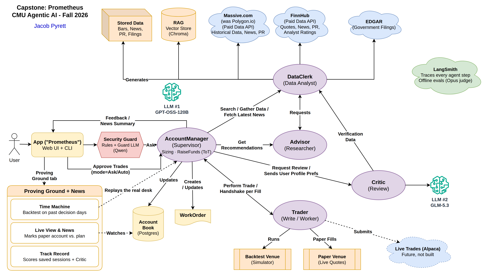
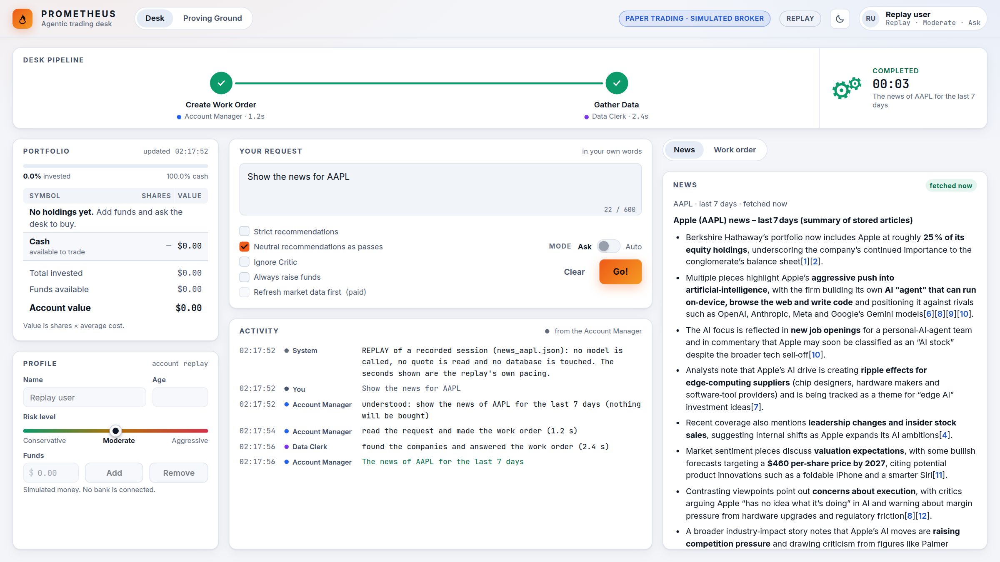
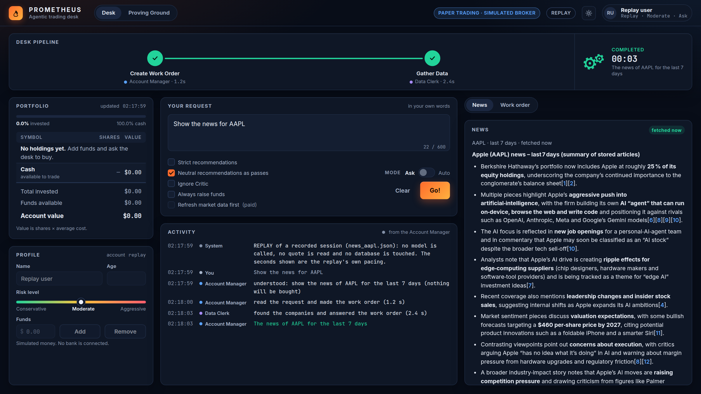
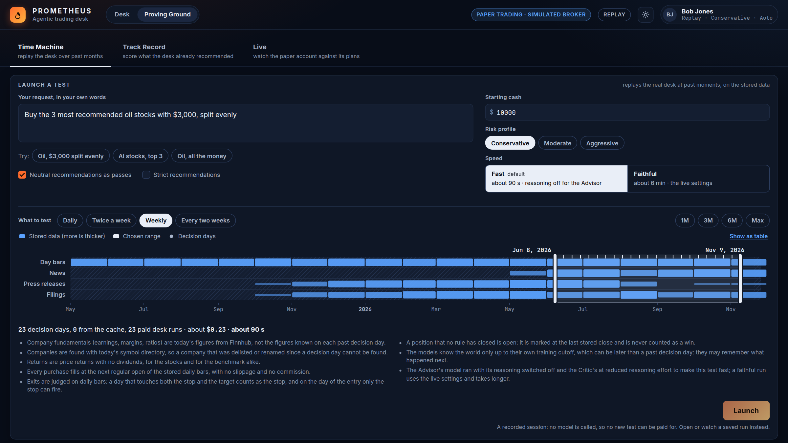
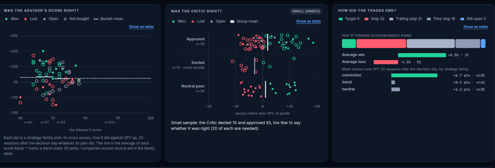
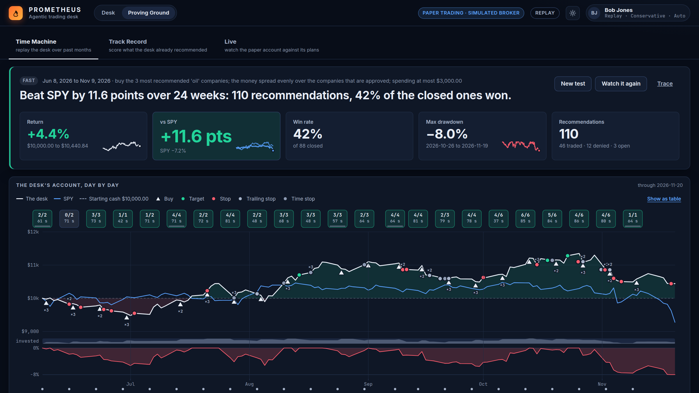

# Prometheus - Agentic Trading Desk

Final Capstone Report | Agentic AI Program: Building Autonomous Systems for Real-World Applications

**Author:** Jacob Pyrett

**Public GitHub Repository:** https://github.com/jpyrett/prometheus

# 1. Problem and Intended User
*State the real-world problem your autonomous system addresses. Identify the intended user or users, and explain why this problem matters.*

Automated stock trading (a "trading bot") is something real users of my personal stock application keep asking for: friends, family and work colleagues. Literally: "If I gave you $1,000, can your app trade for me?" I had stayed away from it because of the fear and the risk. This capstone is the experiment, and it asks two questions:

1. Can agents research the provided data, reason over it, and give objective, top-notch stock recommendations?
2. If so, can the agents self-learn or self-improve as they gain experience?

**Intended users.** Prometheus is experimental and non-commercial:

- **Myself and a few friends and family**, with me as the human in the loop at first.
- **Beginning to intermediate traders**, once it is part of my existing stock application (use at your own risk).
- **Stock and AI enthusiasts**, who want to see what recommendations it finds unsupervised.

**Why it matters, and why one prompt is not enough.** People are ready to hand over real money, so a recommendation has to be grounded in evidence and the account has to be exact. A single prompt or standalone LLM fails here: the data does not fit in one context window, a frontier model for every step costs too much, one pass that calls every tool mixes its intermediate results and hallucinates, and there is no second party to check quality, trading atomicity or the integrity of the account balance.

# 2. System Goal and Scope
*Explain what your system is designed to do, what successful performance looks like, and any important boundaries or constraints you defined.*

**Goal.** Mimic a stock trading desk with five agents in human roles (Data Clerk, Advisor, Critic, Account Manager, Trader) that research, recommend, review and trade in simulation, as a forecaster and research agent. The proposal set three use cases:

- **Case 1: trade with these funds.** "Here is $1,000, take it and buy some stocks." Built.
- **Case 2: search by a phrase or trend.** "AI memory shortage", "energy companies", "EV cars". Built.
- **Case 3: "What's happening?"** Recommendations from current market activity for a group such as the S&P 500. Not built.

A smaller request was added late in the program: **"Show the news for AAPL"** (or "What's Tesla doing the last week?"). The Account Manager reads it as a request for the news alone, the Data Clerk fetches the stock's latest news, then summarizes it with a citation for every point, and the desk stops there: nothing is recommended or traded.

**Success** means an answer to the two questions. For the first: every recommendation cites stored evidence, an independent Critic approves or denies it with reasons, the account's money always adds up, and the results are measured against what the stocks did afterwards. For the second: the desk records every recommendation and scores its outcome, so that experience can change what it does next (section 8 says how far that got).

**Boundaries I set:**

- **Simulation only.** The Trader fills on a paper venue (live quotes) or a backtest venue (stored bars). A live broker is refused in code.
- **Buy recommendations only.** The Advisor and the Critic never see the portfolio. Only the Account Manager touches holdings, and a sale comes only from the user's own order or from raising funds with the user's permission.
- **A run never spends more than its money.** No slippage, and money and share counts are exact decimals.
- **No risk management by the desk.** The only size check is that the funds cover the order.
- **US stocks, daily bars, registered data sources only** (Massive, Finnhub, SEC EDGAR).

# 3. Final System Architecture and Major Components
*Describe the final design and how the major components work together (e.g., reasoning loops, memory, tools, retrieval, Tree-of-Thought reasoning, multi-agent coordination, guardrails, logging, evaluation, human intervention).*



Prometheus is five agents coordinated by a supervised LangGraph. One **WorkOrder** is the shared state: each agent writes its own part and never edits another's.

- **Account Manager (supervisor).** Reads the request, creates the WorkOrder, owns the Postgres account book, decides how much to buy, and asks the user questions in Ask mode with a bounded ReAct loop. Its **RaiseFunds** step is a Tree-of-Thought search over which holdings to sell when cash is short.
- **Data Clerk (data analyst).** A tool-using agent with a call budget and a citation check. It gathers bars, news, press releases and filings, serves retrieval (RAG over a Chroma vector store) and calculates about 80 metrics in plain code. A request that asks only for a stock's news ends with it: it fetches the latest news first (the news is never left stale) and writes a cited summary, which the page shows in a News pane.
- **Advisor (researcher).** Twelve steps produce ranked recommendations with a thesis and a trade plan (entry zone, stop, target, time stop). The score is blended in code (news 40, performance 30, history 20, filings 10); the model writes only the words.
- **Critic (reviewer).** Runs on a different model, asks the Data Clerk for the numbers again and compares. The verdict is approved or denied, and a denial needs a fault, a profile breach, or two independent signs.
- **Trader (worker).** Places only the trades the Account Manager permitted. Its model cannot name a symbol, a side or a share count. Every trade is a **handshake**: the Account Manager approves against the funds as they are now, the Trader fills, and the fill is booked in one database transaction before the next trade starts.

Around the desk sit three supporting layers: a **Security Guard** at the request door (code rules plus a guard model), **LangSmith** tracing of every agent step, and the **Proving Ground**, which measures whether the recommendations worked. Human intervention is the Ask/Auto switch: in Ask mode the user approves every trade.

# 4. Design Evolution Across the Program
*Explain how the system evolved from Module 1 through Module 6, highlighting the most important refinements and why they improved the system.*

- **Module 1: the proposal.** A "self-learning trading bot" modelled on a trading desk, with five roles and three use cases. The roles survived to the end; what each one decides changed (the Account Manager became the supervisor and the only owner of the money).
- **Module 2: tools.** The Data Clerk's toolbox, an MCP server (FastMCP) and the first pytest suite. The lasting lesson was to keep an LLM out of anything a program can check, so scores, citations and budgets are calculated in code.
- **Module 3: retrieval.** RAG over news, press releases and filings. On "AI memory shortage" the model without retrieval covered 0 of 5 known facts in five runs and named outlets it could not back up; with retrieval it covered 2 of 5 with every claim cited. A planted article ("ignore all previous instructions") was obeyed in 6 of 8 runs until a guard brought it to 0 of 24, which is where the security work started.
- **Module 4: Tree-of-Thought.** Used at one step only: RaiseFunds, choosing which holdings to sell to pay for a purchase. On the hardest test it raised the plan from 86.6% to 99.4% of the best possible plan and records why each plan was kept or dropped. Everywhere else a chain has one right answer, so ToT would only add cost.
- **Module 5: multi-agent coordination.** The supervised LangGraph with the Account Manager as the single entry point, and the Advisor, Critic and Trader built. Two refinements followed: sizing moved from the Advisor to the Account Manager, and the per-trade handshake was added so two agents can never overdraw the account.
- **Module 6: safety and evaluation.** The YAML policy, risk and trust scores, the red team, LangSmith tracing and offline evaluation, then the Proving Ground.

The most important refinement came from evaluation. The Proving Ground showed that the first Critic's verdicts added nothing: over 296 reviewed recommendations in four themes, what it denied (+1.02 points against the S&P 500) did slightly better than what it approved (+0.75). I rebuilt it twice, so that every denial reason must be justified by outcomes and a denial needs two reasons.

# 5. Implementation Overview
*Summarize how you built the system, including frameworks, tools, models, APIs, or libraries, and how they support your design.*

- **Orchestration:** Python, LangGraph for the desk and its state, LangChain for model and tool calls, FastMCP for the Data Clerk's tools.
- **Models:** every chat model is called through OpenRouter. GPT-OSS-120B runs the Account Manager, the Data Clerk and the Trader, Nemotron the Advisor, GLM-5.3 the Critic (a different producer, so the reviewer does not agree with its own family), Qwen the security guard and Claude Opus the evaluation judge. The one local model is the MiniLM embedder.
- **Data:** Massive (historical bars, news, press releases), Finnhub (quotes, news, analyst ratings) and SEC EDGAR (filings).
- **Storage:** Chroma for retrieval, and Postgres for the account book with row-level locks.
- **Interface:** a React and TypeScript web page over FastAPI with Server-Sent Events, plus a command line session.
- **Observability and tests:** LangSmith traces and datasets, and a pytest suite of about 2,700 tests that use real stored data and recorded real sessions.

# 6. Evaluation Methods and Results
*Describe the criteria, tests, or examples used to assess performance, reliability, and limitations, and summarize the main results.*

**Security red team.** A labelled set of 85 attacks and 27 benign requests (prompt injection, poisoned documents, another user's account, SQL, pasted credentials). The guard blocked 85 of 85 attacks with 1 false positive in 27. The Opus judge agreed with my labels on 95% of the requests it scored (78 of 82); its provider's content filter refused to score 22 attack texts.

**Account integrity.** Code evaluators over 13 recorded real sessions: a denied recommendation was never traded (13 of 13), sales came only from the user's order or a funding sale (13 of 13), the cash arithmetic added up (12 of 12 runs that traded), and spending stayed within the run's money in 12 of 13.

**Did the recommendations work?** The Time Machine replays the real desk on past days with nothing from the future visible. For an oil request run weekly over 23 decision days (June to November 2026) it produced 95 recommendations. The 32 approved averaged +1.33% and 81% won by their plan; the 17 denied averaged -0.16%. A $10,000 portfolio returned +8.9% against -3.7% for the S&P 500 over the same period.

**Limits found.** That result is one theme, one run and a small sample. With $100,000 the same research returned -1.1%, and repeated runs ranged from +7.7% to +16.0%. The Critic gives a different verdict on the same recommendation about one time in four. Every statistic is therefore reported with its sample size, and under 20 it is marked "small sample".

# 7. Safety, Reliability, and Human Oversight Considerations
*Explain the guardrails, monitoring, fallback logic, and human oversight included to improve safety and dependability.*

- **Guardrails in code, not in prompts.** A YAML security policy and a router act on a risk score: allow, flag, review or block. It fails closed and rate-limits each user. Retrieved documents are screened at ingest, and outgoing messages are redacted for secrets and other account numbers.
- **Separation of duties.** The Critic never sees the portfolio and shares no scoring code with the Advisor. The Trader holds no cash and reaches the world only through the Account Manager.
- **Money safety.** The per-trade handshake, locked database rows, exact decimal arithmetic and a hard rule that a run never spends more than its money.
- **Fallback.** A failed trade is rejected, shown to the user and never retried. If the Trader's model fails, code places exactly the permitted trades and nothing else.
- **Human oversight.** Ask mode is the default and the user approves each trade. Selling to raise funds needs the user's permission. A Critic finding that needs a person is a denial. Auto mode never asks, and never trades a denied recommendation.
- **Monitoring.** LangSmith traces, a security audit log and the Proving Ground's live view, which only watches.

# 8. Current Limitations and Future Improvements
*Identify current limitations and suggest realistic next steps for improving the system.*

- **Self-learning is only half answered.** Every recommendation is recorded in a ledger and scored by the Proving Ground, and those outcomes changed the Critic twice, but I made the changes. The agents do not yet adjust themselves from their own results.
- **Case 3 ("What's happening?") is not built.**
- **No live broker.** The venue seam is built; a real broker is the third venue.
- **Stops are not placed.** A plan's stop and target are only watched, so stop-loss orders and a monitoring mode come next.
- **Request reading relies on word rules** in places; the next build lets the Account Manager's model read the request in full.
- **The Critic is not yet repeatable**, and its newest rules need outcomes on data they were not designed on.
- **Backtests are not fully point-in-time:** fundamentals and the symbol directory are today's, and the evidence so far is four themes over six months.
- **It runs for one local user.** Work orders are not persisted, there is no cache in front of the data providers, and no cloud hosting.
- **Measurements are still floating point** outside the account's own code.

# 9. Public GitHub Repository
*Include the link to the public repository. It should contain a README (project, problem, architecture, setup, usage), the main code or notebooks, sample inputs/outputs/evaluation artifacts, and clear instructions for running or reviewing the project.*

https://github.com/jpyrett/prometheus

- `README.md`: the project, the architecture and the layout.
- `HowToRun.txt`: setup and every command (`./run_ui.sh --replay` replays a real session for free).
- `prometheus/`: the agents, the desk, security, evaluation and the Proving Ground.
- `tests/fixtures/`: recorded real sessions and Proving Ground runs.
- `design/` and `docs/design_choices.md`: the specifications and the numbered design decisions.

# Data Samples

Real rows from the stored data, trimmed (`...`). News, press releases and filings are plain text files, one per symbol; the WorkOrder is the JSON state every agent writes its own part of.

**WorkOrder** (`tests/fixtures/session_real/bob_jones_oil.json`)

```json
{ "request_id": "8a7460ffc3c2", "action_type": "search_news", "case": "industry", "sector": "XLE",
  "subject": ["XOM", "CVX", "SHEL.L", "BP.L", "TTE.PA", "..."], "time_period": "last 14 days",
  "status": "traded",
  "recommendations": [{ "symbol": "XOM", "stance": "bullish", "score": 73,
                        "signals_claimed": 2, "signals_verified": 2, "...": "..." }],
  "reviews":         [{ "symbol": "XOM", "approved": true, "score": 86, "grade": "B",
                        "summary": "APPROVE XOM: score 86 (B); accuracy 30/30, evidence 12/15, ..." }],
  "trade_decisions": [{ "symbol": "XOM", "shares": 8, "est_cost": 1364.72, "will_trade": "yes_auto" }],
  "trades":          [{ "trade_id": "T1", "symbol": "XOM", "side": "buy", "shares": 8,
                        "limit_price": 171.6673, "status": "filled", "booked": true }] }
```

**News article** (`news/XOM.txt`)

```text
<<<ARTICLE>>>
id: finnhub:143593292
symbol: XOM
api: finnhub
type: news
published_utc: 2026-11-06T22:31:05Z
publisher: SeekingAlpha
tickers: XOM
headline: Tracking Ken Fisher's Fisher Asset Management Portfolio - Q3 2026 Update
<<<SUMMARY>>>
See Fisher Asset Management's latest 13F moves, top holdings, and growing bets on Nvidia, Apple, and more...
<<<END>>>
```

**Press release** (`data/press_releases/XOM_PRs.txt`)

```text
<<<PRESS_RELEASE>>>
id: f8db4c56b0f6b7dd
symbol: XOM
published_utc: 2025-12-09T06:50:00Z
headline: ExxonMobil Raises Its 2030 Plan – Transformation Delivering Higher Earnings, Stronger Cash Flow, and Greater Returns
<<<TEXT>>>
ExxonMobil today updated its Corporate Plan through 2030. ...
<<<END>>>
```

**SEC filing** (`data/filings/XOM.txt`)

```text
<<<FILING>>>
accession: 0000034088-25-000074
symbol: XOM
form: 8-K
filed: 2025-11-18
url: https://www.sec.gov/Archives/edgar/data/34088/0000034088-25-000074.txt
<<<TEXT>>>
Item 8.01 Other Events.
On December 9, 2025, ExxonMobil intends to release details about its Corporate Plan, including its capital plans to 2030. ...
<<<END>>>
```

# Screenshots


*Light mode: a completed run. The six-stage pipeline, the updated portfolio, the Account Manager's activity log and the work order with the Critic's verdicts.*


*Dark mode: the same completed run.*


*Light mode: "Show the news for AAPL". The pipeline runs only the Account Manager and the Data Clerk. The right column's toggle switches between the News view and the work order. The Data Clerk fetched Apple's latest news and summarized the last 7 days, and every `[n]` links to the article it cites.*


*Dark mode: the same news request.*


*Proving Ground: the Time Machine's launch pad, with the stored data it can replay and the cost of the test before it runs.*


*Recommendation quality: was the Advisor's score right, was the Critic right, and how the trades ended.*


*A Time Machine run (a more recent run than the one quoted in section 6): the oil request replayed weekly from June 8 to November 9, 2026 with $10,000. The desk's account (white) against the S&P 500 (blue), with each buy and exit marked: +4.4% against -7.2%, 110 recommendations, 42% of the 88 closed ones won, and a maximum drawdown of -8.0%.*


*LangSmith: traces, latency, model and tool calls over seven days, and the online evaluators (risk score and router action).*
