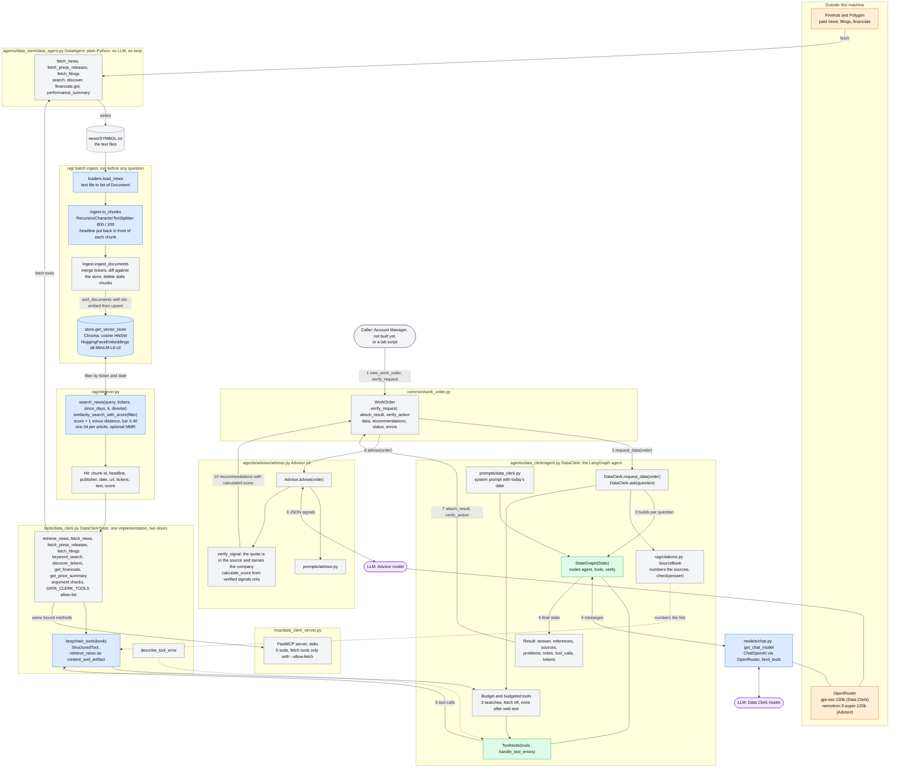
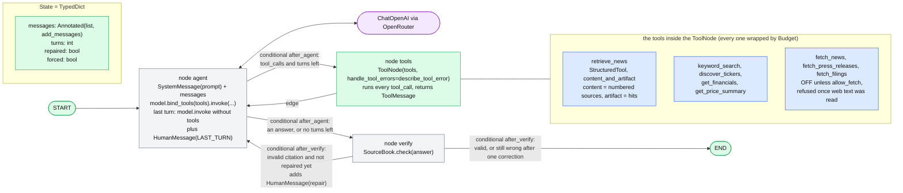
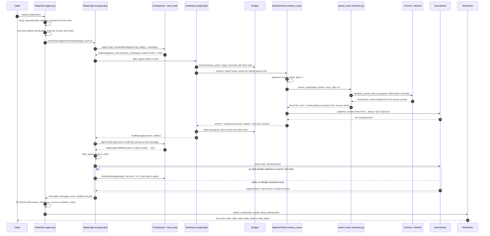
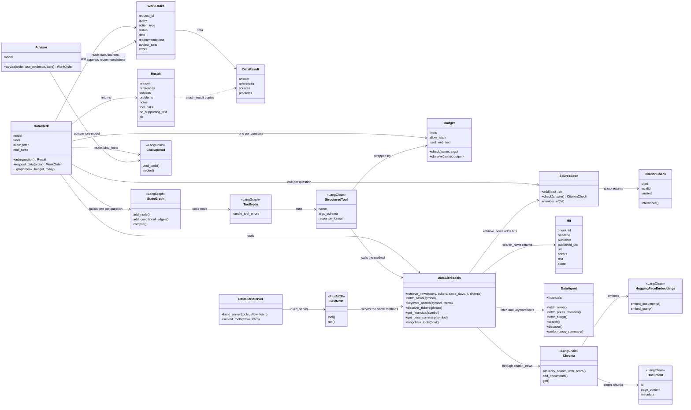

# Week 3 end to end: how the DataAgent works with RAG

Jacob Pyrett, CMU Agentic AI, Oct 2026. Companion to `design/week3_submission.md` (the answers) and `labs/module3_rag/hpw_to_do_langchain_rag.md` (the walk-through).

Every box below is a real file, class or function in this repository. Nothing is a plan.

**How to read the colors**

| Color | Meaning |
|---|---|
| blue | a LangChain class or function (`langchain_core`, `langchain_chroma`, `langchain_huggingface`, `langchain_text_splitters`, `langchain_openai`) |
| green | a LangGraph class or function (`langgraph.graph`, `langgraph.prebuilt`) |
| grey | our code: plain Python in `prometheus/` |
| orange | something outside this machine (paid APIs, OpenRouter) |
| purple | an LLM |

**What is and is not a "chain".** The loop is a LangGraph `StateGraph`. The pieces around it are LangChain components. The code does **not** use `RetrievalQA` or an LCEL `prompt | model | parser` chain, on purpose: `RetrievalQA` retrieves *and* answers, which would merge the Data Clerk and the Advisor (`design/week3_notes.md`), and here the LLM decides whether to retrieve at all (the "agentic RAG" style from the class slides).

---

## 1. The system map: who calls whom

Numbers show the order of one work order, from the request to the Advisor's recommendation. The batch ingest (top left) runs before any of it, and again whenever new news is fetched.

---

## 2. The LangGraph: what runs for one question

This is `DataClerk._graph()` in `agent.py`. It is built fresh for every question, so each question has its own `SourceBook` (so `[1]` means one chunk in that answer) and its own `Budget`.

| Piece | Real code | What it does |
|---|---|---|
| `StateGraph(State)` | `langgraph.graph` | the loop: `add_node`, `add_edge`, `add_conditional_edges`, `compile()` |
| `add_messages` | `langgraph.graph.message` | the reducer that appends each new message to `state["messages"]` |
| `ToolNode` | `langgraph.prebuilt` | runs the tool calls of the last `AIMessage`; with `handle_tool_errors=describe_tool_error` a failing or refused tool becomes a one-line `ToolMessage` and the loop goes on |
| `bind_tools` | `ChatOpenAI` (LangChain) | gives the model the eight tool schemas |
| `StructuredTool` | `langchain_core.tools` | each tool, built from a method's type hints and docstring (`tool(method, parse_docstring=True)`), and `retrieve_news` with `response_format="content_and_artifact"` |
| `HumanMessage`, `AIMessage`, `SystemMessage`, `ToolMessage` | `langchain_core.messages` | the conversation the graph passes around |

---

## 3. One question, step by step (sequence)

"What did MKBHD say about Apple's foldable iPhone?" through `DataClerk.request_data`, with the real tool calls and messages.

---

## 4. The ingest pipeline (LangChain components)

The part that makes retrieval possible. It runs before any question, and `fetch_news` runs the tail of it (`ingest_symbol`) so new articles are searchable at once.

```mermaid
flowchart LR
    classDef lc fill:#dbeafe,stroke:#2563eb,color:#111
    classDef ours fill:#f3f4f6,stroke:#6b7280,color:#111
    classDef ext fill:#ffedd5,stroke:#ea580c,color:#111

    API["Finnhub, Polygon"]:::ext
    DAF["DataAgent.fetch_news<br/>skips duplicates"]:::ours
    TXT[("news/SYMBOL.txt")]:::ours
    LN["load_news(path)<br/>check_symbol, clean text, headline,<br/>publisher, tickers, published time"]:::lc
    DOC["Document<br/>id = article id<br/>metadata: headline, tickers, publisher,<br/>published_utc, published_ts, url, api"]:::lc
    MERGE["same article in two ticker files:<br/>keep one text, merge the tickers"]:::ours
    SPLIT["RecursiveCharacterTextSplitter<br/>chunk_size 800, overlap 100, add_start_index"]:::lc
    CH["chunk Document<br/>id = article id # n<br/>headline put back in front if missing"]:::lc
    DIFF["store.get(where article_id in ...)<br/>unchanged, updated, added, stale deleted"]:::ours
    EMB["HuggingFaceEmbeddings<br/>all-MiniLM-L6-v2, 384 numbers, CPU"]:::lc
    CHR[("Chroma collection<br/>news-sentence-transformers-all-MiniLM-L6-v2<br/>cosine, HNSW ef_construction 400,<br/>ef_search 300, max_neighbors 32")]:::lc

    API --> DAF --> TXT --> LN --> DOC --> MERGE --> SPLIT --> CH --> DIFF
    DIFF -->|"add_documents(ids)"| EMB --> CHR
    DIFF -->|"delete(ids)"| CHR
```

---

## 5. The classes and how they connect

---

## 6. The Advisor and the comparison the week 3 submission asks for

`labs/module3_rag/advisor_with_without.py`. The Advisor never writes the score: the model proposes signals (exact quotes), code verifies them against the retrieved chunks, and code calculates the score from the signals that pass.

