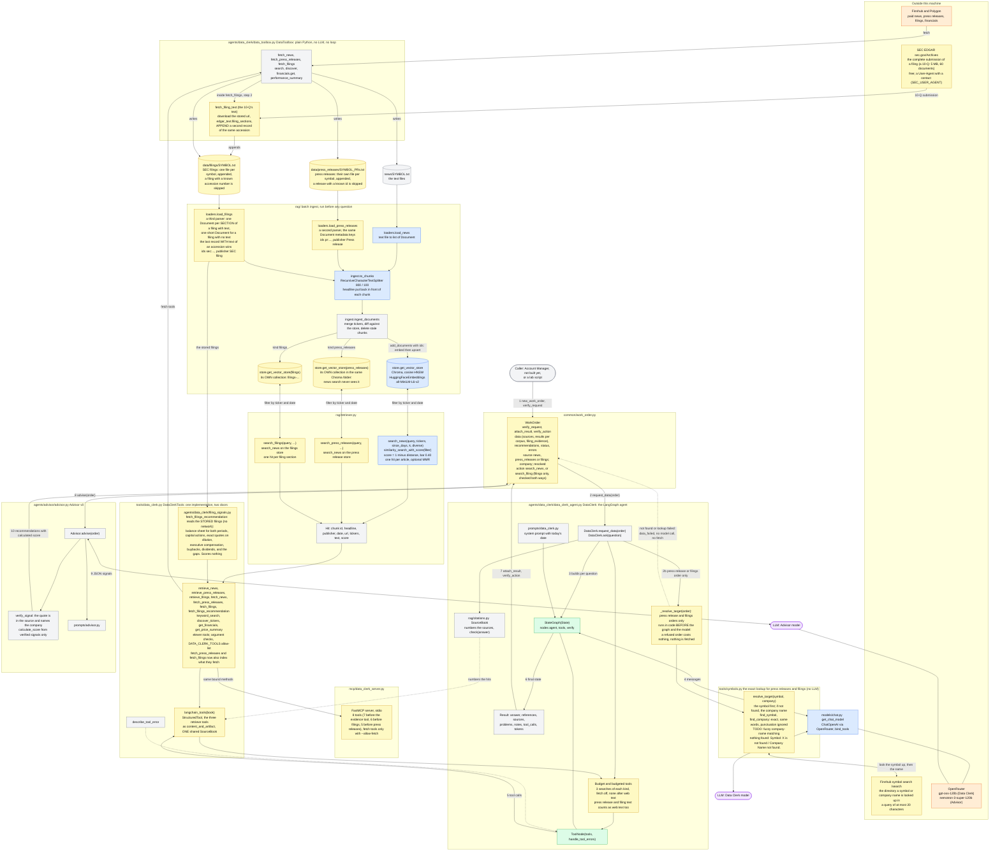
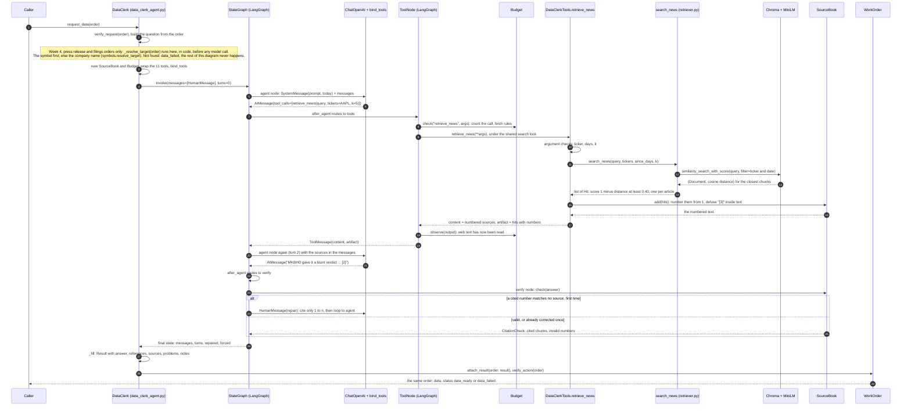
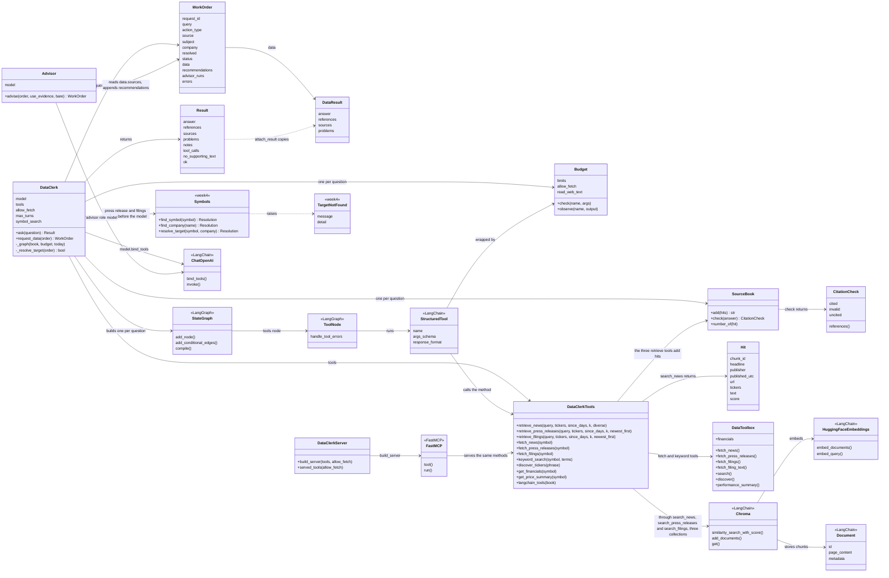
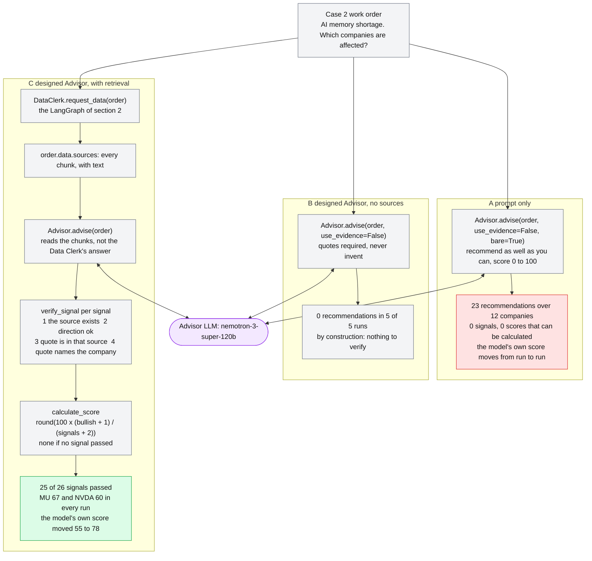
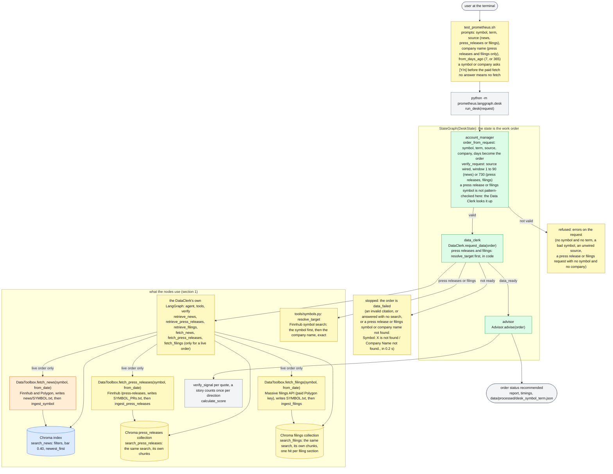
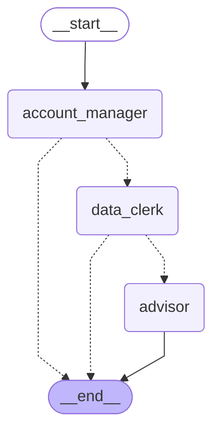

# Week 3 end to end: how the Data Clerk works with RAG

Jacob Pyrett, CMU Agentic AI, Oct 2026. Companion to `design/week3_submission.md` (the answers, 600 to 900 words) and `design/week3_evidence.md` (the full results) and `labs/module3_rag/how_to_do_langchain_rag.md` (the walk-through).

Every box below is a real file, class or function in this repository. Nothing is a plan.

**Updated in Week 4 (press releases, design choices entry 34; then filings, entry 35, and the text of a 10-Q from SEC EDGAR, entry 36; notes in `design/week4.md`).** The diagrams keep what Week 3 built and add press releases as a second source and SEC filings as a third. **Everything new is drawn in yellow** (a filings box is yellow too, and says filings), so the Week 3 picture is still there and the Week 4 additions can be seen at a glance. Counts that changed: the Data Clerk has **ten** tools (it had eight, then nine) and its MCP server offers **seven** by default (it offered five, then six). The picture `design/week3_e2e_diagrams.png` was drawn from the Week 3 version of these diagrams and does not show the yellow boxes until it is rendered again.

**How to read the colors**

| Color | Meaning |
|---|---|
| blue | a LangChain class or function (`langchain_core`, `langchain_chroma`, `langchain_huggingface`, `langchain_text_splitters`, `langchain_openai`) |
| green | a LangGraph class or function (`langgraph.graph`, `langgraph.prebuilt`) |
| grey | our code: plain Python in `prometheus/` |
| orange | something outside this machine (paid APIs, OpenRouter) |
| purple | an LLM |
| yellow | **added in Week 4** for press releases or filings (a new box, or a box whose text changed because of them) |

**What is and is not a "chain".** The loop is a LangGraph `StateGraph`. The pieces around it are LangChain components. The code does **not** use `RetrievalQA` or an LCEL `prompt | model | parser` chain, on purpose: `RetrievalQA` retrieves *and* answers, which would merge the Data Clerk and the Advisor (`design/week3_notes.md`), and here the LLM decides whether to retrieve at all (the "agentic RAG" style from the class slides).

---

## 1. The system map: who calls whom

Numbers show the order of one work order, from the request to the Advisor's recommendation. The batch ingest (top left) runs before any of it, and again whenever new news is fetched.

---

## 2. The LangGraph: what runs for one question

This is `DataClerk._graph()` in `data_clerk_agent.py`. It is built fresh for every question, so each question has its own `SourceBook` (so `[1]` means one chunk in that answer) and its own `Budget`.

```mermaid
flowchart LR
    classDef lg fill:#dcfce7,stroke:#16a34a,color:#111
    classDef lc fill:#dbeafe,stroke:#2563eb,color:#111
    classDef ours fill:#f3f4f6,stroke:#6b7280,color:#111
    classDef llm fill:#f3e8ff,stroke:#9333ea,color:#111
    classDef pr fill:#fef9c3,stroke:#ca8a04,color:#111

    S(["START"]):::lg
    E(["END"]):::lg

    subgraph STATE["State = TypedDict"]
        ST["messages: Annotated(list, add_messages)<br/>turns: int<br/>repaired: bool<br/>forced: bool"]:::lg
    end

    A["node agent<br/>SystemMessage(prompt) + messages<br/>model.bind_tools(tools).invoke(...)<br/>last turn: model.invoke without tools<br/>plus HumanMessage(LAST_TURN)"]:::ours
    M(["ChatOpenAI via OpenRouter"]):::llm
    T["node tools<br/>ToolNode(tools, handle_tool_errors=describe_tool_error)<br/>runs every tool_call, returns ToolMessage"]:::lg
    V["node verify<br/>SourceBook.check(answer)"]:::ours

    S --> A
    A <--> M
    A -->|"conditional after_agent:<br/>tool_calls and turns left"| T
    A -->|"conditional after_agent:<br/>an answer, or no turns left"| V
    T -->|"edge"| A
    V -->|"conditional after_verify:<br/>invalid citation and not repaired yet<br/>adds HumanMessage(repair)"| A
    V -->|"conditional after_verify:<br/>valid, or still wrong after one correction"| E

    subgraph TOOLSET["the tools inside the ToolNode (every one wrapped by Budget)"]
        direction TB
        TR["retrieve_news<br/>StructuredTool, content_and_artifact<br/>content = numbered sources, artifact = hits"]:::lc
        TR2["retrieve_press_releases<br/>the same wrapper and the SAME SourceBook:<br/>[3] is one chunk, whichever tool found it"]:::pr
        TR3["retrieve_filings<br/>the same wrapper and the same SourceBook<br/>a source with no text says so"]:::pr
        TO["keyword_search, discover_tickers,<br/>get_financials, get_price_summary"]:::lc
        TF["fetch_news, fetch_press_releases, fetch_filings<br/>OFF unless allow_fetch,<br/>refused once web text was read<br/>(news, press release and filing text all count)"]:::lc
    end
    T --- TOOLSET

    PRE["before the graph, press release and filings orders only:<br/>_resolve_target in code: symbol first, then company name<br/>nothing found: the order is refused, the graph is never built"]:::pr
    PRE -.-> S
```

| Piece | Real code | What it does |
|---|---|---|
| `StateGraph(State)` | `langgraph.graph` | the loop: `add_node`, `add_edge`, `add_conditional_edges`, `compile()` |
| `add_messages` | `langgraph.graph.message` | the reducer that appends each new message to `state["messages"]` |
| `ToolNode` | `langgraph.prebuilt` | runs the tool calls of the last `AIMessage`; with `handle_tool_errors=describe_tool_error` a failing or refused tool becomes a one-line `ToolMessage` and the loop goes on |
| `bind_tools` | `ChatOpenAI` (LangChain) | gives the model the eleven tool schemas (ten before the evidence tool, nine before filings, eight before press releases) |
| `StructuredTool` | `langchain_core.tools` | each tool, built from a method's type hints and docstring (`tool(method, parse_docstring=True)`), and the three retrieval tools, `retrieve_news`, `retrieve_press_releases` and `retrieve_filings`, with `response_format="content_and_artifact"` and one shared `SourceBook` |
| `HumanMessage`, `AIMessage`, `SystemMessage`, `ToolMessage` | `langchain_core.messages` | the conversation the graph passes around |

---

## 3. One question, step by step (sequence)

"What did MKBHD say about Apple's foldable iPhone?" through `DataClerk.request_data`, with the real tool calls and messages.

---

## 4. The ingest pipeline (LangChain components)

The part that makes retrieval possible. It runs before any question, and `fetch_news` runs the tail of it (`ingest_symbol`) so new articles are searchable at once. Week 4 added a second source (yellow) and then a third, SEC filings (also yellow, bottom of the diagram: `fetch_filings` writes its own file, `load_filings` makes one `Document` per section of a filing that has text and one short `Document` for each filing that has none, the same chunker and the same diff-and-upsert code run on them, and `ingest_filings` stores the result in the `filings-...` collection). The 10-Q has no text in the paid API, so `fetch_filing_text` takes it from SEC EDGAR and appends a second record of the same accession; `load_filings` reads the last record with text (entry 36, the two boxes next to the filings file). The press release part is: `fetch_press_releases` writes its own file, `load_press_releases` makes the same kind of `Document`, the **same** chunker and the same diff-and-upsert code run on it, and `ingest_press_releases` stores the result in its own collection, so a news search never sees a press release and the news collection is unchanged.

```mermaid
flowchart LR
    classDef lc fill:#dbeafe,stroke:#2563eb,color:#111
    classDef ours fill:#f3f4f6,stroke:#6b7280,color:#111
    classDef ext fill:#ffedd5,stroke:#ea580c,color:#111
    classDef pr fill:#fef9c3,stroke:#ca8a04,color:#111

    API["Finnhub, Polygon"]:::ext
    DAF["DataToolbox.fetch_news<br/>skips duplicates"]:::ours
    TXT[("news/SYMBOL.txt")]:::ours
    LN["load_news(path)<br/>check_symbol, clean text, headline,<br/>publisher, tickers, published time"]:::lc

    PAPI["Finnhub /press-releases"]:::ext
    PDAF["DataToolbox.fetch_press_releases<br/>skips a release whose id is already in the file"]:::pr
    PTXT[("data/press_releases/SYMBOL_PRs.txt")]:::pr
    PLN["load_press_releases(path)<br/>a separate parser: the record is PRESS_RELEASE, TEXT, END<br/>ids pr:..., publisher Press release, tickers [SYMBOL]"]:::pr
    DOC["Document<br/>id = article id<br/>metadata: headline, tickers, publisher,<br/>published_utc, published_ts, url, api"]:::lc
    MERGE["same article in two ticker files:<br/>keep one text, merge the tickers"]:::ours
    SPLIT["RecursiveCharacterTextSplitter<br/>chunk_size 800, overlap 100, add_start_index"]:::lc
    CH["chunk Document<br/>id = article id # n<br/>headline put back in front if missing"]:::lc
    DIFF["store.get(where article_id in ...)<br/>unchanged, updated, added, stale deleted"]:::ours
    EMB["HuggingFaceEmbeddings<br/>all-MiniLM-L6-v2, 384 numbers, CPU"]:::lc
    CHR[("Chroma collection<br/>news-sentence-transformers-all-MiniLM-L6-v2<br/>cosine, HNSW ef_construction 400,<br/>ef_search 300, max_neighbors 32")]:::lc
    PCHR[("Chroma collection<br/>press_releases-sentence-transformers-all-MiniLM-L6-v2<br/>the same settings, its own set of chunks")]:::pr

    FAPI["Massive (Polygon) filings endpoints<br/>/vX/index, /10-K/vX/sections, /8-K/vX/text"]:::ext
    FDAF["DataToolbox.fetch_filings<br/>skips a filing whose accession number is already in the file"]:::pr
    EAPI["SEC EDGAR: the complete submission of a 10-Q<br/>(the url stored in the record)"]:::ext
    EDAF["DataToolbox.fetch_filing_text<br/>edgar_text: the 10-Q document, HTML to lines,<br/>split into 11 Items; appends a SECOND record, text_status ok"]:::pr
    FTXT[("data/filings/SYMBOL.txt")]:::pr
    FLN["load_filings(path)<br/>a third parser: the record is FILING, TEXT, END<br/>one Document per == section == (10-K: business, risk_factors; 8-K: items)<br/>one short Document that says so for a filing with no text<br/>ids sec:..., publisher SEC filing, filed date at 00:00:00Z"]:::pr
    FCHR[("Chroma collection<br/>filings-sentence-transformers-all-MiniLM-L6-v2<br/>the same settings, its own set of chunks")]:::pr

    API --> DAF --> TXT --> LN --> DOC --> MERGE --> SPLIT --> CH --> DIFF
    DIFF -->|"add_documents(ids)"| EMB --> CHR
    DIFF -->|"delete(ids)"| CHR
    PAPI --> PDAF --> PTXT --> PLN --> DOC
    EMB -->|"ingest_press_releases: kind press_releases"| PCHR
    DIFF -->|"delete(ids), press releases"| PCHR
    FAPI --> FDAF --> FTXT --> FLN --> DOC
    FTXT -->|"10-Qs with no text"| EDAF
    EAPI --> EDAF -->|"appends"| FTXT
    EMB -->|"ingest_filings: kind filings"| FCHR
    DIFF -->|"delete(ids), filings"| FCHR
```

---

## 5. The classes and how they connect

---

## 6. The Advisor and the comparison the week 3 submission asks for

`labs/module3_rag/advisor_with_without.py`. The Advisor never writes the score: the model proposes signals (exact quotes), code verifies them against the retrieved chunks, and code calculates the score from the signals that pass.

---

## 7. The desk and the main script (Part 9): the path a request takes

`./test_prometheus.sh` prompts for four parameters (and, for press releases and filings only, a company name) and hands them to the desk: a LangGraph whose state is **one work order**, passed from the Account Manager to the Data Clerk to the Advisor. The hand-drawn flow shows how the parameters become the order and where each node goes into the layers of section 1:

| Parameter | Becomes |
|---|---|
| symbol | `subject` `[SYMBOL]`; the order is live and the Data Clerk may fetch |
| term, no symbol | `subject` and `query` are the term; not live; the stored news is searched |
| term and symbol | `query` is "term news for SYMBOL"; live; the fetch is for the whole symbol |
| source | `source`; `news` (the default), `press_releases` or `filings` pass `verify_request` (Week 4: it was `news` only) |
| from_days_ago | `since_days`: the fetch's `from_date` and the search window. News 1 to 90 (default 7); press releases and filings 1 to 730 (default 365) |
| company (Week 4, `press_releases` and `filings` only) | `company`: used when the symbol is not given or not found. The symbol is looked up first and wins; both lookups are exact; nothing found is `data_failed` with the message |

The compiled graph as LangGraph itself prints it (`python -m prometheus.langgraph.desk --show-graph`); dotted arrows are the conditional edges above. **Neither press releases nor filings changed the shape of this graph:** the same three nodes and the same edges. A refused press release or filings order simply ends after `data_clerk`, because the edge to `advisor` is only taken when the order is `data_ready`.

