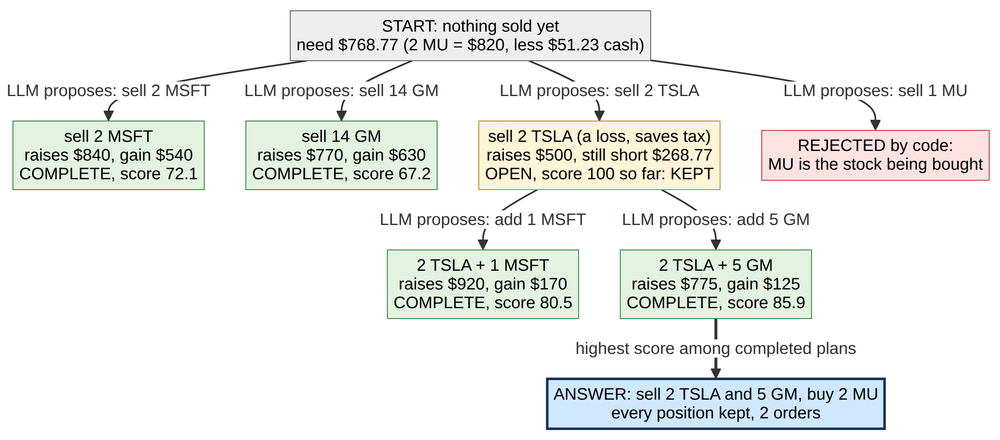

# Prometheus Capstone: Week 4 Submission (Tree-of-Thought)

Jacob Pyrett, CMU Agentic AI, Nov 2026. Submission #4 - Tree-of-Thought (ToT)

**Background.** Prometheus is a multi-agent stock trading desk. The work-order flow and the state are built with LangGraph and the model calls with LangChain; CrewAI is the planned layer for defining the agents and their roles (section 5). The **Account Manager** takes a request and builds a work order, the **Data Clerk** fetches news, press releases, SEC filings (RAG) and quotes, and the **Advisor** turns the evidence into recommendations with a score calculated in code. A Critic and a Trader are designed but not built. In this submission the Account Manager gets one more job, **RaiseFunds**: decide what to sell to pay for a purchase. It is built, tested, and run live with real Finnhub quotes and `gpt-oss-120b` through OpenRouter.

## 1. Is ToT reasoning appropriate for Prometheus?

**Decision: ToT is appropriate for one step of Prometheus, RaiseFunds, and would hinder the rest.**

- **Where it would hinder.** Company lookup (code), data retrieval (RAG), the recommendation score (calculated in code from checked quotes), the critique (fixed checks) and trade orders are chains: each step needs only the result of the one before and has one right answer. Extra branches there would add model calls and latency and nothing to accuracy. The final ranking is by calculated score, and in live mode the user approves the plan.
- **Where it improves the design.** RaiseFunds has several valid answers that must be compared. On the hardest purchase tested, ToT raised the plan from 86.6% to 99.4% of the best possible plan (section 4), and it records why each plan was chosen or dropped (an audit trail a single answer does not give).
- **What it costs.** On the hard test session it used 47,402 tokens for three purchases (about 16,000 each, roughly 13 times the 1,256 tokens of a single-pass call), a few cents, plus a tree to maintain and test. With the speed measures in section 4 it answers in 1 to 6 seconds a purchase. The benefit is worth the cost only at this step, so ToT is used only here.

## 2. Where ToT is used, the workflow, and why a linear chain fails

- **Where in the architecture.** One new node, `account_manager_funds`, in the Account Manager after the Advisor. The desk with RaiseFunds:

```text
request (symbol or term + portfolio, shares to buy) -> account_manager -> data_clerk -> advisor
   -> best recommendation, score above 50? (no: refused, with the reason)
   -> account_manager_funds: RaiseFunds, the Tree of Thought
        1. Data Clerk: quotes (work order fetch_quote -> get_quote -> Finnhub)
        2. depth chosen from the purchase (fewest stocks that could pay + 2, at least 3)
        3. expand: LLM proposes up to 3 sell steps per kept plan, a level in parallel
        4. evaluate: hard checks + calculated score (code)
        5. prune: keep the 3 best unfinished plans; completed plans always kept
        6. loop to 3 while plans are unfinished and depth, calls and the 90 s limit allow
        7. decide: best completed plan (code)
   -> plan: SELL / BUY table, check line, reasoning trace, portfolio before and after
```

- **The workflow part.** After the Advisor recommends a stock, the user wants N shares of it. The money comes from free settled cash plus selling other holdings. RaiseFunds decides **which holdings to sell and how many shares of each**, under rules that are all checked in code: only holdings in profit are sold (no loss); at least one share of every holding is kept; the stock being bought is never sold; shares bought today are locked (T+1); no more shares are sold than the shortfall needs. **In:** the portfolio (a JSON file today), the shares to buy, optionally the symbol. **Out:** a plan (a proposal: nothing is sold or bought) printed as a table, with the reasoning trace, and saved with the order. It extends the Week 3 desk diagram with one node and one inner loop.
- **Why a linear chain of thought fails here.**
  - *Premature commitment:* a chain takes the first plan that works. In the example tree below, "sell 2 MSFT" scores 72.1 while the best plan scores 85.9, and the chain cannot back up.
  - *High branching:* the 7 holdings in profit of the first example below allow about 288,000 whole-share ways to sell. A chain cannot compare them.
  - *Constraint complexity:* five rules apply at once, and a plan that looks fine after one sale can be a dead end after two (the holdings left cannot raise the rest). With the strict rules a purchase often needs several stocks, because no single holding is worth enough.
- **Real examples (live, `gpt-oss-120b`).**
  - *Buy 3 LLY* from a made-up portfolio (F 40 shares at cost $2, GM 10 at $10, FITB 8 at $60, PG 5 at $60, MCD 6 at $40, GOOGL 4 at $100, TSLA 3 at $300, MSFT 2 at $150, $100 cash; real quotes of 2026-11-03; FITB is at a loss and never sold). $4,128 must be raised and no holding can pay alone. A search that follows one plan to the end (what a chain does) scores **75.4**, which is 86.6% of the best plan (87.1, found by trying every combination, for grading only). The tree scores **86.6**, which is 99.4% of the best.
  - *Buy 9 COST* ($9,173) from a made-up 11-holding portfolio ("claude", $800 cash): no holding is worth over $3,600, so three stocks are needed. The tree sells INTC 59, WMT 24 and KO 20 (score 89.4), all in profit, every position kept. "Sell the biggest holding" cannot pay for it.
- **Honesty note.** For a small portfolio a program could try every plan with no LLM; that is how the best plan above was found, for grading. The LLM proposes steps so the design scales to larger portfolios. All numbers, rules and scores are calculated in code, never by the LLM.

## 3. The ToT structure

- **Thought.** One step: "sell *n* shares of *SYMBOL*" plus a one-line reason.
- **Node.** The plan so far (the steps from the root) with its proceeds, shortfall, realised gain, score and score components, all calculated in code.
- **Branch.** One proposed sell step: the edge from a node to a child node.
- **Depth.** The number of levels from the root, one per sell step added (a plan that sells five stocks is at depth 5).
- **How children are generated.** For each kept node the LLM is asked for up to 3 different next steps. The prompt gives the goal, the holdings with Data Clerk prices, cost basis, sellable shares, the plan so far, and why earlier thoughts were rejected. Code classifies each thought (finishes the plan or not) and asks again if a kind is missing.
- **Expected branching factor: 3**: three different ideas per node while each node costs one model call. Branching 4 with beam 10 found the same plans as 3 with beam 3.
- **Depth limit: chosen from the purchase.** The fewest holdings that could pay for it (biggest lots first) plus 2, at least 3 and at most the holdings that can be sold. Buy 3 LLY needs at least 5 stocks, so depth 7; a fixed depth of 3 finds no plan there.
- **Termination and final output.** A node whose proceeds cover the cost is complete and is not expanded. The search ends when no unfinished node is left, the depth or call budget is reached, or the 90-second limit passes. The best completed plan is the answer. With no completed plan the status is `infeasible`, nothing is sold, and the result says how many shares selling everything allowed could buy (for example 3 MU cannot be paid for when one share of every holding is kept). A half-built plan is never returned.

**Example tree** (invented prices, not a live trace): buy 2 MU at $410 with $51.23 free cash, so $768.77 must be raised. This example uses the tax-aware score and allows a loss, so selling TSLA at a loss is allowed; the real default is the strict, most-profitable-first score of section 4.



A linear chain stops at the first plan that works ("sell 2 MSFT", 72.1, $540 of gain). The tree compared four completed plans and found one that realises $125 of gain and keeps every position. The real feature does the same, only deeper (up to 7 levels) and wider (3 unfinished plans kept per level).

## 4. Search and evaluation strategy

**Primary strategy: beam search, width 3**, 3 thoughts per node, the nodes of a level expanded in parallel, depth chosen from the purchase. Width 1 is depth first; a very wide beam is breadth first. Monte Carlo sampling was not used, because it would not give the same answer twice and the plans must be checked, not sampled. Measured live (hard session: 3 LLY, 1 SNDK, up to 3 MU; share of best = against the best plan from trying every combination):

| Search | Hard session | Calls | LLY share of best | 9 COST (easy) |
|---|---|---|---|---|
| depth first (beam 1) | 12 s | 9 | **86.6%** | same plan, 5 s |
| beam 2 | 71 s (slow routing) | 15 | 97.2% | same plan, 5 s |
| **beam 3 (default)** | **8 s** | 23 | **99.4%** | same plan, 5 s |
| beam 6 | 9 s | 39 | 99.4% | same plan, 5 s |
| beam 10, branching 4 | 14 s | 65 | 99.4% | not run |

**Why beam fits.** Depth first follows the first plausible plan and cannot back up: 13 points lower and not faster. Breadth first finds nothing more than width 3 for up to 2.8 times the calls. Time does not depend on width, because a level takes as long as its slowest call; time is set by the number of levels (about one per stock sold). Breadth is nearly free in time and buys accuracy.

**How candidate branches are assessed**

- **Who evaluates: heuristic checks in code plus tool data, no critic agent and no LLM.** The hard checks and the score are two plain functions; the prices they use come from the Data Clerk's quote tool. The LLM only proposes, so the evaluator cannot favour its own output.
- **Hard checks** (a failing thought is rejected, shown in the trace with the reason, and the reason is told to the LLM): the symbol is held, is not the stock being bought, one sell line per plan; the holding is in profit; shares are a whole number up to the sellable shares (T+1 locked shares and the one share always kept are not sellable); lean (no more shares than the shortfall needs); not a dead end (the holdings left can still raise the rest). Free cash is spent first.
- **Score, 0 to 100, four components (0 to 1 each):**

| Component | Weight | Meaning |
|---|---|---|
| green | 0.40 | how profitable the sold shares are, scaled between the least and most profit any plan could realise |
| overshoot | 0.25 | 1 - (cash left after the purchase / cost) |
| keep | 0.20 | 1 - (positions sold out / holdings) |
| orders | 0.15 | 1 / number of sell orders |

An alternative tax-aware score replaces green with "1 - taxable gain / proceeds". Every answer prints a check line (every sale in profit, no position sold out, shares bought of shares asked); the success measure is that line.

- **Pruning thresholds and failure conditions.** There is no score cutoff. A thought that breaks a hard check is rejected outright. Of the unfinished plans the top 3 survive each level, ranked by `0.5 x score + 50 x progress` (progress = share of the money raised), because score alone prunes plans about to finish. Plans with the same sells in another order are dropped as repeats. Completed plans are never pruned. A level where every thought is rejected leaves nothing to expand, so the search ends; running out of calls, depth or the time limit also ends it. Every thought, rejected, pruned or kept, is in the printed trace with its score and reason.
- **Ties** are resolved by a fixed selection policy, not by voting: the beam ranks by the value above, then fewer sell orders, then the earlier node; the final answer is the highest score, then fewer sell orders, then the earlier node. The same inputs always give the same answer.

**Constrained by compute, latency and cost**

- **Budget, enforced in code and tested:** model calls (12 by default, more for a deeper tree), depth, and a 90-second limit per purchase. One purchase is 14 calls (9 COST); the hard session is 23 calls, 36,660 tokens in and 10,742 out.
- **The main time cost is the model's speed.** The same `gpt-oss-120b` runs at about 55 tokens a second on OpenRouter's own routing, 650 on Cerebras and 370 on Groq. The Account Manager asks for Cerebras, then Groq, with fallback. Same plans and scores:

| Run | OpenRouter routing | Cerebras, then Groq |
|---|---|---|
| one purchase, 9 COST | 33 to 47 s | **5 s** |
| hard session | 67 to 72 s | **8 s** |
| four purchases from "claude" | 115 to 165 s | **10 to 14 s** |

- **Reasoning effort low, one sell per thought.** On 9 COST: low 5 s, medium 8 s, high 46 s (on slow routing 33 to 45 s, 82 s, over 5 minutes); the same plan each time, because the code checks every plan. Whole plans as thoughts (a list of sells per thought) were slower (121 s) and scored lower (86.7 against 89.4).

## 5. Mapping ToT roles to implementation tools

The design uses each tool for what it is best at: **CrewAI defines the agents and their roles, LangGraph runs the work-order flow and the search loop.** The role separation is by CrewAI agent; the control flow and state are by LangGraph, which is deterministic and enforces the budgets.

| ToT role | Implementation | Why |
|---|---|---|
| thought generator | **CrewAI** `Agent` "Account Manager planner" (role, goal, backstory, a Task per sell-step request), calling `gpt-oss-120b` through **LangChain** `ChatOpenAI` / OpenRouter, returning JSON | CrewAI gives the agent a defined role and task; LangChain supplies the model, prompt and JSON reply |
| critic / evaluator | the hard checks and score as plain Python, offered to the agents as a CrewAI tool, not as an LLM agent | rules and scores must be exact, so they are calculated, not asked of a model |
| decision maker / controller | **LangGraph** router (`expand -> evaluate_and_prune -> loop or decide`) and code that picks the highest score | deterministic, enforces depth, call and time budgets, and decides what to expand next |
| memory / state manager | **LangGraph** state: frontier, completed plans, trace, call count | all branches live in one process and are passed between nodes; other agents do not read the tree |
| prices (tool access) | Data Clerk `get_quote` tool: work order `fetch_quote`, Finnhub `/quote`; also served by **MCP** | one source of prices for every agent |

- **CrewAI (agent definition, task routing, role separation): used for the agents.** The Account Manager (thought generator), Data Clerk and Advisor are each a CrewAI `Agent` with its own role, goal and tools; a Task describes one request to an agent (for example "propose up to 3 next sell steps for this plan"). The work order says which agent does what. CrewAI does not run the search: the tree needs loops, parallel levels, budgets and a time limit, which LangGraph provides directly.
- **LangGraph and LangChain (control flow, tool integration, search orchestration): used for the flow.** LangGraph runs the work-order flow `account_manager -> data_clerk -> advisor -> account_manager_funds` and, inside the last node, the loop that expands, evaluates, prunes and decides. A graph node calls the CrewAI agent for the thoughts. LangChain provides the chat model, prompts and tool integration.
- **MCP (shared context and tools): used for tool access, not for tree state.** MCP serves the Data Clerk's tools (quotes, news, filings) to any agent, which is the shared evidence. Branch tracking stays in the LangGraph state, because RaiseFunds is a stateful loop of several LLM calls and MCP servers are stateless.
- **Implementation status.** Built and tested today: the LangGraph flow and search loop, the LangChain model calls, the MCP tools, and the agents as plain Python classes with the same role, prompt and JSON contract. Planned, not yet in the code: wrapping those agents as CrewAI `Agent`s and Tasks. The prompts, checks and results above do not change when that is done, because CrewAI only defines the agent and LangGraph still calls it.

## 6. One risk and its mitigation

- **Risk: weak evaluation signals lead to pruning the best branch** (premature pruning, and a search that is too narrow). It happened twice. A beam ranking unfinished plans by score alone pruned every plan about to finish (no plan in five levels), because the score of an unfinished plan rewards having done little. Beam width 1 found 86.6% of the best plan against 99.4% at width 3.
- **Mitigation applied.** The beam ranks by `0.5 x score + 50 x progress`, so plans close to finishing are kept; plans with the same sells in another order are dropped so repeats cannot fill the beam; the beam keeps 3 plans; completed plans are never pruned; the final answer compares only completed plans, whose score is exact. *Noticed by* the trace (every pruned plan with its score) and by grading against the best plan found by trying every combination. *Remaining risk:* 0.6% on the hard purchase; the best plan needs share counts the model does not propose (F 39, GM 9, PG 3, MCD 5, GOOGL 2, MSFT 1) and a wider beam did not help, so a better prompt would be the next step.
- **Other risks, handled.** *Branch explosion and cost:* bounded in code (branching 3, beam 3, depth chosen from the purchase, a call budget that grows with depth, a 90-second limit); the largest run was 65 calls. *Latency* mattered most: runs took minutes with default provider routing, effort medium or high, and whole plans; fixed by fast providers, effort low, parallel levels and the time limit (if both fast providers are down, 33 to 70 s a purchase). *The LLM inventing a number* cannot change a result: prices come from the Data Clerk, proceeds, shortfall and score are calculated, and a rule-breaking thought is rejected with the reason.

## 7. Evidence

All runs used real Finnhub quotes and the real model unless marked offline.

- **Tests.** 296 offline tests pass (96 search and checks, 63 Account Manager, 40 portfolio, 26 most-profitable-first, 22 two purchases, 22 SNDK then MU, 15 strict rules, 12 quotes), using a scripted model and fake quotes. 30 live tests (17 complex scenario, 13 real-time) call the paid APIs and passed in 131 s.
- **First live run: buy 2 MU** (MSFT 50 at $150, TSLA 123 at $300, GM 60 at $10, $51.23 cash; MU $855.10, TSLA $398.50). All three proposed plans already paid for it, so the search ended after one level and one model call (about 10 s): **sell 5 TSLA** ($1,992.50, gain $492.50), buy 2 MU ($1,710.20), $333.53 left over, score 85.2.
- **Two purchases in a row (300 F, then 40 FITB).** The 300 F just bought are locked (T+1); cash and cost basis carry over. Live: 10 TSLA sold for the F, then 148 F (older shares) for the FITB.
- **More than one level (3 SNDK, then as many MU as the cash affords;** PG 15, MCD 120, GOOGL 30, LLY 25, $200). 3 levels, 13 nodes, 7 completed plans; five plans selling two or three stocks (56.8 to 60.6) lost to one sale of 12 GOOGL (72.9), equal to the best plan by exhaustive check.
- **Deep and wide (the portfolio of section 2; 3 LLY, 1 SNDK, up to 3 MU).** First run, before the strict rules: purchase 1 went 5 levels, 50 nodes and 17 completed plans, and took 357 s (75 s with parallel levels and effort low). With the strict rules and depth chosen: 3 LLY sells MCD 5, GM 9, GOOGL 3, F 39, MSFT 1 and PG 2 (86.6, 99.4% of the best); 1 SNDK sells PG 2 and TSLA 2; 3 MU cannot be paid for, so nothing is sold. With fast providers the whole session takes 5 to 8 s. Every node of every tree was re-checked independently. Quality against the best plan was 97.9% in the earlier runs and 99.4% under the strict rules; safety 100%; repeatability 3 of 3 runs for `gpt-oss-120b`. Qwen3-30B-A3B gave the same plans in 3 of 5 runs and a worse plan in 2, never an invalid one.
- **Real-time test, four purchases from "claude"** (11 holdings, about $27,000, $800 cash, two at a loss: 10 NFLX paid by cash, 9 COST, 10 AVGO, up to 40 NVDA): scores 89.6, 88.4, 87.7. 115 to 165 s on OpenRouter routing; **10 to 14 s** on Cerebras and Groq, same plans. A 1-second limit sells nothing rather than something half-planned.
