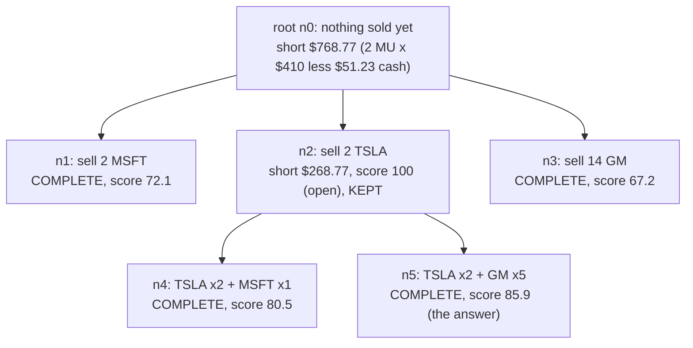

# Week 4 Tree of Thought guide: how RaiseFunds was added to Prometheus

This file is the step-by-step record of how Tree of Thought (ToT) was added to the trading bot: what was built, in which file, why, and how to run it. It is edited as the work goes on.
The decision is also design choices entry 42 (`docs/design_choices.md`); the weekly submission is `design/week4_submission.md`.

**Status (2026-11-04, latest):** the tree is now fast and its defaults are the measured winners (sections 9m to 9r, design choices entries 49 and 50). **Beam search width 3, depth chosen from the purchase, the plans of a level in parallel, and `gpt-oss-120b` on Cerebras then Groq at reasoning effort low**: one purchase takes 1 to 6 s, the hard three-purchase session 8 to 14 s, the four-purchase "claude" session 10 to 14 s (it was 115 to 165 s). Depth first (beam 1) was measured and is worse (86.6% of the best plan against 99.4%); a wider beam finds nothing more; effort medium and high and whole plans as thoughts only cost time. The rest of this status line and sections 9a to 9l are the history; the times in them are from the model's default routing.

**Earlier status (2026-11-03):** code, tests, the offline demo and **two live runs** (real Finnhub quotes, real `gpt-oss-120b`, Jacob's approval) are done: "buy 2 MU" was reached (section 9b); then a made-up two-purchase scenario (F, then FITB) was tested offline and run live (section 9d); then **a live run whose tree goes three levels deep** (buy 3 SNDK, then MU with the cash left, section 9e), after the generator was improved; then **a complex scenario that needs five levels** (eight small holdings, three purchases; offline test and a live run with a 50-node tree, section 9f); then Jacob's rules "sell the most profitable first" and "up to X / as many as possible" (section 9g). The earlier runs stopped at level 1 (section 9c).

## 0. The feature in one paragraph

Jacob holds 50 MSFT (basis 150), 123 TSLA (basis 300) and 60 GM (basis 10) and $51.23 of free settled cash (`cash_avail`). The Account Manager is asked to **buy 2 shares of MU**. Something has to be sold first, but what, and how many shares of each?
There is no single obvious answer (sell the loser to save tax, sell one stock in full to use one order, or sell a little of everything to keep every position), so the options are built step by step,
checked, scored, and cut back to the best few. That is a tree search. The LLM proposes the steps (the thought generator); code checks every step, calculates every score, prunes, and picks the answer.



(The numbers are from the offline demo, with invented prices. Section 9 explains that.)

## 1. Why ToT here, and why not anywhere else (step 1: the decision)

- The five challenges of Prometheus (look up the company, pull the data with RAG, score the recommendation, critique it, trade) are a **chain**: each step needs the result of the one before and nothing else. A chain of thought is enough, and the work is mostly checks and calculations that code does better than a model (entries 24 and 26). See `design/week4_submission.md` section 1.
- **"What to sell to raise the money for a purchase" is the one place the options branch.** Each possible sale changes what is left to sell and what the plan scores, the plans have to be compared against each other, and some branches are dead ends (not enough left to sell). A single linear pass picks the first plan that works, not the best one.
- The user chose this feature (2026-11-03): "What to sell fits the best".

**An honest note on the LLM's part.** The problem is small (three holdings), so a program could enumerate every plan and score it with no LLM at all. What the LLM adds here is *generating* the candidate steps, with a reason in words for each, so that the same pattern can later take a portfolio or a goal that is too large to enumerate and that has softer criteria (news about a holding, the Advisor's score for it). Everything that can be checked is checked in code. That is why the design is "LLM proposes, code disposes".

## 2. Step 2: the prices come from the Data Clerk (a new `get_quote` tool)

The Account Manager must not read a price from anywhere but the Data Clerk. There was **no quote tool**: the Data Clerk had `get_price_summary` (this month's local day files, `data/historical`) and `get_financials`, and the MCP server's `fetch_quote` (`prometheus/mcp/server.py`) is a placeholder that returns `price=stub`. So one was built, in four layers, each a few lines:

| Layer | File | What |
|---|---|---|
| the API call | `prometheus/agents/data_clerk/data_toolbox.py` `DataToolbox.get_quote(symbol)` | one `GET https://finnhub.io/api/v1/quote?symbol=X` with the key in the `X-Finnhub-Token` header (`FINNHUB_API_KEY` from `.env`), through the same `_get_json` as every other Finnhub call (rate limit 4 calls a second, backoff on 429). It returns `{symbol, price, change, change_percent, high, low, open, previous_close, as_of_utc, source}`. Finnhub answers an unknown symbol with all zeros; that is raised as an error, never returned as a price of 0 |
| the tool the LLM sees | `prometheus/tools/data_clerk.py` `DataClerkTools.get_quote` | the 12th tool in `DATA_CLERK_TOOLS`: the docstring is the model's manual, the symbol is checked (`_symbol`) before any call. Budget 5 calls a question (`DEFAULT_CALLS` in `data_clerk_agent.py`) |
| MCP | `prometheus/mcp/data_clerk_server.py` | the same tool is served over MCP with the annotation `READ_REMOTE` (reads an outside API, changes nothing). One implementation, two ways to reach it, as for every other tool |
| the agent call | `DataClerk.request_quotes(order)` in `data_clerk_agent.py` | the design's `<ACTION_TYPE> fetch_quote`: the Account Manager sends a **work order** (`action_type="fetch_quote"`, `subject=[MU, MSFT, TSLA, GM]`) and gets the SAME order back with `data.quotes`. No model call: a price is one lookup, so the Data Clerk calls its own `get_quote` tool in code, once per symbol. A symbol that fails is named in `order.errors` and the order is `data_failed` |

**How the prices were fetched (answer to Jacob's question i).** Account Manager -> `DataClerk.request_quotes(work order)` -> `DataClerkTools.get_quote` (the Data Clerk's tool) -> `DataToolbox.get_quote` -> HTTPS to Finnhub `/quote`.
It is the Data Clerk's *tool*, called in-process by the Data Clerk's agent method. It does **not** go over the MCP server: the Advisor calls `DataClerk.request_data` in-process too, and in the week 2 design MCP is how an agent reaches *its own* tools, not how agents reach each other.
The MCP server does offer the same `get_quote`, so any MCP host can use it.

`verify_request` still refuses `fetch_quote` (it is the check for a *search*); quotes have their own check, `verify_quote_request` in `work_order.py`. `DataResult` gained one optional field, `quotes`.

An honest limit: outside market hours `as_of_utc` is the last trade of the session, not "now". The report prints it so that a stale price is visible.

## 3. Step 3: the sample portfolio

`configs/portfolios/jacob_pyrett.json` (static, read by `prometheus/common/portfolio.py`):

```json
{"user": "Jacob Pyrett", "currency": "USD", "cash_avail": "51.23",
 "positions": [{"symbol": "MSFT", "shares": 50,  "cost_basis": 150.00, ...},
               {"symbol": "TSLA", "shares": 123, "cost_basis": 300.00, ...},
               {"symbol": "GM",   "shares": 60,  "cost_basis": 10.00,  ...}]}
```

The shares and cost bases are Jacob's. **`cash_avail` is the free settled cash** (the money that can buy today): it is written as the string `"51.23"` in the file and loads as the number 51.23 (a negative, `nan` or non-numeric value is refused). RaiseFunds **spends it first**: the money to raise is the cost of the purchase less `cash_avail` (`Problem.need`), the cash counts in "the most shares that could be bought", the overshoot component of the score counts it, a plan is complete when its proceeds plus the cash cover the cost, and if the cash alone covers the cost the status is `funded` and nothing is sold. The cash left after the plan is `cash_avail + proceeds - cost`. Sale proceeds that have not settled (T+1) are not in it. The `acquired` dates are sample values (all old, so everything is sellable under the design's T+1 rule: `Portfolio.sellable_shares`). The file stands in for the Postgres portfolio of the week 2 design.

## 4. Step 4: the ToT structure (the design)

| Question | Choice |
|---|---|
| What is a **thought**? | ONE step: "sell n shares of SYMBOL", with the idea behind it in words. A node is the plan so far (the steps from the root) |
| **Branching** | up to **3** different next steps for every node that is expanded (`BRANCHING`), proposed by the LLM |
| **Depth limit** | at most **3** steps (`MAX_DEPTH`), and never more than the number of holdings: one sell line per symbol |
| **Search strategy** | **beam search**, width **3** (`BEAM_WIDTH`): after each level only the 3 best *unfinished* plans are expanded; completed plans are all kept |
| **The goal** | buy N shares of the target at the Data Clerk's price; the money to raise is `cost - cash_avail` |
| **Termination** | no unfinished plan is left, or the depth limit, or the call budget (`MAX_LLM_CALLS`, **12** since entry 44; it was 8 before the re-asks). Then the highest-scoring completed plan is the answer; none means `infeasible` |
| Who **generates** | the LLM (`gpt-oss-120b`, role `account_manager`) |
| Who **evaluates and prunes** | code only: `check_step` (hard checks), `score_plan` (the score), the beam |
| Who **decides** | code: the highest calculated score; ties go to fewer orders, then to the earlier node |
| **State** | the LangGraph state: the frontier, the completed plans, the trace, the call count |

**Why beam search** (the alternatives): BFS keeps every node (3 branches at 3 levels is small here, but the cost grows with the portfolio and every node is an LLM call); DFS commits to the first branch and can miss the best plan; stochastic sampling is not repeatable and adds nothing when the checks are exact. Beam keeps the best few at each level, so the cost is bounded: at most 1 call at the root and 3 per level (7), plus a re-ask for a node when the generator gives only one kind of step (`--explore`), **12 calls at most** (about $0.001 each with `gpt-oss-120b`), and a pruned plan is gone for good, which is both the saving and the risk (section 12).

**The hard checks** (a thought that fails is REJECTED: kept in the trace with its reason, and the reason is told to the LLM in its next call):

- the symbol is a holding, and is **not the stock being bought** (money for more F never comes from selling F: it must come from other symbols);
- with `only_green` (Jacob's rule for the two-purchase scenario) the holding **shows a profit**: its price is above its cost basis (a holding at a loss, or exactly at its basis, is rejected);
- the symbol is not already in the plan (one sell line per symbol);
- the shares are a whole number of at least 1 and no more than the **sellable** shares (T+1);
- the branch is not a dead end: if the plan is still short, the holdings left must be able to raise the rest.

**The score** (0 to 100, calculated from four components, each 0 to 1, higher is better; `score_plan`):

| Component | Weight | Meaning |
|---|---|---|
| `gain` | 0.40 | 1 minus (the realised gain / the proceeds), clamped: the share of what you raise that is taxable gain. Selling at a loss scores 1 |
| `overshoot` | 0.25 | 1 minus (the cash left over after the purchase / the cost). Whole shares always leave a little. Only known when the plan is complete |
| `keep` | 0.20 | 1 minus (positions sold out completely / holdings): closing a position loses diversification |
| `orders` | 0.15 | 1 / the number of sell orders |

An unfinished plan is scored on the components that exist so far, with the weights renormalised, so the beam can compare partial plans. That score is optimistic (it has no overshoot yet): it only ranks plans against each other.
The model's own words never become a number: a thought that carries its own `score` or `price` is ignored (tested).

What it does **not** model (written at the top of `prometheus/reasoning/raise_funds.py`): fees, tax rates (only "how much of the proceeds is a gain"), the T+1 settlement of the *sale proceeds*, limit orders, and the price moving between the quote and the fill.

## 5. Step 5: the tree as a LangGraph

`prometheus/reasoning/raise_funds.py`, `build_graph`. Three nodes and one loop:

```text
START -> expand -> evaluate_and_prune -> (frontier empty, depth limit or budget used?) -> decide -> END
              ^_______________________________| no
```

- `expand`: for each node in the frontier, call the thought generator once (a function the Account Manager supplies; the LLM). A call that raises is recorded by kind (`expanding n1 failed (TimeoutError)`) and the other nodes are still expanded.
- `evaluate_and_prune`: for every thought, `check_step` (reject or make a child node with calculated proceeds, shortfall, gain and score); completed children go to the answer list; unfinished children are sorted by score and the top 3 become the next frontier; the others are pruned, with the reason in the trace.
- `decide`: records why the search stopped.

The generator is *injected*, so the same graph runs with a scripted function in tests and with the LLM in production. The graph state is the tree.

## 6. Step 6: the Account Manager as an LLM agent (the Advisor's pattern)

`prometheus/agents/account_manager/account_manager.py`, class `AccountManager`, built exactly like the Advisor:

| Advisor | Account Manager |
|---|---|
| `Advisor(model=None, model_id=None)`, builds `get_chat_model("advisor")` | `AccountManager(model=None, model_id=None, clerk=None)`, builds `get_chat_model("account_manager")` |
| `advise(order)` | `raise_funds(portfolio, target, shares)` |
| prompt in `prompts/advisor.py` | prompt in `prompts/account_manager.py` |
| the model replies JSON; `parse_reply`; one retry; code verifies every quote and calculates the score | the model replies JSON; `parse_thoughts`; one retry; code checks every step and calculates the score |

**The model.** Jacob asked for the same model the Advisor uses, `GPT-OSS-120B`. A fact worth knowing: the Advisor's role default is `nvidia/nemotron-3-super-120b-a12b` (`ADVISOR_MODEL`, `.env.example`), and `openai/gpt-oss-120b` is the **Data Clerk's** model (`DEFAULT_MODEL`). I could not read `.env`, so I do not know whether yours overrides `ADVISOR_MODEL`. The new role `account_manager` (`ACCOUNT_MANAGER_MODEL`, default `openai/gpt-oss-120b`, added to `.env.example` and `ROLES` in `models/chat.py`) is `gpt-oss-120b` as asked, and it is one setting if you want to change it.

The prompt (`prompts/account_manager.py`) tells the model the goal, the holdings with the prices **the Data Clerk returned**, the plan so far, the money still to raise, how plans are scored, and the steps the program rejected earlier. The numbers in it are all calculated by code (for example "4 share(s) alone would raise the shortfall"), so the model does not do arithmetic.

## 7. Step 7: how the LLM "drives the reasoning" (answer to Jacob's question c: tool call, MCP, or what?)

**It is none of those.** ToT is not a tool. It is a control loop *around* the LLM:

- A **tool call** (or an MCP tool) is how the LLM *reads data* or *acts*. RaiseFunds is not data and not an action: it is a search that calls the LLM many times and keeps state between the calls. Making it a tool the Advisor calls would hide the loop inside a function and gain nothing.
- **MCP** is stateless by design (the Data Clerk's MCP server says so): a tree's state (frontier, scores, pruned branches) does not belong there. `get_quote` is the one thing here that *is* a tool, and it is served over MCP like the others.
- **"Tree-of-Thought prompting"** (asking one LLM call to branch and prune in its head) was rejected: nothing would check the arithmetic, nothing guarantees a pruned branch stays pruned, and the cost is hidden in one call.
- **What was built:** a LangGraph whose `expand` node calls the LLM once per kept plan. The LLM's job is to *propose the next steps* given what has been tried and what was rejected. The graph decides what to expand next. That is how "the LLM drives the reasoning" while code keeps the discipline: the LLM sees feedback (rejection reasons, the plan so far, the shortfall) and its next proposals change with it.

The mapping to the rubric's roles:

| ToT role | Component | Implemented with |
|---|---|---|
| thought generator | `AccountManager._generate` | LangChain chat model (`ChatOpenAI` through OpenRouter, `get_chat_model`), a prompt, JSON reply |
| critic / evaluator | `check_step` + `score_plan` | plain Python, no LLM (the repo's rule: scores, citations and budgets are calculated in code) |
| decision maker | `answer()` in `raise_funds.py` | plain Python: highest calculated score |
| state management | `TreeState` | LangGraph `StateGraph` (the frontier, completed plans, trace, call count); in the desk the order and the funds answer are the graph state |
| data access | `get_quote` | the Data Clerk's tool; MCP serves the same tool; the Account Manager reaches it through `DataClerk.request_quotes` |
| CrewAI | not used | the project is built on LangGraph; CrewAI would be a second orchestrator for the same loop |

## 8. Step 8: the desk node, the commands and the tests

**Desk.** `build_desk(with_funds=True)` adds the node `account_manager_funds` after the Advisor: `account_manager -> data_clerk -> advisor -> account_manager_funds`. It takes the best recommendation by calculated score (above 50) or the stock the user named, runs RaiseFunds, and puts the answer in `state["funds"]`; the work order is not changed. Without `with_funds` the graph is exactly what it was.

**Commands.** Everything marked LIVE calls a paid API and is only run with Jacob's approval.

```bash
# offline demo: invented quotes and a scripted "LLM"; no network, no key, no cost
~/miniconda3/envs/cmu/bin/python scripts/raise_funds_offline_demo.py

# LIVE: Finnhub /quote for MU, MSFT, TSLA, GM (4 calls) + at most 12 gpt-oss-120b calls
~/miniconda3/envs/cmu/bin/python -m prometheus.agents.account_manager.account_manager --buy MU --shares 2

# LIVE, through the whole desk (this one also fetches news for the symbol: more paid calls)
~/miniconda3/envs/cmu/bin/python -m prometheus.langgraph.desk --symbol MU --raise-funds --buy-shares 2

# tests (always safe: fakes only)
~/miniconda3/envs/cmu/bin/python -m pytest -q --deselect tests/fastmcp_tools.py::test_forced_failure_known_demo
```

**Tests added** (all fakes): `tests/test_portfolio.py`, `tests/test_raise_funds.py` (the checks, the score by hand, the search, the beam, the pruning, the budget, the failures), `tests/test_account_manager.py` (the agent with a scripted model, the Data Clerk's `request_quotes`, the desk node), `tests/test_quote.py` (`DataToolbox.get_quote` with `_get_json` replaced), `tests/test_two_purchases.py` (the made-up F and FITB scenario, section 9d). Existing tests that count the Data Clerk's tools or the MCP tools now say 12 and 9.

## 9. Step 9: the runs

### 9a. Offline demo (done)

`scripts/raise_funds_offline_demo.py`: the quotes are **invented** (MSFT 420, TSLA 250, GM 55, MU 410) and the "LLM" is a small rule that proposes the step that covers the shortfall and a smaller one. The portfolio is the sample file (free cash 51.23). The tree search, the checks, the scores and the report are the real code. Output (abridged):

```text
GOAL     buy 2 x MU at $410.00 = $820.00 (free settled cash $51.23, to raise $768.77); at most 134 share(s) of MU are affordable by selling everything sellable
LEVEL 1  expanded: n0 [(nothing sold)]
  | n1   | n0   | sell 2 MSFT |  72.1 | COMPLETE | MSFT x2; raises $840.00, short $0.00   |
  | n2   | n0   | sell 2 TSLA | 100.0 | kept     | TSLA x2; raises $500.00, short $268.77 |
  | n3   | n0   | sell 14 GM  |  67.2 | COMPLETE | GM x14; raises $770.00, short $0.00    |
LEVEL 2  expanded: n2 [TSLA x2]
  | n4   | n2   | sell 1 MSFT |  80.5 | COMPLETE | TSLA x2, MSFT x1; raises $920.00, short $0.00 |
  | n5   | n2   | sell 5 GM   |  85.9 | COMPLETE | TSLA x2, GM x5; raises $775.00, short $0.00   |
FINAL ANSWER
  | SELL  | TSLA   |      2 | $250.00 |  $500.00 | basis $300.00, gain -$100.00 |
  | SELL  | GM     |      5 |  $55.00 |  $275.00 | basis $10.00, gain $225.00   |
  | BUY   | MU     |      2 | $410.00 | -$820.00 | the goal                     |
  raised $775.00 + free cash $51.23, spent $820.00, left over $6.23; realised gain $125.00     score 85.9 / 100
```

What it shows: the cash is spent first (14 GM raises $770, short of $820 alone, but it completes with the cash); the plan that sells the loser (TSLA, below its basis) first and tops up with a few shares of GM beats selling one stock only (72.1 and 67.2) and beats adding MSFT (80.5: more cash left over, more of the portfolio sold).

### 9b. The live runs (done 2026-11-03, with Jacob's approval)

Command: `python -m prometheus.agents.account_manager.account_manager --buy MU --shares 2`. Cost: 4 Finnhub `/quote` calls and **1** `gpt-oss-120b` call (714 tokens in, 542 out, well under a cent); about 10 seconds. No file was written and the portfolio file was not changed.

**How the prices were fetched** (Jacob's question i): the Account Manager sent the Data Clerk a work order (`action_type=fetch_quote`, subject `[MU, MSFT, TSLA, GM]`); `DataClerk.request_quotes` called its `get_quote` tool once per symbol, in code, and each call was one HTTPS request to Finnhub `/quote` with the key in a header. The tool, not the MCP server, was used (section 2). The quotes the report printed:

| symbol | price | day change | as of (UTC) | source |
|---|---|---|---|---|
| MU | $855.10 | +2.58% | 2026-11-03T21:00:00Z | Finnhub /quote |
| MSFT | $520.99 | +2.74% | 2026-11-03T21:00:00Z | Finnhub /quote |
| TSLA | $398.50 | -1.32% | 2026-11-03T21:00:00Z | Finnhub /quote |
| GM | $88.34 | -1.78% | 2026-11-03T21:00:00Z | Finnhub /quote |

(The timestamp is 4 pm New York: the closing trade of the session, not "now".)

**Run 1** (before `cash_avail` was added: no cash). Goal: 2 x MU = $1,710.20, to raise $1,710.20. The model's three first steps: sell 20 GM (63.7), sell 5 TSLA (86.0), sell 4 MSFT (66.1), all three complete. Answer: **sell 5 TSLA, buy 2 MU** (score 86.0, left over $282.30).

**Run 2** (the sample portfolio with `cash_avail` 51.23, the run of record). Output as printed:

```text
GOAL     buy 2 x MU at $855.10 = $1,710.20 (free settled cash $51.23, to raise $1,658.97); at most 94 share(s) of MU are affordable by selling everything sellable
LEVEL 1  expanded: n0 [(nothing sold)]
  | n1   | n0   | sell 19 GM  |  64.2 | COMPLETE | GM x19; raises $1,678.46, short $0.00  |
  | n2   | n0   | sell 4 MSFT |  65.3 | COMPLETE | MSFT x4; raises $2,083.96, short $0.00 |
  | n3   | n0   | sell 5 TSLA |  85.2 | COMPLETE | TSLA x5; raises $1,992.50, short $0.00 |
    n1: LLM idea: 19 GM shares cover the shortfall with minimal excess cash
    n2: LLM idea: Selling 4 MSFT raises enough cash but incurs taxable gains, good for reducing a large position
    n3: LLM idea: 5 TSLA shares meet the need in a single order, keeping other holdings unchanged
STOP     no unfinished plan is left; the best completed plan is the answer
FINAL ANSWER (the plan with the highest calculated score)
  | SELL  | TSLA   |      5 | $398.50 |  $1,992.50 | basis $300.00, gain $492.50 |
  | BUY   | MU     |      2 | $855.10 | -$1,710.20 | the goal                    |
  raised $1,992.50 + free cash $51.23, spent $1,710.20, left over $333.53; realised gain $492.50
  score 85.2 / 100   components (0 to 1): gain 0.753, keep 1.0, orders 1.0, overshoot 0.805
PORTFOLIO (shares)   MSFT 50 -> 50   TSLA 123 -> 118   GM 60 -> 60   MU 0 -> 2   cash $51.23 -> $333.53
SEARCH   1 LLM calls, 4 nodes, 1 levels, 3 completed plan(s); budget 8 calls, beam 3, branching 3, depth 3
```

**Goal reached:** sell 5 TSLA at $398.50 ($1,992.50), buy 2 MU at $855.10 ($1,710.20), $333.53 of cash left. The program checked the arithmetic: `1,992.50 + 51.23 - 1,710.20 = 333.53`, and TSLA's basis of $300 gives a gain of $492.50 on 5 shares. TSLA won because it has the smallest taxable share of the proceeds among the plans that need a single order (gain 0.753; GM and MSFT are mostly gain, since their bases are 10 and 150).

### 9c. What the live runs did not show

At the real prices one holding was enough to pay for 2 MU, so the model proposed three one-step plans, all complete, and the search ended after one level and one model call. The depth, the beam, the pruning and the rejection feedback were exercised by the tests and the offline demo, **not by a live run**. A live run that needs several steps (a larger purchase, for example `--shares 40`) would show them; it is another paid run and has not been made.

### 9d. A made-up complex example: two purchases in a row, F and then FITB (offline test + live run)

**The request (Jacob, 2026-11-03):** buy F and FITB; make up cost bases F 260 shares @ $2 and "FITH" 52 shares @ $15; "you have to use ToT to determine how to sell enough of the ones which are green (have profit) to buy the new shares"; "do not sell the same shares to buy more of the same share: sell other shares from other symbols"; one purchase after the other; run it live with the last available price.

**How I read it, and the assumptions** (change them in the JSON file or on the command line if they are wrong):
- *FITH is FITB* (Fifth Third Bancorp): FITH is not a ticker.
- *The portfolio* is Jacob's sample (MSFT, TSLA, GM) **plus** F 260 @ $2 and FITB 52 @ $15, with the same $51.23 free cash: `configs/portfolios/jacob_pyrett_f_fitb.json`. With only F and FITB, buying F could only sell FITB and buying FITB only F, so the tree would have no branching at all.
- *The purchases* are **300 F then 40 FITB**: the quantities are mine (made up). Both stocks are also held, so the rule "never sell the stock you are buying" really bites.
- *"Green"* is a hard check, `only_green`: a holding is green if its price is above its cost basis. It is off by default and on with `--only-green`.

**Three new pieces of code** (design choices entry 43):

1. `AccountManager.raise_funds_many(portfolio, purchases)`: asks the Data Clerk **once** for every price (the targets and the holdings), then plans each purchase against the portfolio the one before left. A purchase that cannot be paid for changes nothing, and the next is still attempted.
2. `portfolio.after_purchase(...)`: applies a plan (it returns a new portfolio; the old one is not changed): the sells come out, the shares come in, a stock already held gets the weighted average cost basis, the cash is what the plan left.
3. **A partial T+1 lock.** The shares just bought are marked bought today (`acquired`, `recent_shares`), so the next purchase of the same run cannot sell them, but the older shares of the same stock stay sellable. Without `recent_shares` a position bought today is still locked whole, as before.

**The offline test** (`tests/test_two_purchases.py`; made-up prices MSFT 420, TSLA 250 (below its basis of 300: red), GM 55, F 12, FITB 45; the "LLM" is scripted, including thoughts that break the rules; the Data Clerk's quote tool, the tree, the checks and the scores are real):

| Purchase | What the test shows |
|---|---|
| 1: buy 300 F ($3,600; $3,548.77 to raise) | the scripted model first proposes selling F (rejected: "cannot be sold to pay for itself") and TSLA (rejected: "not in profit (price $250.00 is not above its basis $300.00)"); the beam of 2 prunes the weakest partial plan (GM x50, 56.4) and keeps MSFT x8 (65.7) and FITB x52 (57.8); four plans complete; the answer is **sell 8 MSFT and 5 FITB** (score 66.5; the others 66.1, 60.8 and 58.8) |
| 2: buy 40 FITB ($1,800; $1,763.77 to raise with the $36.23 purchase 1 left) | F is now 560 shares, **260 sellable** (the 300 bought a minute ago are locked): the model's "sell 300 F" is rejected ("only 260 are sellable (560 held)"), FITB (being bought) and TSLA (red) are rejected, and the answer is **sell 150 F** (score 84.0), green again because the new average basis is $7.3571 |
| the whole run | MSFT 42, TSLA 123, GM 60, F 410, FITB 87, cash $36.23; every dollar accounted for (51.23 + 3,585 - 3,600 + 1,800 - 1,800); prices asked of the Data Clerk once (5 symbols, not 10); the portfolio given is not changed |

More tests: a first purchase that is infeasible (100,000 F) leaves the portfolio unchanged and the second is still done; free cash that pays for a purchase sells nothing; a missing quote stops everything before any model call; a bad purchase refuses the whole request; the same scripted thought without `only_green` is allowed and sells TSLA at a loss.

**The live run** (2026-11-03, about 9:30 pm New York, so "the last available price"): Finnhub's `/quote` returned the **regular-session close, 21:00 UTC**. It did not return an after-hours trade, so no after-market price is in this run.

```bash
python -m prometheus.agents.account_manager.account_manager --portfolio configs/portfolios/jacob_pyrett_f_fitb.json --buy F:300 --buy FITB:40 --only-green
```

Prices (Finnhub `/quote`, through the Data Clerk's `get_quote` tool, one call each): F $12.31, FITB $53.93, MSFT $520.99, TSLA $398.50, GM $88.34. Cost: 5 quote calls and **2** `gpt-oss-120b` calls (1,570 tokens in, 1,247 out), well under a cent.

| # | Buy | Cost | To raise (after the free cash) | The model's three plans (score) | Answer | Cash after |
|---|---|---|---|---|---|---|
| 1 | 300 F @ $12.31 | $3,693.00 | $3,641.77 (cash $51.23) | 10 TSLA 87.8, 7 MSFT 71.5, 42 GM 64.1 | **sell 10 TSLA ($3,985.00)** | $343.23 |
| 2 | 40 FITB @ $53.93 | $2,157.20 | $1,813.97 (cash $343.23) | 148 F 84.4, 4 MSFT 68.4, 21 GM 64.1 | **sell 148 F ($1,821.88)** | $7.91 |

End of the run: MSFT 50, TSLA 113, GM 60, **F 412** (260 + 300 - 148), **FITB 92** (52 + 40), cash $7.91; F's average cost basis $7.52 and FITB's $31.93 (= (52 x 15 + 40 x 53.93) / 92). The program's arithmetic: purchase 1: 3,985.00 + 51.23 - 3,693.00 = 343.23; purchase 2: 1,821.88 + 343.23 - 2,157.20 = 7.91. Purchase 2 sold older F shares (148 of the 260), not the 300 just bought, to buy FITB; purchase 1 sold TSLA, not F, to buy F: the rule held in both. Every holding sold was in profit (TSLA $300 -> $398.50, F $7.52 -> $12.31).

**Not shown by the live run:** both purchases were paid by a single sale, so each search ended after one level and one model call, as in the first live run (9c). The depth, the beam and the pruning are shown by the offline test above, with a scripted model. A live run that forces several steps needs a purchase larger than any one holding (for example `--buy F:4000`, about $49,000): another paid run, not made.

### 9e. More than one level deep: buy 3 SNDK, then as many MU as the cash left affords (calculation, generator fix, live run)

**The request (Jacob, 2026-11-03):** a new portfolio, PG 15 @ $60, MCD 120 @ $40, GOOGL 30 @ $100, LLY 25 @ $155 and $200 of free cash (`configs/portfolios/jacob_pyrett_sndk_mu.json`); "buy up to 3 shares of SNDK and with the remainder buy as many shares of Micron (MU)"; "if not enough money by liquidating then do not sell anything"; "calculate first and improve the ToT generator logic as needed"; the example must be **more than one level deep**.

**How I read it** (Jacob chose reading A when asked): sell only as much as 3 SNDK needs; the cash left over (the $200 plus any overshoot) buys as many MU as it can. 3 SNDK is all-or-nothing: if selling everything cannot pay for it, nothing is sold. ("Up to 3" is moot here: liquidating everything buys 69.) New code: `--buy SNDK:3 --fill MU` (the fill stock is never sold, and the sells are **lean**: a hard check, no step may sell more shares than the shortfall needs), and `--explore` (the generator change below).

**1. Calculate first** (real Finnhub quotes, the 2026-11-03 close, 6 calls): SNDK $1,126.52, MU $855.10, PG $162.06, MCD $263.04, GOOGL $280.03, LLY $1,409.38. 3 SNDK = $3,379.56, **$3,179.56 to raise** after the cash. The holdings are worth PG $2,430.90, MCD $31,564.80, GOOGL $8,400.90, LLY $35,234.50, all in profit; $77,831.10 with the cash. Three holdings can pay for 3 SNDK alone (GOOGL 12 shares, MCD 13, LLY 3); PG cannot ($2,430.90 is under the need), so PG is only ever a *partial* step.
A brute force over every lean plan of one or two sells (`tests/test_sndk_mu.py`, scored with the code's own score) gives the optimum: **sell 12 GOOGL, score 72.9**. The best plan of several stocks is 11 PG + 5 GOOGL (67.1); 13 MCD scores 64.3 and 3 LLY 63.0 (the only single sale whose leftover buys a share of MU: 1 MU, $193.48 left). With the score's weights, one sale beats several, because each extra order costs 0.15 x (1 - 1/orders) and PG's position is closed (keep).

**2. The generator was the weak part.** Three live runs, same portfolio (each 3 levels or fewer; `gpt-oss-120b`):

| Run | Generator | What happened |
|---|---|---|
| 1 | the prompt of entries 42 and 43, plus lean and the fill stock, plus a first version of the "partial steps" instruction | the model read "at least one PARTIAL step" as "all PARTIAL" and "lean" as "sell *less*": its three first steps were 12 MCD, 11 GOOGL and 2 LLY, **none finishing the plan**; the tree went 3 levels and 7 calls (185 seconds) and ended on a poor plan (LLY x2, MCD x1, PG x1: **54.6**) when 72.9 was available. A deeper tree is not a better tree |
| 2 | `--explore`: code checks that both kinds of step are present and asks again if not | the tree went 3 levels, 12 nodes, 7 completed plans, 4 calls; the answer was **MCD x13, 64.3**: the model never proposed GOOGL (the best sale) at any level. The search can only compare what the generator proposes |
| 3 | `--explore` plus the taxable share of each holding in the prompt | 3 levels, 13 nodes, 7 completed plans, 4 calls (55 seconds); the model proposed GOOGL x12, and the answer is **GOOGL x12, 72.9, equal to the brute-force optimum** |

**What the generator change is** (`prompts/account_manager.py`, `reasoning/raise_funds.py`; only with `explore`, the earlier prompt is untouched otherwise):

- *Two kinds of step*, decided by code, never by the model's label. **COVER**: a step that finishes the plan; **PARTIAL**: one that does not. `kinds_of` runs the hard checks on each thought and sorts the survivors. The prompt explains the tree (the model proposes *branches*, the search asks again for the next step of the best unfinished ones) and asks for both kinds.
- *Asked again when a kind is missing.* `missing_kind` says, from facts computed by code, which kind is missing: if a holding could finish the plan alone and no thought does ("none of your steps finishes the plan, and GOOGL (12 shares), MCD (13 shares) could finish it alone: give a COVER step with exactly that many shares"), or if two or more holdings can still be sold, there is room for another step and every thought finishes the plan ("give a PARTIAL step as well"). The model is called once more for that node, with the note; `choose` keeps one COVER and one PARTIAL first and at most 3 thoughts in all. The re-ask is a call and counts in the budget (**raised from 8 to 12**) and is printed in the trace ("n0: asked again: ...").
- *Per holding in the prompt:* whether it can finish the plan alone (and the exact number of shares), or, when it cannot, "all N sellable shares are worth $X, so it is a PARTIAL step" (before this the PG line said "20 share(s) alone would raise the shortfall" for a holding of 15); with `explore`, the **taxable share** of what selling it raises (the first component of the score, calculated: GOOGL 64%, LLY 89%).
- *Lean and the fill stock in the prompt:* a COVER step sells exactly the number shown; the cash left buys the fill stock automatically.

**4. The live run of record (run 3)**: `python -m prometheus.agents.account_manager.account_manager --portfolio configs/portfolios/jacob_pyrett_sndk_mu.json --buy SNDK:3 --fill MU --explore`. 6 Finnhub quote calls, 4 `gpt-oss-120b` calls (4,706 tokens in, 3,711 out), 55 seconds. The tree (every number calculated by code; "kept" = unfinished and expanded next):

```text
LEVEL 1  expanded: n0 [(nothing sold)]
  | n1   | n0   | sell 3 LLY    |  63.0 | COMPLETE | LLY x3; raises $4,228.14, short $0.00    |
  | n2   | n0   | sell 12 GOOGL |  72.9 | COMPLETE | GOOGL x12; raises $3,360.36, short $0.00 |
  | n3   | n0   | sell 5 PG     |  66.4 | kept     | PG x5; raises $810.30, short $2,369.26   |
LEVEL 2  expanded: n3 [PG x5]
  | n4   | n3   | sell 10 MCD   |  58.7 | COMPLETE | PG x5, MCD x10; raises $3,440.70, short $0.00      |
  | n5   | n3   | sell 4 GOOGL  |  56.0 | kept     | PG x5, GOOGL x4; raises $1,930.42, short $1,249.14 |
  | n6   | n3   | sell 1 LLY    |  47.6 | kept     | PG x5, LLY x1; raises $2,219.68, short $959.88     |
LEVEL 3  expanded: n5 [PG x5, GOOGL x4], n6 [PG x5, LLY x1]
  | n7   | n5   | sell 1 LLY    |  59.1 | COMPLETE | PG x5, GOOGL x4, LLY x1; raises $3,339.80, short $0.00   |
  | n8   | n5   | sell 5 MCD    |  60.6 | COMPLETE | PG x5, GOOGL x4, MCD x5; raises $3,245.62, short $0.00   |
  | n9   | n5   | sell 2 MCD    |  50.3 | kept     | PG x5, GOOGL x4, MCD x2; raises $2,456.50, short $723.06 |
  | n10  | n6   | sell 4 MCD    |  56.8 | COMPLETE | PG x5, LLY x1, MCD x4; raises $3,271.84, short $0.00     |
  | n11  | n6   | sell 4 GOOGL  |  59.1 | COMPLETE | PG x5, LLY x1, GOOGL x4; raises $3,339.80, short $0.00   |
  | n12  | n6   | sell 2 MCD    |  43.7 | kept     | PG x5, LLY x1, MCD x2; raises $2,745.76, short $433.80   |
STOP     the depth limit (3) was reached; the best completed plan is the answer
FINAL ANSWER
  | SELL  | GOOGL  |     12 |   $280.03 |  $3,360.36 | basis $100.00, gain $2,160.36 |
  | BUY   | SNDK   |      3 | $1,126.52 | -$3,379.56 | the goal                      |
  raised $3,360.36 + free cash $200.00, spent $3,379.56 + $0.00 on 0 x MU (the cash left, $180.80, buys 0 at $855.10: less than one share), left over $180.80; score 72.9 / 100
PORTFOLIO   PG 15 -> 15   MCD 120 -> 120   GOOGL 30 -> 18   LLY 25 -> 25   SNDK 0 -> 3   MU 0 -> 0   cash $200.00 -> $180.80
SEARCH   4 LLM calls, 13 nodes, 3 levels, 7 completed plan(s); budget 12 calls, beam 3, branching 3, depth 3
```

**What it shows.** The tree is **three levels deep**: 13 nodes, 7 completed plans, 5 of which sell two or three stocks (PG x5 first, then GOOGL, LLY or MCD) and score 56.8 to 60.6. Selling several cheaper stocks to buy the expensive one was built, scored and compared, and **lost** to one sale of GOOGL (the best plan of three stocks scored 60.6). The answer equals the brute-force optimum. The cash left ($180.80) buys no MU (one costs $855.10), as expected for reading A.

**Findings and limits.**
- *If several stocks should win*, the score has to say so (for example a component for spreading a sale over holdings, or no cost for extra orders). It is a choice about what Jacob wants, not something the generator can fix. Not changed.
- *If MU shares should count as a goal*, 3 LLY is the only single sale that buys one (score 63.0, sells $848 more than the purchase needs). Today MU is only what the leftover buys; making it a priority would sell more than reading A allows. Not changed.
- *The generator still decides what is compared.* In run 2 the model never proposed GOOGL; the tree cannot find a plan it is not shown. The taxable-share line fixed it in run 3, once, and one run is a sample, not a measurement. A model that proposes different holdings could still miss the best plan.
- *The ideas are the model's words and are not checked.* In run 2 it wrote that selling PG "realizes a loss" (PG is in profit); the report now says so in the trace header. Only the numbers beside them are calculated.
- *Cost and speed:* the explore runs took 55 and 83 seconds and 4 calls; the run with the weaker prompt took 185 seconds and 7. Latency is what the tree costs, not dollars.
- *Not exercised:* the re-ask (the model gave both kinds in run 3). It is exercised by `tests/test_sndk_mu.py` with a scripted model.

### 9f. Pushing the tree in breadth and depth: the complex scenario (offline test, live run, three things it found)

**Is the tree running more than one level deep?** Yes since section 9e (3 levels, 13 nodes). But there the best plan was a single sale, and one holding could pay for the purchase, so the depth was explored and not needed. The complex scenario makes depth *necessary*.

**The scenario** (`configs/portfolios/jacob_pyrett_complex.json`, made up): eight small holdings worth $7,553.38 in all (F 40 @ $2, GM 10 @ $10, FITB 8 @ $60, PG 5 @ $60, MCD 6 @ $40, GOOGL 4 @ $100, TSLA 3 @ $300, MSFT 2 @ $150), $100 of cash, none worth as much as $1,578.24. FITB is made up at a loss (basis $60, price $53.93), so with `--only-green` it may not be sold. Three purchases in a row, from the real 2026-11-03 close: **3 LLY** ($4,228.14), **1 SNDK** ($1,126.52), **3 MU** ($2,565.30), selling lean and green only.
*Calculated first:* the seven holdings in profit are worth $7,121.94; the three biggest (MCD, TSLA, GOOGL) raise $3,893.86, under the $4,128.14 LLY needs, and the four biggest are enough. So LLY needs **at least four stocks sold: at least four levels**; a depth of 3 (the default) cannot find any plan. After LLY the SNDK plan has to come from what is left, and 3 MU is more than what is left can pay.

**The test** (`tests/test_raise_funds_complex_live.py`, function `raise_funds_complex(model_id)`; 15 test items, 7 checks for each of the two models and a comparison, **live only**): the scenario is run with a real model, the large one and the smaller one at the same time, and the tests check what must hold for any model because the code checks every thought: every node of every tree is valid by a calculation that does not use the search's own functions (recomputed from the portfolio file and the live quotes), the stock being bought and the holding at a loss are never sold, shares and dollars add up, LLY needs a plan of at least four stocks and the tree went that deep. Jacob (2026-11-03): "an offline test is not needed and can be deleted. The system will always be online", so the first version of this test, with a rule-based double of the model, was **deleted**; the few pure functions it covered (the size of the tree, the priority of a plan) are small unit tests in `tests/test_raise_funds.py`. The live test is skipped unless `PROMETHEUS_LIVE_TESTS=1` (it spends a few cents and about 3 minutes, and AGENTS.md says a paid call needs Jacob's yes); there is no other guard.

**The live run** (`gpt-oss-120b`, real quotes, 11 quote calls, `--explore --green-first --only-green --lean --max-depth 5 --branching 4 --max-calls 30`; about 6 minutes, 24 model calls, 34,369 tokens in and 29,704 out; this was before the transposition fix below):

| # | Buy | Tree | Answer (sells) | Cash after |
|---|---|---|---|---|
| 1 | 3 LLY ($4,228.14) | **5 levels, 50 nodes, 17 completed plans**, 12 kept, 20 pruned, 13 calls | MCD x6, GM x10, MSFT x2, F x40, PG x1 (**five stocks**, score 77.7) | $29.94 |
| 2 | 1 SNDK ($1,126.52) | 3 levels, 16 nodes, 9 completed plans, 6 calls | GOOGL x4 (score 95.5) | $23.54 |
| 3 | up to 3 MU, **2 bought** ($1,710.20) | 2 levels, 5 nodes, 2 completed plans, 5 calls; the model was **asked again twice** for a COVER step | PG x4, TSLA x3 (score 82.2) | $157.08 |

End of the run (corrected): FITB 8 (the loss, never sold), LLY 3, SNDK 1, **MU 2**, cash $157.08; F, GM, PG, MCD, GOOGL, TSLA and MSFT all sold out. **The run printed MU 3 in its final portfolio table: a bug, found by reading this run** (below).

**Four things the scenario found** (each fixed or recorded):

1. **A beam that ranks by score alone prunes the plans that are about to finish.** The score of an unfinished plan counts only what exists so far (few orders, no position closed), so it rewards having done little. In the first offline run, five levels in, every plan that would have finished had been pruned and the purchase was infeasible (the last plan cut was $129.68 short). With `explore` the beam now ranks by **priority**: half the score, half the progress (the share of the money already raised); the choice of the answer still uses the score alone (shown with a scripted test of the same scenario, deleted later: the same thoughts ranked by score were infeasible, ranked by priority they gave a four-stock plan; `tests/test_raise_funds.py` keeps the unit test of the priority itself).
2. **The same sells in another order filled the beam.** In the live run level 4 expanded `MCD x6, GM x10, MSFT x2`, `GM x10, MCD x6, MSFT x2` and `MCD x6, MSFT x2, GM x10`: one plan three times, and level 5 expanded it three times more (about half of the 50 nodes were repeats). The search now remembers every set of sells it has reached and drops the same sells in a different order ("the same sells as n8 in a different order"). **Offline only: this fix was made after the live run and was not run live.** Effect on the replay of the SNDK run: 13 nodes became 12.
3. **The quote work order allowed 10 symbols and the scenario needs 11** (eight holdings, three purchases): the Data Clerk refused the request before any model call ("a quote request is for at most 10 symbols at a time"). The limit is now 30 for a work order (answered by code, not by a model that could ask for too much); the model's own tool is still limited to 10.
4. **The final portfolio of a run said 3 MU when 2 were bought** (the purchase was "up to 3" and the portfolio could pay for 2). `raise_funds_many` applied the number of shares *asked* to the portfolio instead of the number *bought*. The cash was right and the purchase table said 2; only the portfolio carried to the next purchase and printed at the end was wrong. Fixed after the run (`result["shares"]`), with a test that fails without the fix (`tests/test_green_first.py`).


**What it does not show.** The live run is one run (a sample): the model found a five-stock plan at level 5, but nothing says it would again (section 9h has five more runs of the same scenario, and one of them is different). The live tree took 6 minutes; section 9h is about making that faster.

### 9g. Sell the most profitable first, and how many shares to buy (Jacob's rules of 2026-11-03)

**What Jacob asked for**, after the last scoring question: "sell the most profitable (stocks most in the green) first"; "sell up to the X amount of shares (3 in this example); if X is not provided and the recommendation is a single stock, buy as many as possible"; for several recommended stocks, "a tool function to do simple arithmetic to loop through the stock choices and calculate the max profit". Jacob then corrected himself: **"we need to use ToT to determine what to sell, not this simple function"**. So the tree still decides what to sell in every case, and the arithmetic function that I had begun to build as a decision-maker (a greedy "sell most profitable first" planner and an allocation loop over several stocks) was **removed before it was used**. What remains in `prometheus/tools/trading_math.py` is only what the tree's *evaluator* needs: `pct_gain`, `rank_green`, `profit_bounds`.

- **`--green-first`** (off by default; the earlier entries' scores are unchanged): the first component of the score, "realise the least taxable gain", is replaced by **`green`**, same weight 0.40: where the plan's realised profit stands between the least and the most that selling the same amount could realise (the most: the most profitable holdings first, ranked by percent gain; the least: the reverse). 1.0 is the green-first plan. The prompt lists the holdings most in the green first and says how the plan is scored. Percent gain is the right ranking for profit: the profit per dollar raised is gain% / (1 + gain%), which rises with gain%.
  *Example (SNDK x3, fill MU, real prices):* with the tax-aware score the best single sale is 12 GOOGL (72.9), then 13 MCD (64.3) and 3 LLY (63.0); **with green-first the order reverses**: 3 LLY 98.6, 13 MCD 91.7, 12 GOOGL 60.1. 3 LLY also leaves cash for one share of MU.
- **How many shares.** `--buy SNDK:3` is now **up to 3** (as many as the portfolio can pay for, at most 3); `--exact` makes it all-or-nothing as before. `--buy MU` with no number (and no `--shares`) is **as many as the portfolio can pay for** (one stock only; it can sell nearly everything). The number is arithmetic (`Problem.max_affordable`: the cash plus everything that may be sold); the plan that raises the money is the tree's, with a depth of as many steps as there are holdings that can be sold. If not even one share can be paid for, nothing is sold and no model is asked. With several stocks and no numbers the request is **refused** ("works for ONE stock"): the rule for splitting money across several stocks was part of the function that Jacob withdrew, and has not been replaced.
- **The API** keeps its old defaults (exact, no green-first), so every earlier result and test is unchanged: `raise_funds(..., shares=None | int, up_to=False, green_first=False)`.

**Live run** (SNDK x3 then as many MU as the cash left buys, `--explore --green-first`; real quotes; 4 `gpt-oss-120b` calls, 30 seconds): the tree went **3 levels, 11 nodes, 5 completed plans**. Level 1: sell 3 LLY (98.6, complete), sell 13 MCD (91.7, complete), sell all 15 PG (partial, 40.0; kept). Levels 2 and 3 extended PG with one share of LLY, MCD or GOOGL: the plans of several stocks scored 57.6 to 59.9, because they sell less profitable holdings first. **Answer: sell 3 LLY ($4,228.14, a gain of $3,763.14), buy 3 SNDK ($3,379.56) and 1 MU ($855.10), $193.48 left** (score 98.6). The cash left after SNDK ($1,048.58) buys the share of MU. With green-first the plan that sells the most profitable holding also wins on MU, which the tax-aware score did not.

**Limits.** Percent gain, not dollar gain, ranks the holdings (Jacob chose it). "Most profitable first" is a *preference in the score*, so a plan that must sell a lesser holding to finish is still allowed, at a lower score. Selling the most profitable first realises more taxable gain: that is the opposite of the earlier tax-aware rule, and both stay available.

### 9h. Why it is slow, and how to make it faster (Jacob, 2026-11-03: "it is too slow to compute which stocks to sell using ToT; are we doing something wrong?")

**Is something wrong? No bug; two causes, both about waiting.** The checks, scores and pruning of a whole tree take well under a second. All the time is the model, and it was spent two ways:

1. **The plans of a level waited for each other.** A level expands up to 3 plans (the beam), each with its own call to the model, and they were called one after the other. They do not depend on each other (each is expanded from the same snapshot of what was rejected).
2. **The model thinks for a long time before a short answer.** A call's answer is about 200 tokens of JSON (up to four steps with a sentence each), yet `gpt-oss-120b` produced about 1,240 output tokens per call (29,704 over 24 calls, 15 seconds a call), almost all of it reasoning that is not shown. The input is small (about 1,500 tokens a call) and is not the problem.
And the scenario is built to be heavy: LLY needs four stocks, so five levels and 13 calls are inherent to it (a purchase that one holding can pay for takes 3 or 4 calls and about 12 seconds).

**What was changed** (design choices entry 46):
- **`parallel`** (`--sequential` turns it off; on by default on the command line, off in the API so that scripted tests stay in order): the plans of a level call the model at the same time, one thread each, and the answers are put back in the order of the frontier, so the result and the trace are **identical** to the sequential ones (tested). The call budget is shared by the threads.
- **`effort`** (`--effort low`): OpenRouter's `reasoning` effort for the model. A thought is a few short steps, so "low" cuts what the model thinks. On `gpt-oss-120b` it cut output tokens by about 3.5x. **It does not help Qwen3** (below).

**Measured, live, the complex scenario** (the same flags, real quotes; times include the 11 quote calls):

| Run | Model | Effort | Plans of a level | Time | Calls | Tokens out | Answer |
|---|---|---|---|---|---|---|---|
| 1 | gpt-oss-120b | default | one by one | **357 s** | 24 | 29,704 | A |
| 2 | gpt-oss-120b | **low** | **together** | **75 s** | 22 | 10,270 | A (the same) |
| 3 | qwen3-30b-a3b | default | one by one | 264 s | 21 | 44,322 | A (the same) |
| 4 | qwen3-30b-a3b | default | together | 170 s | 22 | 51,783 | A (the same) |
| 5 | qwen3-30b-a3b | low | together | 502 s | 35 (2 retries) | 121,168 | **different, worse**: scores 74.8, 88.8, 77.7 against 77.7, 95.5, 82.2 |
| 6 | the live test: gpt-oss low, together | | | 70 s | 20 | 8,847 | A |
| 6 | the live test: qwen default, together | | | 192 s | 25 | 53,232 | purchase 1 **different** (F x1, MCD x6, GM x10, MSFT x2, PG x4); purchases 2 and 3 the same |

A = purchase 1: MCD x6, GM x10, MSFT x2, F x40, PG x1 (77.7); purchase 2: GOOGL x4 (95.5); purchase 3: PG x4 and TSLA x3 (82.2), cash $157.08. (Runs 1 to 5 are the command line; run 6 is `tests/test_raise_funds_complex_live.py`.) The simpler SNDK x3 then MU scenario: 30 seconds before, **12 seconds** with parallel and effort low (3 calls, 895 tokens out instead of 3,622), same answer.

**What this says.**
- **gpt-oss-120b with low effort and the plans in parallel is about 5 times faster (357 s to 75 s) and gave the same answer.** About a third of the gain is the threads and the rest is the shorter thinking (2.1x for Qwen's threads alone: 264 s to 170 s, where the effort does nothing).
- **The smaller model, Qwen3-30B-A3B, is not faster to answer a thought**: it thinks as much (44,000 to 53,000 tokens out) and varies from run to run: in five runs of the same scenario it found the same plans as gpt-oss in three, and a different plan in two (once with effort low, which made it slower and its answers worse, and once in the live test). The code's checks held every time (no invalid plan), so a weaker model does not make a wrong sale; it can make a **worse plan**, and nothing in a single run tells which. That is the finding for "does a smaller model change the results": **sometimes**, not predictably.
- One run per setting is a sample, not a measurement.

**What else could be done, not done** (each trades something): a smaller beam or fewer thoughts per plan (fewer calls, but the search sees fewer plans: the premature-pruning risk of section 9f); a cap on the model's output tokens (can cut a JSON answer in half); a model that does not think, if the quality holds; stopping a level early when a plan already scores above every plan still open (needs a bound on what an open plan can reach, which the score does not give); caching a model's answer for a plan it has been asked about before (the same sells in another order are already skipped).

### 9i. How well does it work? A grade, against a brute-force best plan (Jacob, 2026-11-03)

**Method.** "Accurate" needs something to be accurate against. `scripts/raise_funds_oracle.py` (no network, no model, 2 seconds) tries every whole-share combination of the holdings in profit for each purchase of the complex scenario and keeps the best by the code's own score. The live answer is then compared with it. Each purchase starts from the state the live run left.

| Purchase | Tree's answer (gpt-oss-120b, the live runs) | Best possible | Tree / best |
|---|---|---|---|
| 3 LLY (needs 4+ stocks) | MCD 6, GM 10, MSFT 2, F 40, PG 1: **77.7** | F 32, GM 9, MCD 6, GOOGL 3, MSFT 1: **82.8** (83.0 with up to 7 stocks) | 93.8% |
| 1 SNDK | GOOGL 4: 95.5 | 95.5 (the same plan) | 100% |
| 2 MU (up to 3) | PG 4, TSLA 3: 82.2 | 82.2 (the only valid plan) | 100% |

**Grades** (A 90 to 100, B 80 to 90, C 70 to 80, D 60 to 70, F below 60):
- **Safety (is every plan valid?): A, 100%.** In every live run, every node of every tree passed an independent recalculation; no plan sold the stock being bought or the holding at a loss; money and shares added up. The code checks every thought, so the model cannot cause an invalid sale.
- **Quality of the plan (score against the best possible), gpt-oss-120b: A, 97.9%** (93.8, 100, 100). Exactly the best plan in 2 of 3 purchases; on the hard purchase 6% short.
- **Repeatability: gpt-oss-120b A (the same answer in 3 of 3 runs); Qwen3-30B C/D (the same in 3 of 5, 60%).**
- **Overall, as built with gpt-oss-120b: B+ to A-, about 90%. With Qwen3-30B-A3B: C+, about 78%.**

**Why not a plain A.** (1) The one hard purchase missed the best plan: the tree builds plans out of whole holdings ("sell all of F", "sell all of GM"), while the best plan sells most of several (F 32 of 40, GM 9 of 10); the generator rarely proposes a part of a lot, and a beam of 3 cannot recover it. A wider beam or a prompt that asks for partial lots would be the first thing to try (not tried). (2) Three scenarios and about ten live runs are a small sample. (3) "Best" is by our own score, whose weights are judgement calls (and `--green-first` and the tax-aware score give opposite answers): this measures whether the search finds what the score likes, not whether the trade makes money. (4) Only the complex scenario has a full oracle; the SNDK scenarios were checked against plans of one or two sells. (5) The first runs of the SNDK scenario scored 75% and 88% of the best (54.6 and 64.3 against 72.9) before the generator was fixed: the grade is for the final configuration.

### 9j. A wider beam, tried (Jacob, 2026-11-03: "try to optimize using a wider beam to find the missed best plan, then re-judge")

`scripts/raise_funds_beam_experiment.py` runs the complex scenario live (gpt-oss-120b, effort low, parallel) at several beam widths and compares each purchase with the brute-force best for the state that run itself reached.

**With the rules of section 9i (a position may be sold out), beam 6 and beam 10 found nothing new.** Purchase 1 (3 LLY) scored 77.7 at both, as at beam 3: 93.6% of the best (83.0), the same plan every time (nodes 70 and 104 against 50: a wider beam builds more plans and finds the same winner). The best plan sells *parts* of several lots (F 37 of 40, GM 9 of 10, PG 3 of 5, MCD 5 of 6 ...), and the model's thoughts were "all of F", "all of GM", "all of MCD": a wider beam keeps more of the plans the generator proposes; it cannot keep a plan nobody proposed. So the cause of the miss was the **generator's habit of selling whole lots**, not the beam.

**Then the evaluator was changed** (next section), and that is what fixed it.

### 9k. The strict evaluator and the success measure; the re-judgement (Jacob, 2026-11-03)

**What Jacob asked.** "Best score = able to find profitable stocks to sell and was able to buy the requested shares is the success metric. Change the evaluator to only sell profitable shares and never liquidate or take a loss on shares when selling them."

**The change** (design choices entry 47): two hard checks in code, **on by default in the Account Manager**: `only_green` (a sale needs price above cost basis: no sale takes a loss; it existed, as a flag, and is now the default) and the new `never_liquidate` (one share of every holding is always kept: at most held - 1 shares of a holding can be sold, and shares locked by T+1 count among the ones kept). `--allow-loss` and `--allow-liquidate` turn them off. The prompt tells the model both rules, and the sellable shares it sees are already one fewer. And a **success check** is calculated and printed with every answer (`rf.success`): every sale shows a gain, no position sold out, the requested shares bought (`CHECK ... -> SUCCESS`).

**Why it matters for the miss.** A plan can no longer be "all of F": it has to take *part* of a lot, which is what the best plans do. The model's thoughts changed with the rule, and the tree found the best plan.

**Live, the complex scenario, strict evaluator** (gpt-oss-120b, effort low, parallel; the brute-force best for the same state is the corrected oracle, see below):

| Setting | Time | LLY x3 | SNDK x1 | MU up to 3 |
|---|---|---|---|---|
| beam 3, depth 5 | 60 s | SUCCESS, 63.9, 5 stocks | SUCCESS, 89.3 (best) | nothing can pay for even one: nothing sold |
| beam 6, depth 5 | 51 s | SUCCESS, 63.9 | SUCCESS, 89.3 (best) | the same |
| beam 6, **depth 7** | 121 s | SUCCESS, **87.1 = the best (100%)**: MCD 5, GM 9, MSFT 1, F 39, GOOGL 2, PG 3 | SUCCESS, 86.8 (best) | the same |
| Qwen3-30B-A3B, beam 6, depth 7 | 161 s | SUCCESS, 86.6 (99.4% of 87.1) | SUCCESS, 89.3 (best) | the same |

- **Success measure: every purchase the portfolio could pay for succeeded: 8 of 8** (LLY and SNDK in four live runs): every sale in profit, no position sold out (one share of each kept), the requested shares bought. In all four runs the first two purchases were bought in full.
- **MU could not be bought, and the tree said so correctly**: with a share of every holding kept and only holdings in profit, everything the portfolio can sell is worth $5,396.67 (+ $100 cash) = $5,496.67, and 3 LLY + 1 SNDK cost $5,354.66, leaving nothing for a $855.10 share. It is arithmetic, not a miss: "nothing sold" is the right answer.
- **Depth, not beam width, is what the scenario needs.** The best plan for LLY under the strict rules sells **six** stocks (F 39, GM 9, PG 3, MCD 5, GOOGL 2, MSFT 1; 87.1). At depth 5 both beam 3 and beam 6 found 63.9, which **is** the best plan of five stocks or fewer (the brute force says so): the tree was optimal inside its depth limit and the limit was the problem. At depth 7 it found 87.1. A wider beam made no difference at either depth (the plans were the same, only more nodes: 43 against 62).
- The default depth (3) cannot solve this purchase at all; the depth has to be asked for (`--max-depth 7`). The tree does not yet raise it by itself.

**An error of mine, found and fixed here.** The brute-force "best plan" used a wrong test for "lean" (it asked that removing one share of the *cheapest* sold stock leaves the plan short; it should be the *dearest*, since that stock can be the last step). It rejected some valid plans. Re-run corrected: the earlier non-strict numbers of section 9i do not change (83.0 and 82.8 for LLY, 95.5, 82.2), and the strict LLY best is 87.1 (it was 86.9 with the error). The grade of 9i stands.

**Re-judged** (same scale, A 90 to 100, B 80 to 90, C 70 to 80, D 60 to 70, F below 60):
- **Success measure (profitable stocks found to sell and the requested shares bought): A, 100%** of the purchases the portfolio could pay for (8 of 8); the one that could not be paid for was reported as such and nothing was sold.
- **Safety (the evaluator): A, 100%** (no loss, no position sold out, in every plan of every tree: recalculated independently by the live test).
- **Quality of the plan against the best possible: A, 99.4% to 100%** at a depth that allows the best plan (87.1, 87.1 and 86.6 of 87.1; SNDK always the best). At too small a depth: 73.5% (63.9 of 86.9), still the best the depth allowed.
- **Repeatability:** gpt-oss-120b gave the same plan at beam 3 and 6 (same depth). The smaller model found a nearly equal plan (99.4%) this time; in the earlier runs it varied (section 9h). One strict run of it.
- **Overall: A-, about 93%** (was B+ to A-, about 90%). Held back by: four strict live runs and one scenario are a small sample; the depth is something the user has to know to ask for; "best" is by our own score, and it is the score under the new rules (lean, green-first, one share kept); and the MU purchase, which the rules make impossible, shows what the rules cost: **less money can be raised** (a position of one share is always left).

### 9l. (History: times on the default routing; section 9m has the current ones.) Is it quick enough to trade in real time? The portfolio of "claude" (Jacob, 2026-11-03: "design the final test ... focus on checking if this will be quick enough for the user ... it can't be too slow to be able to find some stocks to sell")

**What was built.** A new made-up portfolio for the user **claude** (`configs/portfolios/claude.json`) and a harder scenario than the earlier ones: eleven holdings across price ranges ($20 to $620 a share, about $27,000 at the 2026-11-03 close), $800 of cash, PFE and NKE at a loss (never sold). Four purchases in a row, with the rules of entry 47: **10 NFLX** (the cash pays: nothing is sold and no model is asked), **9 COST** ($9,173: no holding is worth more than $3,600, so at least three stocks must be sold), **10 AVGO** ($3,321), **up to 40 NVDA** (the most the portfolio can pay for: 29, nearly everything that is left: the heaviest purchase). The test is `tests/test_realtime_live.py` (13 items, live, `PROMETHEUS_LIVE_TESTS=1`, about 3 minutes).

**A new feature, because a person is waiting: the time limit** (`--deadline SECONDS`, `deadline` in the API; design choices entry 48). When it passes, no new level starts and no new call is made, and **the best plan completed so far is the answer**; with none completed, the answer is "no plan found" and **nothing is sold**. A level whose calls are already out is waited for (a call cannot be taken back), so a purchase ends at most one level's latency after the limit. The trace now carries the seconds at the end of every level, and the result `stats.seconds` and `stats.first_plan_seconds` (when the first plan was completed).

**Measured** (live, gpt-oss-120b, effort low, the plans of a level in parallel, beam 3, branching 3, depth up to 6):

| Run | Session | 9 COST | 10 AVGO | up to 40 NVDA | Scores (COST, AVGO, NVDA) |
|---|---|---|---|---|---|
| one session, no limit (command line) | 193 s | 63 s, first plan at 18 s, 19 calls | 76 s, first plan at 18 s, 21 calls | 51 s, 15 calls | 89.6, 86.1, 87.2 |
| one session, **limit 30 s** (command line) | **108 s** | **34 s**, first plan at 18 s | **36 s**, first plan at 15 s | **35 s** | 89.6, 88.4, 87.7 |
| the test, three sessions at once: limit 30 s | 115 s | 38 s [16] | 31 s [15] | 44 s | 89.6, 88.4, 87.7 |
| the test: no limit | 165 s | 44 s [22] | 87 s [14] | 31 s | 89.6, 88.4, 87.7 |
| the test: limit **5 s** (far too short) | 31 s | 6 s: no plan, **nothing sold** | 14 s (a plan, 1 call) | 8 s: no plan, **nothing sold** | |

(NFLX, paid by the cash, took 0 seconds and no model call in every run.)

**What it says.**
- **Yes, it is quick enough to be used while the user waits, not for anything that needs milliseconds.** An ordinary purchase (a few stocks to sell) has a first valid plan in **15 to 22 seconds** and an answer in **30 to 45 seconds**; four purchases in a row take **under two minutes**. The test checks: a purchase within 60 seconds (the limit plus a level in flight), the first valid plan of an ordinary purchase within 30 seconds, the session within 150 seconds, and the answer under the limit at least 90% as good as the unlimited one.
- **The limit costs nothing in quality here**: the same plans and scores with and without it (89.6, 88.4, 87.7). The levels after the first completed plan did not find better ones, in this scenario. In the run with no limit the AVGO purchase took 87 seconds for the same plan that the limited run had at 31 seconds.
- **Where the time goes: about 8 to 14 seconds a level**, almost all of it one round of parallel model calls. A purchase is as slow as the number of levels it needs; one that can be paid for by one stock takes about 10 seconds (the SNDK scenario: 12 seconds).
- **The "as many as possible" purchase is the slowest** (35 to 51 seconds): it needs nearly all the holdings, and a plan completes only at the last level (first plan at 44 s in the test, at 35 s alone), so a short limit gives no plan and sells nothing. That is the safe failure, and it is what the 5-second session shows.
- **If time runs out before a plan exists, nothing is sold**, never a half-built plan (tested with the 5-second limit).

**Limits of this test.** It is one scenario, one model, one afternoon of API latency (about 4 minutes of calls): a slow provider day would stretch every number (the thresholds have room for a slow level, not for a stalled call). It measures wall-clock time to a plan on the *live API*; it does not measure order execution. Three sessions share the connection in the test, so its numbers are a little worse than a single session's (the table has both). "Real time" here means interactive decision support for one person, tens of seconds; faster would need fewer levels (a smaller depth or beam, at the cost of the best plan), a faster model, or an earlier limit.

### 9m. Where the time went: the provider (Jacob, 2026-11-04: "it takes 15 minutes or longer, not acceptable ... what is the best approach, BFS or DFS?")

**Finding: the search strategy was not the main cause. The same model, `openai/gpt-oss-120b`, answers at about 55 tokens a second with OpenRouter's own choice of provider, 650 on Cerebras and 370 on Groq.** Every call of the tree is a few hundred tokens, so the speed of the model is the speed of the tree.

| One small JSON call (240 tokens) | Time |
|---|---|
| OpenRouter's own choice | 3.8 to 4.8 s (55 tokens/s) |
| Cerebras (`provider.only`) | 0.4 s (650 tokens/s) |
| Groq | 0.7 s (366 tokens/s) |

The Account Manager now asks for `provider.order = [cerebras, groq]` with the others as fallback (`providers="auto"`, `--providers`; only for gpt-oss). `sort: throughput` did not change the choice. Measured, the same plans and scores before and after:

| What | OpenRouter's choice | Cerebras, then Groq |
|---|---|---|
| One purchase, 9 COST (5 levels, beam 3) | 33 to 47 s, first plan 11 to 17 s | **5 s**, first plan 1.6 s |
| The hard session (3 LLY, 1 SNDK, up to 3 MU; depth 7; beam 3) | 67 to 72 s | **8 s** |
| The `claude` session of four purchases (`tests/test_realtime_live.py`) | 115 s (30 s limit), 153 to 165 s (none) | **10 to 14 s** |
| The complex scenario, gpt-oss-120b (`raise_funds_complex()`) | 75 to 81 s | **5 to 6 s** |

The privacy cost: the provider sees the prompt (prices, holdings, quantities; no keys or names). One run was 81 s on a day Cerebras was rate-limited or unavailable (the call falls back to the next provider), so the limit of 90 seconds stays.

### 9n. Depth first or beam search? Measured

**Answer: beam search, level by level, with the model calls of a level made at the same time, width 3.** Beam width 1 is a depth-first dive (one plan followed to the end, nothing kept in reserve); a very wide beam is breadth-first. With the same model speed, width 3 is as fast as width 1 and finds better plans; wider than 3 finds nothing more.

Why time barely depends on the width: the plans of a level are expanded in parallel, so a level takes as long as its slowest call. Time is set by the number of levels (about one per stock that has to be sold). Width changes the number of calls and the accuracy.

**One purchase, 9 COST (an easy purchase), fast providers, effort low:** the same plan at every width (INTC 59, WMT 24, KO 20, score 89.4), all in 5 seconds:

| Beam | Time | Calls | First plan |
|---|---|---|---|
| 1 (depth first) | 5 s | 5 | 1.6 s |
| 2 | 5 s | 10 | 1.8 s |
| **3** | 5 s | 14 | 1.6 s |
| 6 | 5 s | 27 | 1.3 s |

On OpenRouter's own routing the same four took 47, 33, 33 and 39 s (7, 10, 14 and 25 calls).

**The hard session** (3 LLY, 1 SNDK, up to 3 MU; the best LLY plan sells six stocks; depth chosen: 7). Share of the brute-force best plan (87.1):

| Beam, branching | Session (fast providers) | Session (OpenRouter's choice) | Calls | LLY score (share of best) | SNDK |
|---|---|---|---|---|---|
| 1, 3 (depth first) | 12 s | 72 s | 9 | 75.4 (**86.6%**) | best |
| 2, 3 | not run | 71 s | 15 | 84.7 (97.2%) | best |
| **3, 3** | **8 s** | 67 s | 23 | **86.6 (99.4%)** | best |
| 6, 3 | 9 s | not run | 39 | 86.6 (99.4%) | best |
| 10, 4 | 14 s | not run | 65 | 86.6 (99.4%) | best |

- **Depth first loses 13 points on the hard purchase** (86.6% against 99.4%) and is not faster (12 s against 8 s; 72 s against 67 s on slow routing).
- **Wider than 3 is not worth it**: beam 6 and beam 10 (branching 4) find the same plan as beam 3 with 1.7 and 2.8 times the calls. The best plan (F 39, GM 9, PG 3, MCD 5, GOOGL 2, MSFT 1) needs share counts the model does not propose; a wider beam does not make it propose them.
- **Why the narrow search loses**: the best plan sells parts of six lots. A search that keeps one plan follows the first plausible ordering and cannot back up.
- **Depth is the cost**: about one level per stock sold; at 1 to 2 seconds a level on the fast providers, 8 to 14 seconds on slow routing.

### 9o. Reasoning effort: low is enough

One purchase (9 COST), beam 3, gpt-oss-120b, alone; the same plan (score 89.4) every time:

| Effort | OpenRouter's choice | Cerebras, then Groq |
|---|---|---|
| **low** | **33 to 45 s**, first plan 13 to 17 s | **5 s**, first plan 1.6 s |
| medium | 82 s, first plan 41 s | 8 s, first plan 2.7 s |
| high | over 5 minutes, stopped (one call 24 s, 3,454 tokens) | 46 s, first plan 14.6 s |

A single small call on slow routing: low 1.1 s, medium 2.2 s, high 4.6 s. On the complex scenario the default effort took 357 s and low took 75 s for the same plans (section 9h). **The effort is low by default and does not need to be higher.** The code checks every plan and the search compares plans, so more thinking per call does not change what the search finds; it only delays the answer. For a model that is not gpt-oss the effort is left alone (it made qwen3-30b slower and worse).

### 9p. Whole plans as thoughts: tried, slower, off by default

The tree costs one round of the model per stock sold. Whole plans as thoughts (`--whole-plans`: the model returns lists of sells, code checks them in order, one to three rounds) should need fewer rounds. Measured on 9 COST, OpenRouter's own routing: **121 s** (round 1 took 30 s, round 2 took 88 s), 6 calls, 12,585 output tokens (about 2,100 a call, against 300 to 500 for one sell), score 86.7 against 89.4. Asking for whole plans makes the model work out the sums, which is the slow part. Not measured again on the fast providers. Kept as an option (tested), not the default.

### 9q. Should the tree raise its own depth? Yes, and it does (design choices entry 49)

The question: "should the tree raise its own depth when a purchase can't be paid for within it? Today you have to pass `--max-depth` yourself."
**Answer: yes.** When no depth is given, the depth is chosen from the purchase: the fewest holdings that could pay for it (the biggest lots first, arithmetic, nothing is searched) plus two for plans that spread the sale, at least the default of 3 and at most the holdings that can be sold; the call budget grows with it. The strict LLY purchase needs at least 5 stocks, so its depth is 7 (and its best plan sells 6). With the default depth of 3 no plan can be found; with the chosen depth the tree finds 99.4% of the best. A depth that is asked for is never changed (`--max-depth`), and `auto_depth=False` turns it off.

### 9r. The defaults (design choices entry 50)

`AccountManager()` and the command line use the settings that won: **beam search width 3, 3 thoughts a plan, depth chosen from the purchase, the plans of a level in parallel, gpt-oss-120b on Cerebras then Groq with reasoning effort low, a limit of 90 seconds a purchase (`--deadline 0` for none), only holdings in profit, one share of every holding kept, lean sells, most profitable first, "up to X" shares.** `--no-explore`, `--no-green-first`, `--no-lean`, `--allow-loss`, `--allow-liquidate`, `--exact`, `--sequential`, `--effort`, `--providers`, `--beam`, `--branching`, `--max-depth`, `--max-calls`, `--whole-plans` change them. `AccountManager.classic()` turns them all off (the behaviour of entries 42 to 47: the older tests use it).

## 10. Step 10: how a ToT run can go wrong (the failure modes, and what the design does)

| Failure mode | In this design |
|---|---|
| **Branch explosion** | the branching factor (3), the beam (3) and the call budget (12, more for a deeper tree) are constants in code, the depth is chosen from the purchase (entry 49), and a purchase has a time limit (90 s). Tested: more thoughts than the factor are ignored, the budget and the limit end the search |
| **Weak evaluation signal** | the score is calculated from four components with fixed weights, not asked of a model. The weakness is the *weights* (they are judgement calls: tax counts 0.40) and the partial score (optimistic, since it has no overshoot). The final choice only compares *completed* plans, whose score is exact |
| **Premature pruning** | the beam can cut a branch that would have been best (tested: a pruned plan's good continuation is never found). Mitigations: completed plans are never pruned; the beam is 3 and the portfolio has 3 holdings, so most of the tree survives; every pruned node is in the trace with its score and the cut-off. A wider beam is one constant |
| **The LLM invents or miscalculates** | it cannot: every thought is checked, the prices come from the Data Clerk, and the proceeds and score are calculated. A bad thought is rejected and told to the model |
| **Stale price** | the quote's `as_of_utc` is printed. The plan treats the price as the fill price |

## 11. What is not done

- ~~A live run that exercises the deeper levels~~ done in section 9e (3 levels, 13 nodes, 7 completed plans). Still not live: the re-ask (the model gave both kinds of step in the run of record), and a purchase where a plan of several stocks wins.
- The Account Manager does not place the orders: the answer is a plan. The Trader and the portfolio database (the week 2 design) do that.
- The T+1 settlement of the *sale proceeds*, fees and tax rates are not modelled.
- The Advisor's score for the holdings is not an input to the plan yet (selling the holding the Advisor likes least would be a natural criterion).
- `design/week4_submission.md`: rewritten 2026-11-04 (concise answers, the depth first against beam search tables).
- Whole plans as thoughts were not measured on the fast providers (section 9p): it may be competitive there; it is an option, not the default.
- The speed depends on Cerebras and Groq being up. If both are down the calls fall back to the other providers (33 to 70 s a purchase) and the 90-second limit binds.
- One run per setting is a sample. The beam widths were compared on one hard purchase (3 LLY) and one easy one (9 COST); a second hard scenario would be a better test.
- The best LLY plan (87.1) needs share counts the model does not propose (PG 3, GOOGL 2); the tree finds 86.6. Closing that gap needs a better generator prompt, not a wider beam.
