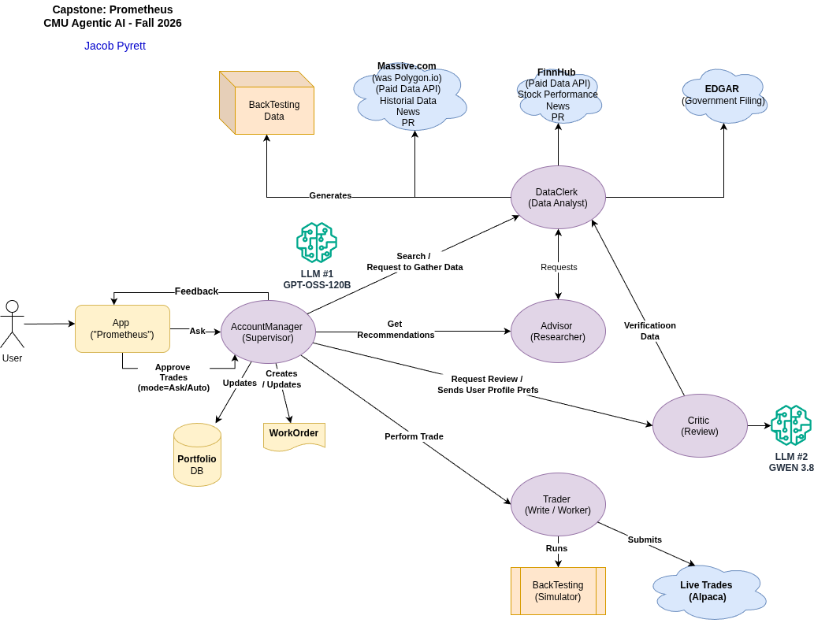

# Submission: Prometheus (multi-agent stock trading desk)
Jacob Pyrett, CMU Agentic AI, Nov 8, 2026. Submission #5 - Multi-Agent Architecture and Coordination Plan

## Problem and why multi-agent

**Accomplish.** A user wants to research and/or trade stocks. The user can request known stocks by symbol and/or name, or ask the system to search for stocks by key terms or phrases such as "pizza stocks". The two can be combined: "Get recommendations for: MCD, YUM, and Burger King" looks up the fast food companies (MCD is McDonald's, YUM is Taco Bell and so on) and dynamically resolves "Burger King" to its stock symbol, QSR. Trades can be requested the same way. Research can also be by date: "Tell me how Tesla (or the S&P 500) has been doing this [time period]".

**Primary problem.** This agentic system should find good stocks to trade using internal data gathering (RAG) and a recommendation/review system, then trade them and measure how it goes over a range of backtesting.

**Why multiple agents.** A squad of specialists works in parallel, checks each other's work and spans the domain (stock news, live and historical data, company data, filings), with an intelligent recommendation system. All of this is too much for the context window of a single agent: there are many complex steps to fetch, ingest, summarize, score and review, plus the trading and account management (servicing) actions.

## Number of agents: 5

Data Clerk, Account Manager, Advisor, Critic and Trader. Each one is a distinct skill with distinct tools, data access and (for the Advisor and Critic) using two different LLMs. The roles are to: gather data, orchestrate and serve the user, recommend, review independently, execute. Splitting further (for example a separate news agent and a separate filings agent) would add coordination overhead without a new kind of responsibility, so those stay as tools inside the Data Clerk.

## Roles and responsibilities

1. **Data Clerk (Data Analyst).** Retrieves all data on the backend from a few sources: live APIs and historical files. Also generates the final backtesting dataset needed for the final results (verification).
2. **Account Manager (Supervisor).** Accepts the initial user query as a **WorkOrder** (the unit of work). Makes the backend calls to the Data Clerk: get stock prices ("quotes"), and get recommendations based on a company stock symbol, a company name, or a phrase ("pizza stocks", "AI memory stocks"). If a recommendation is requested, it asks the Advisor to generate it. The metadata (stage status and results, any extra information, the recommendations themselves) is appended to or updated in the WorkOrder. Also performs the user's portfolio management actions: get balance, add funds, and raise funds (sell existing stocks to get cash).
3. **Advisor (Researcher).** Generates stock recommendations for the provided symbols and returns them as part of the updated WorkOrder. Uses LLM #1, GPT-OSS-120B, working from the prepared data the Data Clerk provides.
4. **Critic (Reviewer).** Independently reviews the recommendations passed to it. Uses a separate model from a different producer, LLM #2, Qwen 3.8. It receives certain fields of the user profile (risk tolerance, age and so on) to double-check that the recommendation is worth trading (makes sense, is appropriate) and returns the final approve/deny with reasons.
5. **Trader (Processor / Worker).** Receives the order to execute a trade from the Account Manager after it is approved. Depending on the setting, it either runs a simulated trade against historical data to see how the user's portfolio would be affected, or places a real trade with the Alpaca online broker (to be determined, depending on whether it can be built by the class deadline).

**Behavior.** Based on the WorkOrder action, the system runs:

- Research only (press releases, filings, live quotes)
- Research + Recommendations
- All: Research + Recommendations + Trade
- Portfolio management

The user also sets a mode, **Ask** or **Auto**. In Ask mode the system interactively asks whether to place the trades after presenting the recommendations. In Auto mode the Trader places the trades without user approval.

**User outputs.**

1. Research output: a summary of stock performance, news, historical metrics (for example P/E), press releases and filings.
2. Current quotes: "Get TSLA's current stock price" returns $395.25.
3. Recommendation requests: "Is TSLA a good buy?", "Tell me the top 5 companies in the S&P 500 to buy."
4. Trade requests: "I added $5000 to my portfolio, trade the best 'AI stocks' companies."
5. Portfolio requests: "Tell me my current portfolio list of stocks and balances."
6. Overall: "How much have I made from using this trading system?"

## Coordination strategy: graph-based (supervisor)

Coordination is a simple supervised graph (sub-agents pattern) built in **LangGraph**, with the Account Manager as the leader. Inside it, the Advisor and the Critic form a team that can talk directly to the Data Clerk, each independently of the other. That lets them send specialized requests following **ReAct**: Reason, Act, then Observe. Execution order follows the dependencies of the WorkOrder: data first, then recommendations, then review, then (if approved and permitted by the mode) the trade.

## Communication

Agents communicate through LangGraph workflow state. The WorkOrder is passed as `state['work_order']`, and each agent appends or updates its own part. The statuses of the individual steps are:

- Requested data: Data Prepared (Yes/No)
- Generated recommendations: Yes/No
- Each `Recommendation[i]_Approved`: Yes/No
- `Funds_Avail`: Yes/No
- Errors / feedback
- `WillTrade`: Yes (user approved), No (system denied), No (no funds), No (user denied)

Communication is one-way where efficiency matters (Account Manager to Trader, and the Data Clerk's results back to its caller). It is two-way where validation matters:

- Account Manager and Critic: the Critic's approve/deny with reasons comes back to the Account Manager.
- Account Manager and Data Clerk: the requested data goes back to the user's request.
- Advisor and Data Clerk, and Critic and Data Clerk: direct requests for more data or verification data.

## Trade-offs

**Supervisor design.** The Account Manager is the supervisor because it is the agent that interfaces with the user. This enforces a single entry point for the user. That increases data security, makes required actions easier to track (auditing and explainability), and allows centralized control of application settings. It is also more reliable, because the Account Manager can redo failed steps in its calls to the individual agents, such as generating recommendations from the Advisor or requesting data research. The cost is that the Account Manager is a bottleneck and a single point of failure.

**Feedback loop with the user.** Asking the user whether to proceed with a trade, or simply handing back the recommendations, research or portfolio information they asked for, is much easier with one supervisor. It adds latency in Ask mode, which is the price of safety.

**Coordination overhead.** A simple supervised graph keeps coordination cheap and easy to debug. The Advisor/Critic/Data Clerk direct channels add ReAct loops (more calls and tokens) in exchange for better-grounded recommendations.

**Other design choices.**

1. **Persisting WorkOrders.** The second generation should not pass WorkOrders around as JSON. Ideally they are fetched from a cache (Redis) and persisted in a main Postgres database. This change cannot be done by the deadline.
2. **"Tokenomics" / scaling.** Recommendations could be looked up and stored as documents in the Redis cache, which would save a lot of cost and tokens.
3. **Reasoning traces.** ReAct with structured JSON is the current system. Structured JSON makes it easier to debug and prove the system before optimizing it.
4. **Model choices.** A strong mid-range model is preferred, to make sure ReAct works, over a frontier model such as Opus. The Critic uses a different model family (Qwen 3) because, as best practice, it avoids the producer agreeing too much with data it created itself.
5. **Control / guardrails.** The Ask/Auto mode is enforced using guardrails (module 6) so the Trader agent cannot execute any trade without permission. Guardrails also restrict the Data Clerk to researching stock-related data from general terms.
6. **Live trading.** This is a project risk: complicated in scope, risky, and very unlikely to be reached. The likely outcome is backtesting for the final verification.

## Effective and scalable problem solving

- **Tools per agent.** Each agent calls tools that do specific things. That is better for debugging and makes it easy to add distinct actions, so the agents can become more capable and give better recommendations and portfolio handling. For example, Raise Funds uses Tree-of-Thought (ToT).
- **USE MCP** THe DataClerk will use MCP communication with the other agents to make the system more efficient & scalable. 
- **Better RAG.** Having a separate data analyst (the Data Clerk) allows the RAG to be indexed better, with MMR relevance and better filtering and ranking.
- **LangGraph.** It provides state management and works with the agent harness. It also handles workflow execution in a more professional way, which supports scaling.
- **Two-way verification.** The Account Manager and the Critic verify each other's results so recommendations are accurate. The Account Manager and the Data Clerk communicate both ways to provide the data the user requested.