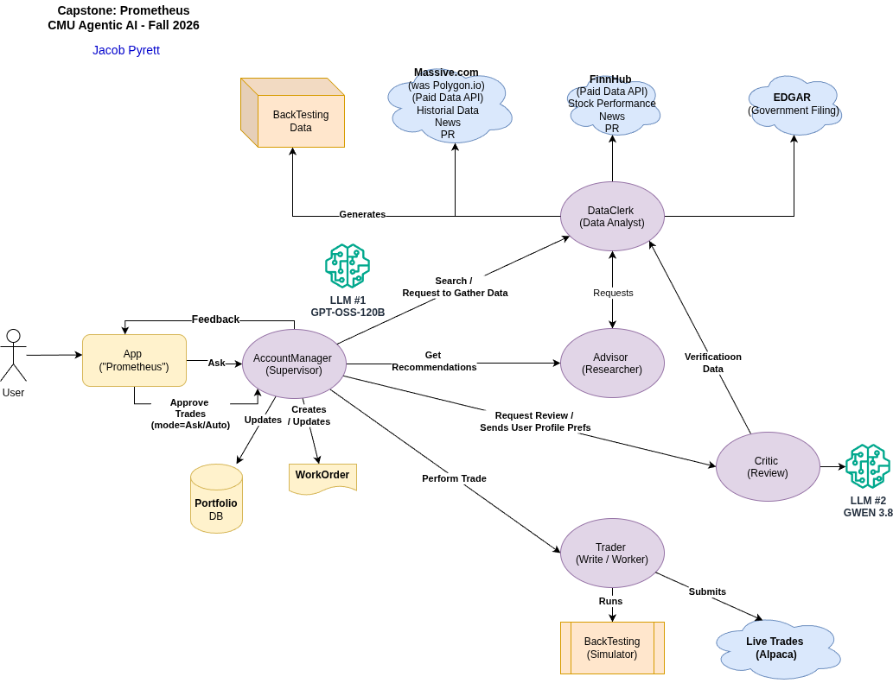
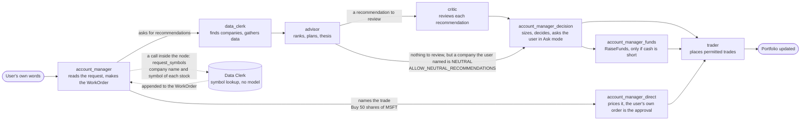
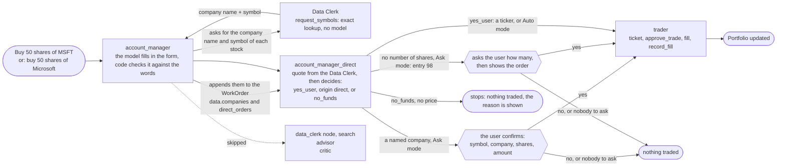
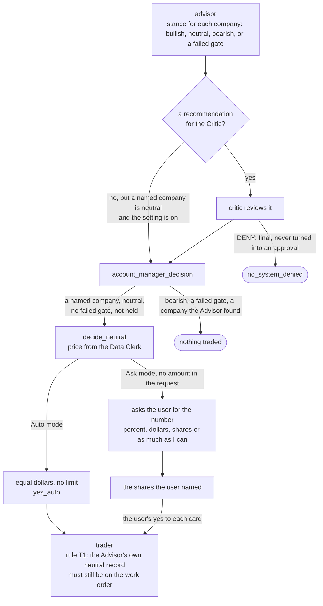
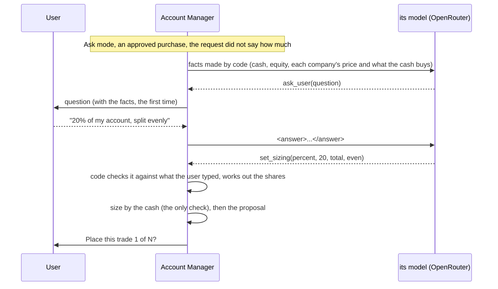
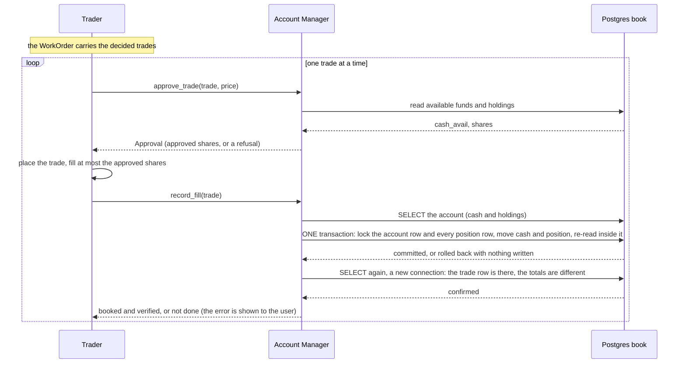

# Updated design: Prometheus (multi-agent stock trading desk)
Jacob Pyrett, CMU Agentic AI, Nov 14 to 15, 2026. The Submission #5 design (`week5_submission.md`), brought up to date with what was built and decided after it. Same five agents, same supervised LangGraph; what changed is who decides what, how a trade is executed and how the money is protected.


*The Week 5 diagram still shows the five agents and their channels. The flows below replace it where they differ.*

## Where things stand

| Part | Status |
|---|---|
| Data Clerk: stored bars, news, press releases, filings, 80 calculated metrics, MCP server | Built |
| Account Manager: profile, Postgres account book, reads the user's own words, decides what may trade, RaiseFunds (Tree of Thought) | Built |
| Advisor v1: ranked, audited recommendations with a trade plan and a thesis | Built; it recommends companies and the plan of the trade and no longer writes a size (entry 80) |
| Critic v1: independent review, score 0 to 100, approve or deny | Built; it no longer sizes and never receives the portfolio (entry 80) |
| Trader v1 with the `PaperBroker`: simulated paper and backtest trades, never live | Built |
| The LangGraph desk and the user session (`./test_prometheus.sh --session`) | Built |
| Ask mode: the user approves the exact order that will be placed | Built (entry 79) |
| Sizing moves to the Account Manager (`sizing.py`, `configs/account_manager_v1.json`) | Built (entries 79 and 80): the Account Manager sizes every approved purchase and records how |
| Auto mode spends the funds round-robin (a share of each stock in turn) | Built (entry 80) |
| The Trader and the Account Manager shake hands on every trade | Built (entries 81 and 82; `design/trader_handshake_spec.md`): row-level locks on the portfolio, a SELECT before and after the commit, a failed trade shown and never retried, nothing halts the run; proved on the real Postgres, including two Traders booking at once |
| The Account Manager asks the user how much to buy, with ReAct, in Ask mode | Built (entry 85; `agents/account_manager/clarify.py`): a percentage of the account, dollars, shares or "as much as I can"; code checks the answer against what the user typed and does the arithmetic; real model recorded on six kinds of answers |
| A news article or press release that fails is discarded | Built (entry 83): skipped completely at load, ingest and fetch; never stored, found, scored or sent to the Advisor |
| A trade the user names ("Buy 50 shares of MSFT", "of Microsoft", or no number at all: "I want to buy MSFT", entry 98) skips the recommendation and the Critic | Built (entries 87 and 88; `agents/account_manager/direct.py`): the Account Manager reads the order, asks the Data Clerk for each company's name and symbol and appends them to the work order, prices it, the user's own order is the approval (a named company is confirmed in Ask mode), and the desk goes `account_manager -> account_manager_direct -> trader`; placed as typed or not at all; no profile limit applies; proved on real sessions with real models (Bill Gates, `tests/fixtures/session_real/bill_gates_direct_order*.json`) |
| A NEUTRAL recommendation counts as approved (`ALLOW_NEUTRAL_RECOMMENDATIONS=true` in `.env`) | Built (entry 91; `agents/account_manager/neutral.py`): a company the user named that the Advisor scored neutral gets a purchase decision from the Account Manager (`origin: "neutral"`, equal dollars, Auto `yes_auto`, Ask asks), the Trader's rule T1 accepts it only while the Advisor's own neutral record is on the work order, and a Critic denial stays final; in Ask mode the user is first asked for the number when the request had none (entry 92). Proved on a real paid run (Pam Smith: SNDK denied, MU 32 and AMD 46 shares bought, $502.59 left; `tests/fixtures/session_real/pam_smith_neutral.json`) |
| No profile size limit anywhere: the Account Manager does no risk management | Built (entry 91): position, loss, order, exposure and liquidity caps are removed from the code, the profile, the Postgres schema, the flags and the tests; the only check is that the funds cover the order |
| No liquidity rule anywhere: the Critic's risk score has no liquidity or stop-distance measure, the Advisor has no liquidity gate and asks for no daily-dollars or spread number (the Data Clerk does not calculate them either), and the Critic enforces only the Advisor's four gates | Built (entries 92 to 95): six risk measures, weights scaled to 100 (`tests/test_critic_risk.py`); four Advisor gates: no_metrics, freshness, red_flag, event_risk (`tests/test_gates.py`); `critic/integrity.GATES` |
| Paid runs and the local embedder | Paid test runs are allowed and preferred (entry 84). Every chat model is on OpenRouter; the one local model is the RAG embedder (MiniLM, `sentence-transformers`), by Jacob's choice |
| Live trading with a real broker | Not in scope; refused in code |
| Stop-loss orders in the Trader, and a monitoring mode for open positions | **TODO, a future version** (Jacob, 2026-11-15): the plan's stop is only a price on the record today; nothing rests at the broker and nothing watches a filled position (see "The Trader, the PaperBroker and the handshake" and Open and next 9) |
| WorkOrders persisted in Postgres / cached in Redis | Open |

## What changed since Week 5

| Week 5 plan | Now |
|---|---|
| The Trader either simulates or places a real trade with Alpaca (to be determined) | No live trading. The Trader runs against a **simulated broker** (`PaperBroker`) in two modes: `paper` (the current quote) and `backtest` (the next open of the stored daily bars). `live` is refused in code. |
| The Critic uses Qwen 3.8 | Z.ai GLM 5.3 through OpenRouter, and it only **labels** quotes. Every number, score and verdict is code. A bake-off against Qwen 3.8 on recorded evidence is still open. |
| The Advisor recommends | The Advisor recommends **companies** and the plan of the trade (entry zone, stop, target, time stop, order style, invalidation). **How much to buy is not its decision** (the sizing move). |
| The Critic reviews with the user's profile | The Critic sees only the risk fields of the profile (tolerance, age, horizon, excluded names, minimum price). It knows **nothing of the user's money**, and that is enforced by the type (`RiskView` is frozen and forbids extra fields). |
| The Account Manager routes and updates the WorkOrder | It also **reads the user's own words** into a form that code checks, **sizes** the purchases, runs the **Ask or Auto** decision, and owns the money and the portfolio in **Postgres**. |
| The portfolio is a JSON file | The **account book is Postgres** (entry 72): the application role cannot edit the cash column; a deposit or a trade goes through a SQL function that locks the account row and changes cash and position together. |
| One run needs an open market | `USE_LIVE_TRADING=false` makes the desk work at the previous business day's close, so it can be run and tested when the market is closed (entry 76). |
| In Auto mode the amount is whatever the profile allows, stock by stock | Auto mode takes the funds requested and buys **round-robin**: a share of the first stock, a share of the next, and around again until the funds are used up. **No limit of the profile applies any more** (entry 91). |
| Ask mode asks "place the trades?" after the recommendations | The user is shown the **final proposal** (shares and cost after the split) and approves each trade; what is approved is exactly what is placed (entry 79). |
| The Trader gets the approved trade and reports | The Trader places **one trade at a time**; the Account Manager updates the funds and the portfolio in the book after each, and only then approves the next (the handshake, below). |
| Ask mode shows a size | In Ask mode the Account Manager first **asks how much** (a percentage, dollars, shares or "as much as I can") when the request did not say, then shows the final proposal (entry 85). |
| Every request goes through the Advisor and the Critic | A request that **names the trade** ("Buy 50 shares of MSFT", "sell 10 shares of TSLA") is a **direct order**: no research, no recommendation, no Critic review, and no second question in Ask mode. The Account Manager prices it and decides it (the user's own order is the approval), and the Trader places it through the same handshake (entry 87). |
| A neutral Advisor score is a no trade | With `ALLOW_NEUTRAL_RECOMMENDATIONS=true` a company the user named that the Advisor scored neutral counts as approved: the Account Manager decides it (`origin: "neutral"`), asks for the number first in Ask mode, and the Trader's rule T1 accepts it only while the Advisor's own record is on the work order; a Critic denial stays final (entries 91 and 92). |
| The profile limits one stock to 10% of the account, one review to 30%, and so on | **No limit of the profile exists**: the Account Manager does no risk management; the only check is that the funds cover the order (entry 91). The Critic's risk score no longer has a liquidity or a stop-distance measure (entry 92). |
| A bad news record stops the load | A news article or press release that cannot be processed is **skipped and discarded completely**: never stored, found, scored or sent to the Advisor (entry 83). Filings stay strict. |

## Problem and why multi-agent

Unchanged from Week 5: a user researches or trades stocks by symbol, by company name, by brand or by a phrase ("pizza stocks"), and a squad of specialists gathers the data, recommends, reviews independently, then trades and measures. One agent could not hold the context of fetching, ingesting, scoring, reviewing, trading and servicing an account. What the build added is the clearest case for the split: **the agent that proposes is not the agent that approves, and neither is the agent that spends.**

## Number of agents: 5

Data Clerk, Account Manager, Advisor, Critic and Trader. Splitting further (a news agent, a filings agent) would add coordination without a new kind of responsibility, so those remain tools inside the Data Clerk.

## Roles and responsibilities

The principle that organizes the update:

| Agent | Decides | Does not decide |
|---|---|---|
| **Data Clerk** | what data exists and what it says: quotes, stored bars, news, press releases, filings, 80 metrics (each with value, unit, as-of date, window, source) | anything about a trade |
| **Advisor** | which companies, their stance and score, the evidence, the thesis, and the **plan** (prices and dates) | **how much to buy or sell** |
| **Critic** | whether each recommendation is approved: accuracy, evidence, risk fit of the company against the user's tolerance, age and horizon, timing, value, chart | **how much**, and nothing about the user's money |
| **Account Manager** | whether a trade is permitted (Ask or Auto), how the user's money is divided as they asked (**no risk management and no size limit: the only check is that the funds cover the order**); the user's profile; the funds and the portfolio, which are the book's | which companies, or whether a company is a good idea |
| **Trader** | how to place one permitted trade (order type and a limit price inside a range code computed) | whether, what, or how much |

1. **Data Clerk (Data Analyst).** `DataClerk` is an agent (model, tools, a bounded loop, a budget, a citation check); `DataToolbox` is plain Python and not an agent. It answers the other agents' work orders (`request_data`, `request_metrics`, `request_quotes`, `request_bars`, `request_verification`, `find_companies`, `refresh_data`). Numbers are **calculated by code** from stored daily bars, Finnhub's payload and filing evidence; a gap is `None` with a note, never a guess. Its tools are also served over MCP.
2. **Account Manager (Supervisor).** `AccountManager` accepts the user's request. `understand_request` makes the model fill in a form (an action, a theme or tickers or names, how many, an even split, a budget) and **code accepts it only when every ticker, name and number is in the user's words**. It holds the user's profile and the Postgres account book (deposits, holdings, gain, counts). `decide_trades` turns the Critic's verdicts into permissions. `raise_funds` is the Tree of Thought for what to sell to buy a stock (only holdings in profit; never a position sold out). It divides the user's money over the purchases as they asked (**it does no risk management: the only check is that the funds cover the order**) and, in Ask mode, clarifies the amount with the user (below). With `ALLOW_NEUTRAL_RECOMMENDATIONS` on, a company the user named that the Advisor scores neutral counts as approved (entry 91). When the user names the trade ("Buy 50 shares of MSFT") it reads that as a **direct order** (`orders` in its form, every field checked against the user's words), asks the Data Clerk for each company's name and symbol and appends them to the work order (`name_the_stocks`), prices it with the Data Clerk and decides it (`decide_direct`): the user's own order is the approval, so nothing is recommended or reviewed; only a company the user *named* (not a ticker) is confirmed with them, in Ask mode.
3. **Advisor (Researcher).** Called only for a request for recommendations: a trade the user names never reaches it (Amendment 10 of `design/advisor_v1_final_spec.md`, entry 87). `Advisor.generate_recommendations` runs twelve steps in `advisor/recommend.py`. The model (GPT-OSS-120B, on a fast host) is called twice, to propose signals, events and quotes (all checked by code) and to write a three-sentence thesis (every number and reference checked); it writes no number that is used. Strategy families (trend, reversion, event, capital return, theme and conviction) each vote; the score is a blend of **40% news and press releases, 30% performance, 20% historical metrics, 10% filings**; gates fail when their input is missing (four gates: no metrics, freshness, red flag, event risk; **no liquidity gate and no liquidity number**, entries 93 and 94). The record carries everything the Critic needs.
4. **Critic (Reviewer).** `Critic.review_recommendations` runs nine steps in `critic/review.py`. It asks the Data Clerk **again** for the key numbers, a quote and the sources and compares them with what the Advisor wrote. Six dimensions, 100 points: accuracy 30, evidence 15, risk fit 20, timing 10, value 15, chart 10 (plus a discount bonus). Its risk score has five measures (volatility, drawdown, beta, ATR, flags) and **no liquidity, stop-distance or company-size measure** (entries 92 and 97). Approve at 70 or more (a blocker caps the score at 49); trade without asking at 80 or more (Auto). It imports nothing of the Advisor's scoring code (a test enforces it); what cannot be verified is not approved; a model's label can only **lower** a result; an approval expires (`valid_until_utc`), so a stale approval never trades.
5. **Trader (Processor / Worker).** `Trader.execute_trades` runs ten steps (`trader/execute.py`). It makes one ticket per permitted decision, gets one snapshot of prices **through the Account Manager**, and places the trades against the `PaperBroker`. Its model (GPT-OSS-120B at temperature 0) has four guarded tools and **cannot name a symbol, a side or a number of shares**; then a code sweep places what the model left, so a failing model never stops a permitted trade and never causes one that is not permitted.

**Behavior.** The WorkOrder action decides how far the desk goes: research only; research and recommendations; all (research, recommendations, trade); portfolio management. A request only to *look* ends after the Advisor. A request that **names the trade** skips the research, the Advisor and the Critic and goes from the Account Manager to the Trader ("A trade the user names", below).

**Ask or Auto.** In **Ask** (the default) the user approves each trade. In **Auto** the desk trades what the Critic approved at the profile's mark; a review that asks for a person (`requires_human`), an approval below the mark and **every sale** still go to the user.

## The desk: a LangGraph



The graph in `desk.py` has eight nodes (`account_manager`, `data_clerk`, `advisor`, `critic`, `account_manager_decision`, `account_manager_funds`, `account_manager_direct`, `trader`, between the start and the end) and `--show-graph` prints them. **The Data Clerk's symbol lookup is not a node**: it is a call the Account Manager makes inside its own node (`AccountManager.request_symbols`, a `lookup_symbol` work order answered by `DataClerk.request_symbols`), the same way it asks the Data Clerk for quotes (`request_prices`) inside `account_manager_decision` and `account_manager_direct`. A direct order skips the Data Clerk's *node* (the research), so the Account Manager asks for the company name and the symbol itself and appends them to the work order before the work order leaves its node. The only edge added for neutral recommendations is `advisor -> account_manager_decision` (when the Advisor recommended nothing for the Critic to review).

`prometheus/langgraph/desk.py`. **One WorkOrder is the state**; each node writes its own part and never edits another's (the Trader's rule T10: the recommendations, reviews and decisions are the same bytes after it ran). The status moves `new -> data_ready -> recommended -> reviewed -> decided -> traded`. The trader node runs only when at least one decision says `yes_auto` or `yes_user`. A decision is one of `yes_auto`, `yes_user`, `pending_user`, `no_system_denied` (the Critic's denial is final), `no_expired`, `no_funds`, `no_user_denied`.

**A user session** (`./test_prometheus.sh --session`, entry 78) creates the user and the account in Postgres, adds the money, and starts this graph with what the user typed ("I want to buy oil stocks. Buy the most from the 3 most recommended and split the money evenly"). All agents are real; the data are the stored data; the clock can be the simulated one.

## A trade the user names: the direct order (built 2026-11-15, entries 87 and 88)

"Buy 50 shares of MSFT" is not a request for advice. Jacob's rule: *skip generating a recommendation and auto-approve it (skip the Critic step), and move the WorkOrder on to the Account Manager to work with the Trader.* The desk gets one more node and one more path; the path of a request for recommendations is not changed.



```mermaid
sequenceDiagram
    participant U as User
    participant A as Account Manager
    participant D as Data Clerk
    participant T as Trader
    U->>A: buy 50 shares of Microsoft
    A->>U: understood: buy 50 shares of Microsoft (your own order). Go ahead?
    U-->>A: yes
    A->>D: lookup_symbol order: Microsoft
    D-->>A: Microsoft Corporation, MSFT (exact match, never a guess)
    A->>A: append company name and symbol to the WorkOrder
    A->>D: current price of MSFT
    D-->>A: quote (523.88)
    A->>A: decide: the user's own order is the approval (yes_user, origin direct), valid for 30 minutes
    Note over A,U: a company the user NAMED: in Ask mode the user confirms the symbol, the company, the shares and the amount; in Auto mode the returned symbol is used without asking
    A->>U: Is this the order you meant: buy 50 shares of Microsoft Corporation (MSFT), about $26,194.00?
    U-->>A: yes
    Note over A,T: if the cash does not pay for all 50 shares: no_funds, nothing is made smaller, the Trader does not run
    A->>T: the decided WorkOrder
    T->>A: approve_trade (placed as typed, or not at all)
    A-->>T: approved
    T->>A: record_fill (booked in Postgres, read before and after)
    A->>U: the Trader's result and the portfolio after the trade
```

- **Reading it.** The Account Manager's model fills in `action: "order"` and `orders` (`side`, `symbol` for a ticker or `company` for a name, `shares`). **Code accepts it only when the user's own words give every field**: the ticker or the name as typed, the shares written as a number of *shares* right before it, the last buying or selling word before it as the side. A dollar amount, a percentage or a decimal is never read as shares. Buys and sells are supported; several trades in one request are too. **A stock named with NO number is a direct order too** (entry 98: "I want to buy MSFT", "buy Microsoft", "Buy $5,000 of MSFT"): `shares` is null, and **a program decides** whether the request is a direct order, not the model: a word that asks for a recommendation (recommend, advice, research, "should I", "if the recommendations pass") makes it a request to buy or research, and named tickers or companies to buy with no such word, no theme and no count are a direct order whatever the model said. For such an order the Account Manager sizes the number: in **Ask mode it asks the user for it** with the same bounded questions as for any purchase and then shows the order for a yes; in **Auto mode** it spends what the user's words say (their dollars, an even split when asked, otherwise round-robin: one stock gets what the cash allows). A **sale with no number is not placed** (it says to name how many).
- **The company name and the symbol are on the WorkOrder.** A request for research goes through the Data Clerk's node, which receives the work order and appends what it finds. A direct order skips that node, so **the Account Manager asks the Data Clerk** (`DataClerk.request_symbols`: a ticker is looked up for its company, a company's name for its ticker, with the exact matching of press releases and filings, never a guess; an ambiguous or unknown name stops the order with the Data Clerk's own message) and **appends the answer to the work order itself**: `data.companies` and the user's own order in `direct_orders` (symbol, company name, what was typed).
- **What is skipped.** The Data Clerk's search, the Advisor and the Critic. No recommendation exists and no review is made or forged; a test builds the desk with factories that fail if any of the three is asked for.
- **Auto-approved, and a named company is confirmed in Ask mode.** The decision is `yes_user` with `origin: "direct"`: the user said yes by naming the trade, so a ticker the user typed is not asked about again, in either mode. When the user named a COMPANY the symbol is the Data Clerk's, so in **Ask mode** the user confirms the symbol, the company, the shares and the amount first; in **Auto mode** the returned symbol is used without asking. The work order carries the user's own order in `direct_orders`.
- **The permission is narrow.** The Trader's rule T1 (`work_order.verify_trade`) accepts a direct decision only while the work order holds the user's matching record (same id, ticker and side, and not more shares than typed), and the price check runs out 30 minutes after it was made. The word `direct` alone permits nothing; a decision that is not direct still needs the Critic's approval.
- **The size is the user's, and no profile limit ever applies.** The profile's limits that cut a recommended purchase (a share of the account in one stock, the loss a stop would cost, the exposure of one review, the order and liquidity caps) never apply to a trade the user names; a test reads the source of the direct path and fails if it names one. The account is the limit: the cash, or the shares held. A purchase the cash does not pay for is `no_funds` and says how many shares it does pay for; the handshake refuses, and does not cut, an order the account can no longer pay for in full, and a sale is refused whole when T+1 locks some of its shares. Nothing is sold to fund a direct purchase.
- **TODO: limit orders.** A direct order is a market order (the paper broker fills at the current quote, with a few basis points of slippage) and does not check the market hours. "Buy 50 shares of MSFT at $500 or less" is not built: it needs a price in the form, a limit on the record and the decision, the ticket's range, and an order that may rest until the price is reached.
- **A real run (2026-11-15, the real models and the real symbol directory).** The stored close of MSFT on 2026-11-13 is $523.88. Bill Gates with $20,000 asked for 50 shares ($26,194.00): refused whole, "the most it pays for is 38 shares", the account unchanged. With $30,000 the same request was approved, the Trader's model placed it (50 at $524.14), $3,792.90 stayed in the account and the portfolio shows MSFT 50; "buy 50 shares of Microsoft" in Auto mode found MSFT and did the same.

## Who decides how much, and the only check: the funds (entries 80 and 91)

**The Account Manager does no risk management.** (Jacob, 2026-11-15.) It delegates tasks to the other agents, updates the user's profile and portfolio, and works with verifying the trades the Trader has made. How much to buy is the user's money divided as they asked, and **the only sizing check is that the funds cover the order**. There is no limit of the profile any more (a share of the account in one stock, the loss a stop would cost, the exposure of one review, a cap on one order), no liquidity cap, and no flag or question to raise one: Jacob, 2026-11-15: *"profile limits never apply to any orders"*, *"I do not want any of these limits ... remove them all from all tests and code"*, *"the only sizing that we need is to make sure the trade order has enough funds to cover it"*. They were the Account Manager's own entry-80 arithmetic (`account_manager/sizing.py`, plain Python, no model); the profile fields, the account book's columns, the session's `--max-position-pct`, `--max-exposure-pct` and `--max-loss-pct`, and the Ask-mode "raise this limit for one purchase?" question are all gone. The Critic never used them: it judges the *company's* risk against the user's tolerance, age, horizon and exclusions, and it is given no money.

- **What bounds a purchase**, in whole shares: the **cash** (all of it, for every purchase: nothing is reserved), the **budget** the user gave, and **the amount the user asked for** ("20% of my account", "$3,000", "10 shares"). Nothing else.
- **How the money is divided** (the user's words, or Auto's default): `even` gives each purchase the same dollars (a purchase whose share buys less than one share is dropped and the rest are balanced again). When the user asked for no split, **Auto mode is round-robin**: take the funds requested (the user's budget, else the available cash), buy one share of the first stock, one of the next, and keep going round in rank order until the funds are used up; a stock drops out when it has the shares the user asked for, and the pot ends the rest. It is arithmetic in code, so each stock ends with a final share count and the Trader places one trade per stock. Ask mode with no split asked buys as much as the cash allows, stock by stock in rank order, unless the user chooses another way.
- **No cash is reserved.** Each purchase may use all the funds available in the portfolio; the first trades use the money and a later one gets what is left (the handshake enforces it at trade time, and refuses a purchase there is no cash for).
- Each decision records how it was sized: the cash and budget caps, which one **bound**, and the equity it used.
- **The money, not a limit, is what stops a purchase.** The real Bob Jones session ($15,000, entry 80) was recorded under the old 10% position limit and bought CVX 6 and EOG 9; with no limit the same round-robin spends the cash (CVX 40 and EOG 39 shares, $14,970.08).

## A neutral recommendation is approved (entries 91 and 92; `ALLOW_NEUTRAL_RECOMMENDATIONS=true` in `.env`)

Jacob: *"A neutral recommendation is same as Approved."* The setting is read by the Account Manager "when working with the WorkOrder recommendation result to allow the Trader agent to use the WorkOrder". Unset or false changes nothing.



A company the user *named* that the Advisor scores neutral (no strategy passed; no entry plan, no stop, no Critic review) gets a trade decision with `origin: "neutral"` (`account_manager/neutral.py`): a market order at the Data Clerk's quote, equal dollars with the other neutral companies and no limit of any kind (one neutral company gets all the money), `yes_auto` in Auto mode, and in Ask mode the user is **asked for the number first** when the request had none ("I want to buy MU and AMD"; entry 92), with the same bounded questions as for any approved purchase, one set for the Critic's purchases and the neutral ones, and then says yes or no to each card (no answer: `pending_user`, nothing traded). The shares the user names are what is proposed, cut only by the cash. A bearish stance trades nothing, a gate that failed is not a stance and stops the company, a company the Advisor discovered for a theme is never bought as neutral, and **a Critic denial is final** (only a company the Advisor did *not* recommend can be neutral, so the setting cannot turn a denial into an approval). The Trader's permission (`work_order.verify_trade`, rule T1) accepts such a decision only while the work order holds the Advisor's own neutral record of that symbol on `order.candidates`, with no Critic review beside it, for a purchase, and until the decision's own expiry (30 minutes): the word "neutral" alone permits nothing, and no review is forged.

**A real run (2026-11-15, the real models, the simulated close of Friday 2026-11-13).** Pam Smith, 30, aggressive, $50,000, Auto: *"Buy MU, SNDK and AMD if the recommendations pass. Go ahead and trade if the recommendations pass."* SNDK (bullish 46) was denied by the Critic (risk above her profile, a falling knife: final). MU (neutral 62) and AMD (neutral 48) were approved by the setting: MU 32 shares and AMD 46 shares, filled at $778.70 and $534.33 ($24,918.37 and $24,579.04), both booked through the handshake; cash $50,000.00 to $502.59.

### How much, asked of the user in Ask mode

**In Ask mode, with ReAct (built, entry 85).** When the request did not already say how much (a code check of the user's words: no percentage, dollar amount, number of shares or "as much as I can") and somebody is at the keyboard, the Account Manager runs a bounded loop BEFORE it sizes: THOUGHT, then `ask_user(question)` or `set_sizing(unit, amount, scope, allocation)`, then the user's answer (or a refusal) as OBSERVATION, at most three questions. The user may answer a **percentage** of the account, a **dollar amount**, a **number of shares** or "as much as I can", for each company or in total, and how to split a total (evenly, round-robin or as much as the cash allows, only when they said so). The model only phrases the questions and reads the answers; **code validates every action and does the arithmetic**: the amount must be a number the user typed, the unit one their words show, a percentage at most 100, shares whole, the cost within the cash. The shares asked for are one more limit of each purchase (`asked`): never more than the user asked or than any limit allows. A model that fails, nonsense, or no answer leaves the default size and the Account Manager says so. Then the user is shown the proposal with the final shares and cost and approves each trade. In Auto mode it never asks.



## The Trader, the PaperBroker and the handshake

**`PaperBroker`** (`trader/broker.py`) is the one funnel every trade goes through, whoever places it (the model's `place_order` tool or the code's sweep), so no guard can be skipped by a path that forgets it:

- **T1** permission is code: `work_order.verify_trade` runs again for every trade as it is placed. **T2** an order is a type and a price inside the range code computed. **T3** a trade is placed once; a `filled` or `rejected` trade is final.
- It places against **one snapshot of prices** (paper: the quote; backtest: the stored bars, filled at the next open and then followed through the later bars). Every sale is placed before any purchase.
- A purchase fills for the shares the cash pays for, at most the shares decided (`cash_policy: "reduce"`); none is `insufficient_cash`.
- **Funding sales** (RaiseFunds) are trades of their own, placed with their purchase, never by the model, and only with the user's yes. If the sales cannot pay for even one share, nothing is sold.
- The model's four tools are `verify_request`, `place_order`, `check_trade_status` and `notify_account_manager`. Its prompt and tool results hold only symbols, numbers and words from closed lists made by code: **no web text, thesis or company name ever reaches it**. Its words reach two places (a trade's note and the run's summary), and code checks the summary.

**TODO (Jacob, 2026-11-15, see Open and next 9):** stop-loss orders in the Trader, and a monitoring mode, in a future version.** Today the plan's stop is only a price on the record: the Trader places market and limit purchases and sales and nothing rests at the broker, and after a fill nothing watches the position (only a backtest follows a filled purchase through the stored bars and records whether the stop, the target or the time stop came first, `simulator.follow`). A future version adds (1) a STOP-LOSS ORDER the Trader places with the purchase (a type of order beside market and limit: the stop price from the Advisor's plan, checked by code like every other price, permitted by the same rule T1 and booked through the same handshake, with the reason `stop` on the closing trade) and (2) a MONITORING MODE: a run that does not trade anything new but watches the open positions against their stop, target and time stop (the quote in paper mode, the later bars in backtest) and places the exit it is permitted to place, with the Account Manager still the only owner of the funds. Open questions for that version: who permits an exit that no review approved (a stop the user accepted when they approved the purchase, in Ask mode, or a standing permission), how often it runs and what starts it (a schedule, the user, a graph node), what a stop does when the market is closed or gaps through the price, and how it appears in the account book and to the user. Nothing of this is built.

**The handshake (built, entry 81; it replaced the Trader's own running copy of the account).** The Trader holds **no cash and no portfolio**. The Account Manager and its Postgres book are the only owner of the funds, with ACID properties and data integrity:



The next trade is not approved until the previous one is booked or has failed, so **a purchase always meets the funds as the book has them after the earlier trades, and the Trader cannot overdraw them**. **A booking is three reads around one locked commit (entry 82):** the Account Manager SELECTs the account; commits the trade in ONE transaction that holds row-level locks on the account row and on every position row of the portfolio and re-reads the account before it commits (rolling everything back on any difference); then SELECTs again on a new connection and confirms that the trade row is there and that the cash and the shares are different from before. **A trade that fails is not committed, the Account Manager shows the user the error and the account as it stands, the trade is `rejected` (`account_refused`) and never retried, and the Trader goes on to the next trade: nothing halts the run.** The user talks to the Account Manager only, so it is the one that speaks. A funding sale goes through the same steps before its purchase is approved. With no saved account (a backtest, a test), the Account Manager keeps the working portfolio itself: the same two calls, no database.

**It never waits when no trade remains.** Approval is asked only for a trade about to be placed. After the last trade is booked the run goes straight to its end, with no further approval, polling or sleep, and with nothing to place there is no handshake call at all. A trade refused at approval, or rejected before it fills, causes no booking. Tests record the real Account Manager's calls on the real Postgres to prove it: N filled trades give exactly N approvals and N bookings, and none after the last. **What the real database tests proved:** with $2,000 the first purchase books and the second is cut from 8 shares to 4; with $1,400 the second is rejected `insufficient_cash`; two Traders booking at the same moment against one account get one booking and one `account_refused`, and the cash is never below zero. The Trader's source holds no `apply_fill` and no arithmetic on cash (a test reads it), and the model sees a refusal only as a reject code, never as the book's text.

The Trader reaches the world only through the Account Manager (rule **T5**): the portfolio, the cash, the quotes, the bars and the booking all go through `AccountManager` methods, and a test reads the Trader's imports.

## Communication

Agents still communicate through the LangGraph state: the WorkOrder is `state["order"]`, with the Advisor's `recommendations`, the Critic's `reviews` (joined by `record_id`), the Account Manager's `trade_decisions`, and the Trader's `trades` and `trader_runs`. Statuses and errors travel on it. The channels are as in Week 5, with these changes:

- **Critic to Account Manager**: the verdict, the score and the reasons come back to the Account Manager, which alone decides the size and the permission.
- **Account Manager to Data Clerk**: for a trade the user names, the lookup of each company's name and symbol (`lookup_symbol`), appended by the Account Manager to the work order, because that path skips the Data Clerk's node.
- **Account Manager to Trader**: a one-way hand-off of the decided WorkOrder, and then a two-way handshake **per trade** (approval out, booked status back). For a trade the user names the hand-off comes straight from the Account Manager's direct decision; the Advisor and the Critic are not in the path.
- **Trader to Data Clerk**: never direct; the prices come through the Account Manager.
- **Account Manager to the user**: the final proposal and, in Ask mode, one question per trade (and the sizing questions, once built).
- **Advisor and Critic to the Data Clerk**: direct, as in Week 5. The Critic asks again on purpose, so that its judgement uses numbers it fetched itself.

## Guardrails: what a model may not do

The rule behind every choice (design entries 24 and 26): **an LLM stays out of anything a program can check.**

- Scores, sizes, citations, budgets, cash and permissions are calculated in code. A model's output can lower a result, never raise one.
- The **Critic** has eight principles, each enforced by a test: it imports nothing of the Advisor's scoring, uses its own fetched numbers, approves nothing it cannot verify, never raises for a data or model failure, and never trades.
- The **Trader** has ten rules, T1 to T10, each with a test that fails when its guard is removed: permission, no sizing or picking by the model, once, paper only, one door, code finishes the job, never raises, two places for the model's words, no web text, other agents' records untouched. `PAPER_TRADING` set to anything but true refuses the whole run.
- **Ask or Auto** is enforced in code by `decide_trades` and `verify_trade`: no trade without a decision that says yes. A sale is never automatic. The one other way to a trade is the user's own direct order: `verify_trade` accepts it only while the work order holds the user's matching record, and it is placed as typed or not at all.
- **The money is the book's.** The Postgres role cannot edit cash directly, and no agent keeps a copy it spends from.

## Trade-offs

**Supervisor design.** Unchanged and now stronger: the Account Manager is the single entry for the user and the single owner of the money. The cost is the same (a bottleneck and a single point of failure), and the handshake adds a round trip per trade, which is the price of never overdrawing.

**A simulated broker, not a real one.** Alpaca was a maybe in Week 5. Live trading is complicated, risky and not needed to show the system; the `PaperBroker` fills against real quotes (paper) and real stored bars (backtest) with explicit fill rules, so the result is measurable and repeatable. The cost is that slippage, partial fills and exchange behavior are modeled, not observed.

**Trader: a model with tools plus a code sweep, not a free ReAct loop and not a one-shot plan.** The model may choose an order type and a limit price inside a range, and nothing else. A free loop whose tools take a symbol and a share count would be exactly the made-up trade; temperature 0 gives repeatability, not truth, so no safeguard relies on it.

**Handshake inside the Trader's placement funnel, not a cycle in the desk graph.** A graph-level cycle (`trader -> settle -> trader`) would call the model once per trade, and the handshake in the single funnel cannot be skipped by the model's tools, the sweep or the funding path.

**One owner of the funds.** The earlier Trader kept a running copy and told the Account Manager once at the end, which meant two owners for the length of a run. The handshake removes the copy.

**Sizing in the Account Manager.** The Advisor and Critic stay about recommendations and cannot see the money. The Account Manager divides the user's money as they asked, in code, and does no risk management: since entry 91 the only check is that the funds cover the order (the position, loss, exposure, order and liquidity caps were removed as too much like a financial adviser's role). The cost is that nothing but the cash, the budget and the user's own words keeps a purchase small: a user who says nothing and is in Ask mode is shown the largest order the cash buys, and approves each trade.

**Neutral counts as approved (entries 91 and 92).** Jacob chose to treat an Advisor score of "no strategy passed" as a yes when the user named the company, because the alternative (the Advisor's neutral and the user's request both ending in no trade) made "buy these three if the recommendations pass" do nothing in the real run. The cost is that an approval now rests on the user's own choice of the company and the Critic's denial, not on a positive recommendation: it is behind a setting that is off unless `.env` says true, it trades only companies the user named, and the Trader's permission needs the Advisor's own record.

**The direct order's symbol lookup is a call, not a node.** The Account Manager asks the Data Clerk for the company name and the symbol inside its own node and appends them to the work order, rather than routing a work order through a Data Clerk node for a lookup: the node's job is research, which a direct order skips by Jacob's rule. The cost is that the graph's picture does not show the lookup; the diagrams above and `desk.py`'s header do.

**Round-robin in Auto mode.** Buying a share of each stock in turn spreads the money across the recommended companies instead of letting the top-ranked one take every dollar, and it needs no choice from the user. The cost is that the split is by shares, not by dollars: a dearer stock takes more of the money than a cheaper one, so the user who wants equal dollars says "evenly" and gets `even`.

**Model choices.** Strong mid-range models that follow a tool protocol (GPT-OSS-120B for the Advisor, Trader and Account Manager) and a different producer for the Critic (GLM 5.3), as best practice against a producer agreeing with what it made.

**Other choices.**
1. **Persisting WorkOrders.** Still in the graph state, not in Redis or Postgres. The account book is in Postgres.
2. **Tokenomics.** Recommendations could be cached as documents in Redis to save tokens. Open.
3. **Reasoning patterns by agent.** The Data Clerk uses a tool loop with a budget and a citation check; the Advisor a two-call plan and thesis with code checks; the Critic one labeling call per recommendation; the Account Manager a Tree of Thought for funding and (specified) ReAct for sizing questions; the Trader a guarded tool loop. Structured JSON throughout, so a run can be debugged and proved.
4. **No cash reservation.** Rejected: reserving each purchase's money in advance. Any available funds can be used, and the handshake decides at trade time.

## Effective and scalable problem solving

- **Tools per agent.** Each agent calls tools that do one thing; the Trader's tools cannot name a symbol or a size, and the Data Clerk's are served over MCP.
- **Better RAG.** A separate data analyst lets the stored news, press releases and filings be indexed and filtered on their own (ChromaDB, relevance ranking), and numbers come from calculation, not from text.
- **LangGraph.** State management and workflow execution for the desk, and the Trader's own model loop.
- **Two-way verification.** The Critic re-fetches what the Advisor wrote; the Account Manager and the book agree after every trade; a test compares the Trader's output with the Account Manager's decisions.
- **Real data in tests.** About 2,760 tests (a purge of 2026-11-15, entry 90, took out the ones whose lines others already cover) run on the real stored bars, the real captures of the Advisor, the Critic and a whole user session, and (opt-in, paid) the real agents. No made-up stock data and no stand-in agents in the new tests. One real-data news test fails (the same Finnhub article stored with two times 7.8 hours apart) and is left failing on purpose.

## Open and next

1. ~~Re-capture a real session with the new flow~~ **Done 2026-11-15:** `tests/fixtures/session_real/bob_jones_oil_round_robin.json` (Bob Jones, $15,000, conservative, Auto, no split asked: CVX 6 and EOG 9 shares round-robin, PSX denied for risk, both fills booked through the handshake; replayed by `tests/test_session_replay_round_robin.py`). The live end-to-end tests (`PROMETHEUS_LIVE_TESTS=1 pytest tests/test_end_to_end_live.py`) pass (8).
2. ~~Decide whether the sizing cash should include what RaiseFunds could raise~~ **Decided (entry 84): no.** The sizing cash is the available cash. A funding sale is the minimum number of shares the purchase needs and never liquidates a holding (RaiseFunds' `lean` and `never_liquidate`).
3. ~~Build the Account Manager's ReAct sizing questions for Ask mode~~ **Built 2026-11-15 (entry 85).** Not done inside it: a total in shares that the cash cuts is not moved to another company. (The limits it could raise were removed by entry 91.)
4. Direct orders (entries 87 and 88): ~~the profile's limits, the market hours and company names~~ **Decided by Jacob (entry 88): no profile limit ever applies to a trade the user names; no market-hour check; a company name goes through the Data Clerk and, in Ask mode, the user confirms.** ~~Whether "no limit applies" reached recommended purchases~~ **Yes (entry 91): no limit exists anywhere.** Open: **limit orders** (the TODO above).
5. Decide the Critic's model with a paid bake-off on recorded evidence.
6. Persist WorkOrders (Postgres, with a Redis cache).
7. ~~The Advisor's liquidity gate~~ **Removed (entries 93 and 94): there is no liquidity rule or input anywhere in the Advisor or the Critic** and the Data Clerk no longer calculates a daily-dollars or a spread number (entry 95). Jacob's to tune: the six risk weights of the Critic (scaled in proportion to 100 after the two removals, entry 92) in `configs/critic_v1.json`.
8. ~~"I want to buy MSFT" with no number~~ **Built (entry 98): it is a direct order**; Ask mode asks for the number. Open: Ask mode asks for a SALE's number too? (a sale with no number is refused today).
9. **TODO (Jacob, 2026-11-15): stop-loss orders in the Trader and a monitoring mode, in a future version** (the plan's stop is only a price on the record today, and nothing watches a position after it is filled; the text is in "The Trader, the PaperBroker and the handshake" above).
