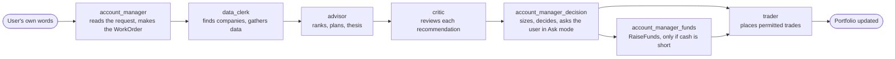
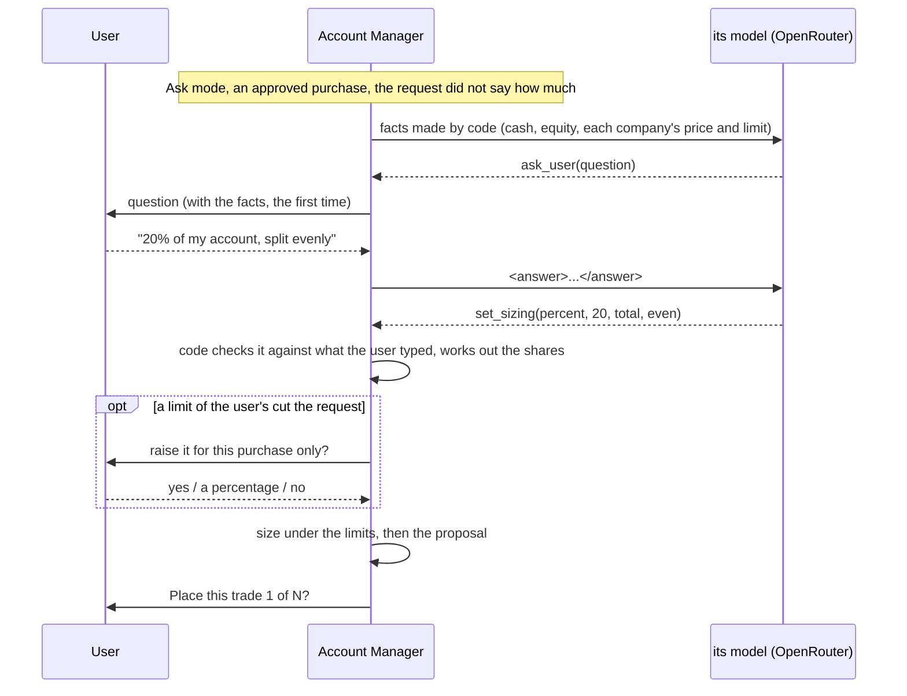
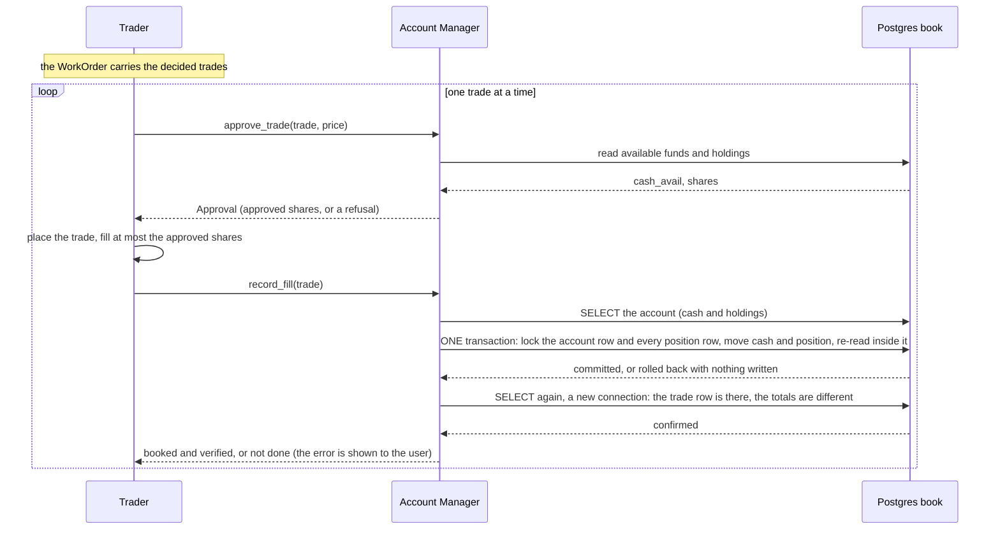

# Updated design: Prometheus (multi-agent stock trading desk)
Jacob Pyrett, CMU Agentic AI, Nov 14 to 15, 2026. The Submission #5 design (`week5_submission.md`), brought up to date with what was built and decided after it. Same five agents, same supervised LangGraph; what changed is who decides what, how a trade is executed and how the money is protected.

*The Week 5 diagram still shows the five agents and their channels. The flows below replace it where they differ.*

## Where things stand

| Part | Status |
|---|---|
| Data Clerk: stored bars, news, press releases, filings, 82 calculated metrics, MCP server | Built |
| Account Manager: profile, Postgres account book, reads the user's own words, decides what may trade, RaiseFunds (Tree of Thought) | Built |
| Advisor v1: ranked, audited recommendations with a trade plan and a thesis | Built; it recommends companies and the plan of the trade and no longer writes a size (entry 80) |
| Critic v1: independent review, score 0 to 100, approve or deny | Built; it no longer sizes and never receives the portfolio (entry 80) |
| Trader v1 with the `PaperBroker`: simulated paper and backtest trades, never live | Built |
| The LangGraph desk and the user session (`./test_prometheus.sh --session`) | Built |
| Ask mode: the user approves the exact order that will be placed | Built (entry 79) |
| Sizing moves to the Account Manager (`sizing.py`, `configs/account_manager_v1.json`) | Built (entries 79 and 80): the Account Manager sizes every approved purchase and records how |
| Auto mode spends the funds round-robin (a share of each stock in turn) | Built (entry 80) |
| The Trader and the Account Manager shake hands on every trade | Built (entries 81 and 82; `design/trader_handshake_spec.md`): row-level locks on the portfolio, a SELECT before and after the commit, a failed trade shown and never retried, nothing halts the run; proved on the real Postgres, including two Traders booking at once |
| The Account Manager asks the user how much to buy, with ReAct, in Ask mode | Built (entry 85; `agents/account_manager/clarify.py`): a percentage of the account, dollars, shares or "as much as I can"; code checks the answer against what the user typed and does the arithmetic; real model recorded on six kinds of answers |
| A news article or press release that fails is discarded | Built (entry 83): skipped completely at load, ingest and fetch; never stored, found, scored or sent to the Advisor |
| Paid runs and the local embedder | Paid test runs are allowed and preferred (entry 84). Every chat model is on OpenRouter; the one local model is the RAG embedder (MiniLM, `sentence-transformers`), by Jacob's choice |
| Live trading with a real broker | Not in scope; refused in code |
| WorkOrders persisted in Postgres / cached in Redis | Open |

## What changed since Week 5

| Week 5 plan | Now |
|---|---|
| The Trader either simulates or places a real trade with Alpaca (to be determined) | No live trading. The Trader runs against a **simulated broker** (`PaperBroker`) in two modes: `paper` (the current quote) and `backtest` (the next open of the stored daily bars). `live` is refused in code. |
| The Critic uses Qwen 3.8 | Z.ai GLM 5.3 through OpenRouter, and it only **labels** quotes. Every number, score and verdict is code. A bake-off against Qwen 3.8 on recorded evidence is still open. |
| The Advisor recommends | The Advisor recommends **companies** and the plan of the trade (entry zone, stop, target, time stop, order style, invalidation). **How much to buy is not its decision** (the sizing move). |
| The Critic reviews with the user's profile | The Critic sees only the risk fields of the profile (tolerance, age, horizon, excluded names, minimum price). It knows **nothing of the user's money**, and that is enforced by the type (`RiskView` is frozen and forbids extra fields). |
| The Account Manager routes and updates the WorkOrder | It also **reads the user's own words** into a form that code checks, **sizes** the purchases, runs the **Ask or Auto** decision, and owns the money and the portfolio in **Postgres**. |
| The portfolio is a JSON file | The **account book is Postgres** (entry 72): the application role cannot edit the cash column; a deposit or a trade goes through a SQL function that locks the account row and changes cash and position together. |
| One run needs an open market | `USE_LIVE_TRADING=false` makes the desk work at the previous business day's close, so it can be run and tested when the market is closed (entry 76). |
| In Auto mode the amount is whatever the profile allows, stock by stock | Auto mode takes the funds requested and buys **round-robin**: a share of the first stock, a share of the next, and around again until the funds are used or every stock has reached a limit. |
| Ask mode asks "place the trades?" after the recommendations | The user is shown the **final proposal** (shares and cost after the split) and approves each trade; what is approved is exactly what is placed (entry 79). |
| The Trader gets the approved trade and reports | The Trader places **one trade at a time**; the Account Manager updates the funds and the portfolio in the book after each, and only then approves the next (the handshake, below). |
| Ask mode shows a size | In Ask mode the Account Manager first **asks how much** (a percentage, dollars, shares or "as much as I can") when the request did not say, then shows the final proposal (entry 85). |
| A bad news record stops the load | A news article or press release that cannot be processed is **skipped and discarded completely**: never stored, found, scored or sent to the Advisor (entry 83). Filings stay strict. |

## Problem and why multi-agent

Unchanged from Week 5: a user researches or trades stocks by symbol, by company name, by brand or by a phrase ("pizza stocks"), and a squad of specialists gathers the data, recommends, reviews independently, then trades and measures. One agent could not hold the context of fetching, ingesting, scoring, reviewing, trading and servicing an account. What the build added is the clearest case for the split: **the agent that proposes is not the agent that approves, and neither is the agent that spends.**

## Number of agents: 5

Data Clerk, Account Manager, Advisor, Critic and Trader. Splitting further (a news agent, a filings agent) would add coordination without a new kind of responsibility, so those remain tools inside the Data Clerk.

## Roles and responsibilities

The principle that organizes the update:

| Agent | Decides | Does not decide |
|---|---|---|
| **Data Clerk** | what data exists and what it says: quotes, stored bars, news, press releases, filings, 82 metrics (each with value, unit, as-of date, window, source) | anything about a trade |
| **Advisor** | which companies, their stance and score, the evidence, the thesis, and the **plan** (prices and dates) | **how much to buy or sell** |
| **Critic** | whether each recommendation is approved: accuracy, evidence, risk fit of the company against the user's tolerance, age and horizon, timing, value, chart | **how much**, and nothing about the user's money |
| **Account Manager** | **how much to buy or sell**; whether a trade is permitted (Ask or Auto); the funds and the portfolio, which are the book's | which companies, or whether a company is a good idea |
| **Trader** | how to place one permitted trade (order type and a limit price inside a range code computed) | whether, what, or how much |

1. **Data Clerk (Data Analyst).** `DataClerk` is an agent (model, tools, a bounded loop, a budget, a citation check); `DataToolbox` is plain Python and not an agent. It answers the other agents' work orders (`request_data`, `request_metrics`, `request_quotes`, `request_bars`, `request_verification`, `find_companies`, `refresh_data`). Numbers are **calculated by code** from stored daily bars, Finnhub's payload and filing evidence; a gap is `None` with a note, never a guess. Its tools are also served over MCP.
2. **Account Manager (Supervisor).** `AccountManager` accepts the user's request. `understand_request` makes the model fill in a form (an action, a theme or tickers or names, how many, an even split, a budget) and **code accepts it only when every ticker, name and number is in the user's words**. It holds the user's profile and the Postgres account book (deposits, holdings, gain, counts). `decide_trades` turns the Critic's verdicts into permissions. `raise_funds` is the Tree of Thought for what to sell to buy a stock (only holdings in profit; never a position sold out). It sizes the purchases and, in Ask mode, will clarify the amount with the user (below).
3. **Advisor (Researcher).** `Advisor.generate_recommendations` runs twelve steps in `advisor/recommend.py`. The model (GPT-OSS-120B, on a fast host) is called twice, to propose signals, events and quotes (all checked by code) and to write a three-sentence thesis (every number and reference checked); it writes no number that is used. Strategy families (trend, reversion, event, capital return, theme and conviction) each vote; the score is a blend of **40% news and press releases, 30% performance, 20% historical metrics, 10% filings**; gates fail when their input is missing. The record carries everything the Critic needs.
4. **Critic (Reviewer).** `Critic.review_recommendations` runs nine steps in `critic/review.py`. It asks the Data Clerk **again** for the key numbers, a quote and the sources and compares them with what the Advisor wrote. Six dimensions, 100 points: accuracy 30, evidence 15, risk fit 20, timing 10, value 15, chart 10 (plus a discount bonus). Approve at 70 or more (a blocker caps the score at 49); trade without asking at 80 or more (Auto). It imports nothing of the Advisor's scoring code (a test enforces it); what cannot be verified is not approved; a model's label can only **lower** a result; an approval expires (`valid_until_utc`), so a stale approval never trades.
5. **Trader (Processor / Worker).** `Trader.execute_trades` runs ten steps (`trader/execute.py`). It makes one ticket per permitted decision, gets one snapshot of prices **through the Account Manager**, and places the trades against the `PaperBroker`. Its model (GPT-OSS-120B at temperature 0) has four guarded tools and **cannot name a symbol, a side or a number of shares**; then a code sweep places what the model left, so a failing model never stops a permitted trade and never causes one that is not permitted.

**Behavior.** The WorkOrder action decides how far the desk goes: research only; research and recommendations; all (research, recommendations, trade); portfolio management. A request only to *look* ends after the Advisor.

**Ask or Auto.** In **Ask** (the default) the user approves each trade. In **Auto** the desk trades what the Critic approved at the profile's mark; a review that asks for a person (`requires_human`), an approval below the mark and **every sale** still go to the user.

## The desk: a LangGraph

`prometheus/langgraph/desk.py`. **One WorkOrder is the state**; each node writes its own part and never edits another's (the Trader's rule T10: the recommendations, reviews and decisions are the same bytes after it ran). The status moves `new -> data_ready -> recommended -> reviewed -> decided -> traded`. The trader node runs only when at least one decision says `yes_auto` or `yes_user`. A decision is one of `yes_auto`, `yes_user`, `pending_user`, `no_system_denied` (the Critic's denial is final), `no_expired`, `no_funds`, `no_user_denied`.

**A user session** (`./test_prometheus.sh --session`, entry 78) creates the user and the account in Postgres, adds the money, and starts this graph with what the user typed ("I want to buy oil stocks. Buy the most from the 3 most recommended and split the money evenly"). All agents are real; the data are the stored data; the clock can be the simulated one.

## Who decides how much (the sizing move, built 2026-11-14, entry 80)

How much to buy depends on the user's money and limits, which the Advisor and the Critic must not know. The arithmetic that was the Critic's and the Advisor's moves to `account_manager/sizing.py` (plain Python, no model, thresholds in `configs/account_manager_v1.json`):

- **Caps per purchase**, in whole shares: position (`max_position_pct` of equity less what is held), loss (`max_loss_per_trade_pct` of equity over the plan's stop distance), order (`max_order_dollars`), liquidity (a share of the stock's 20-day average dollar volume), and the **cash**. A cap that cannot be worked out is `None` with a note; a size is never computed from a guess.
- **Pools shared across the purchases**, in the rank order of the recommendations: the exposure limit (`max_new_exposure_pct`) and, when the user gave one, the budget.
- **What the user asked for**: `even` gives each purchase the same dollars (a purchase whose share buys less than one share is dropped and the rest are balanced again). When the user asked for no split, **Auto mode is round-robin**: take the funds requested (the user's budget, else the available cash), buy one share of the first stock, one of the next, and keep going round in rank order until the funds are used up. A stock drops out of the rounds when it reaches its own limit (position, loss, order, liquidity) or the exposure limit leaves no room; the pot ends the rest. It is arithmetic in code, so each stock ends with a final share count and the Trader places one trade per stock. Ask mode with no split asked buys as much as the caps allow, stock by stock in rank order, unless the user chooses another way.
- **No cash is reserved.** Each purchase may use all the funds available in the portfolio; the first trades use the money and a later one gets what is left (the handshake enforces it at trade time).
- Each decision records how it was sized: the caps, which one **bound**, and the equity it used.
- **The profile's limits, not the funds, are what usually stops a purchase.** On the real Bob Jones session ($15,000, conservative profile) round-robin buys 8 XOM and 9 EOG and stops: both reached the 10% position limit, so about $12,200 stays unspent. The report names the limit and the flag that raises it for the next session.

**In Ask mode, with ReAct (built, entry 85).** When the request did not already say how much (a code check of the user's words: no percentage, dollar amount, number of shares or "as much as I can") and somebody is at the keyboard, the Account Manager runs a bounded loop BEFORE it sizes: THOUGHT, then `ask_user(question)` or `set_sizing(unit, amount, scope, allocation)`, then the user's answer (or a refusal) as OBSERVATION, at most three questions. The user may answer a **percentage** of the account, a **dollar amount**, a **number of shares** or "as much as I can", for each company or in total, and how to split a total (evenly, round-robin or as much as the limits allow, only when they said so). The model only phrases the questions and reads the answers; **code validates every action and does the arithmetic**: the amount must be a number the user typed, the unit one their words show, a percentage at most 100, shares whole, the cost within the cash. The shares asked for are one more limit of each purchase (`asked`): never more than the user asked or than any limit allows. When the user's own position or exposure limit cut what they asked for, the Account Manager asks once (no model) whether to raise that limit for this purchase only; the saved profile never changes. A model that fails, nonsense, or no answer leaves the default size and the Account Manager says so. Then the user is shown the proposal with the final shares and cost and approves each trade. In Auto mode it never asks.

## The Trader, the PaperBroker and the handshake

**`PaperBroker`** (`trader/broker.py`) is the one funnel every trade goes through, whoever places it (the model's `place_order` tool or the code's sweep), so no guard can be skipped by a path that forgets it:

- **T1** permission is code: `work_order.verify_trade` runs again for every trade as it is placed. **T2** an order is a type and a price inside the range code computed. **T3** a trade is placed once; a `filled` or `rejected` trade is final.
- It places against **one snapshot of prices** (paper: the quote; backtest: the stored bars, filled at the next open and then followed through the later bars). Every sale is placed before any purchase.
- A purchase fills for the shares the cash pays for, at most the shares decided (`cash_policy: "reduce"`); none is `insufficient_cash`.
- **Funding sales** (RaiseFunds) are trades of their own, placed with their purchase, never by the model, and only with the user's yes. If the sales cannot pay for even one share, nothing is sold.
- The model's four tools are `verify_request`, `place_order`, `check_trade_status` and `notify_account_manager`. Its prompt and tool results hold only symbols, numbers and words from closed lists made by code: **no web text, thesis or company name ever reaches it**. Its words reach two places (a trade's note and the run's summary), and code checks the summary.

**The handshake (built, entry 81; it replaced the Trader's own running copy of the account).** The Trader holds **no cash and no portfolio**. The Account Manager and its Postgres book are the only owner of the funds, with ACID properties and data integrity:

The next trade is not approved until the previous one is booked or has failed, so **a purchase always meets the funds as the book has them after the earlier trades, and the Trader cannot overdraw them**. **A booking is three reads around one locked commit (entry 82):** the Account Manager SELECTs the account; commits the trade in ONE transaction that holds row-level locks on the account row and on every position row of the portfolio and re-reads the account before it commits (rolling everything back on any difference); then SELECTs again on a new connection and confirms that the trade row is there and that the cash and the shares are different from before. **A trade that fails is not committed, the Account Manager shows the user the error and the account as it stands, the trade is `rejected` (`account_refused`) and never retried, and the Trader goes on to the next trade: nothing halts the run.** The user talks to the Account Manager only, so it is the one that speaks. A funding sale goes through the same steps before its purchase is approved. With no saved account (a backtest, a test), the Account Manager keeps the working portfolio itself: the same two calls, no database.

**It never waits when no trade remains.** Approval is asked only for a trade about to be placed. After the last trade is booked the run goes straight to its end, with no further approval, polling or sleep, and with nothing to place there is no handshake call at all. A trade refused at approval, or rejected before it fills, causes no booking. Tests record the real Account Manager's calls on the real Postgres to prove it: N filled trades give exactly N approvals and N bookings, and none after the last. **What the real database tests proved:** with $2,000 the first purchase books and the second is cut from 8 shares to 4; with $1,400 the second is rejected `insufficient_cash`; two Traders booking at the same moment against one account get one booking and one `account_refused`, and the cash is never below zero. The Trader's source holds no `apply_fill` and no arithmetic on cash (a test reads it), and the model sees a refusal only as a reject code, never as the book's text.

The Trader reaches the world only through the Account Manager (rule **T5**): the portfolio, the cash, the quotes, the bars and the booking all go through `AccountManager` methods, and a test reads the Trader's imports.

## Communication

Agents still communicate through the LangGraph state: the WorkOrder is `state["order"]`, with the Advisor's `recommendations`, the Critic's `reviews` (joined by `record_id`), the Account Manager's `trade_decisions`, and the Trader's `trades` and `trader_runs`. Statuses and errors travel on it. The channels are as in Week 5, with these changes:

- **Critic to Account Manager**: the verdict, the score and the reasons come back to the Account Manager, which alone decides the size and the permission.
- **Account Manager to Trader**: a one-way hand-off of the decided WorkOrder, and then a two-way handshake **per trade** (approval out, booked status back).
- **Trader to Data Clerk**: never direct; the prices come through the Account Manager.
- **Account Manager to the user**: the final proposal and, in Ask mode, one question per trade (and the sizing questions, once built).
- **Advisor and Critic to the Data Clerk**: direct, as in Week 5. The Critic asks again on purpose, so that its judgement uses numbers it fetched itself.

## Guardrails: what a model may not do

The rule behind every choice (design entries 24 and 26): **an LLM stays out of anything a program can check.**

- Scores, sizes, citations, budgets, cash and permissions are calculated in code. A model's output can lower a result, never raise one.
- The **Critic** has eight principles, each enforced by a test: it imports nothing of the Advisor's scoring, uses its own fetched numbers, approves nothing it cannot verify, never raises for a data or model failure, and never trades.
- The **Trader** has ten rules, T1 to T10, each with a test that fails when its guard is removed: permission, no sizing or picking by the model, once, paper only, one door, code finishes the job, never raises, two places for the model's words, no web text, other agents' records untouched. `PAPER_TRADING` set to anything but true refuses the whole run.
- **Ask or Auto** is enforced in code by `decide_trades` and `verify_trade`: no trade without a decision that says yes. A sale is never automatic.
- **The money is the book's.** The Postgres role cannot edit cash directly, and no agent keeps a copy it spends from.

## Trade-offs

**Supervisor design.** Unchanged and now stronger: the Account Manager is the single entry for the user and the single owner of the money. The cost is the same (a bottleneck and a single point of failure), and the handshake adds a round trip per trade, which is the price of never overdrawing.

**A simulated broker, not a real one.** Alpaca was a maybe in Week 5. Live trading is complicated, risky and not needed to show the system; the `PaperBroker` fills against real quotes (paper) and real stored bars (backtest) with explicit fill rules, so the result is measurable and repeatable. The cost is that slippage, partial fills and exchange behavior are modeled, not observed.

**Trader: a model with tools plus a code sweep, not a free ReAct loop and not a one-shot plan.** The model may choose an order type and a limit price inside a range, and nothing else. A free loop whose tools take a symbol and a share count would be exactly the made-up trade; temperature 0 gives repeatability, not truth, so no safeguard relies on it.

**Handshake inside the Trader's placement funnel, not a cycle in the desk graph.** A graph-level cycle (`trader -> settle -> trader`) would call the model once per trade, and the handshake in the single funnel cannot be skipped by the model's tools, the sweep or the funding path.

**One owner of the funds.** The earlier Trader kept a running copy and told the Account Manager once at the end, which meant two owners for the length of a run. The handshake removes the copy.

**Sizing in the Account Manager.** The Advisor and Critic stay about recommendations and cannot see the money; the cost is that the Account Manager now holds the most arithmetic of any agent, all of it in code with its thresholds in a config file.

**Round-robin in Auto mode.** Buying a share of each stock in turn spreads the risk across the recommended companies instead of letting the top-ranked one take every dollar its limits allow, and it needs no choice from the user. The cost is that the split is by shares, not by dollars: a dearer stock takes more of the money than a cheaper one, so the user who wants equal dollars says "evenly" and gets `even`.

**Model choices.** Strong mid-range models that follow a tool protocol (GPT-OSS-120B for the Advisor, Trader and Account Manager) and a different producer for the Critic (GLM 5.3), as best practice against a producer agreeing with what it made.

**Other choices.**
1. **Persisting WorkOrders.** Still in the graph state, not in Redis or Postgres. The account book is in Postgres.
2. **Tokenomics.** Recommendations could be cached as documents in Redis to save tokens. Open.
3. **Reasoning patterns by agent.** The Data Clerk uses a tool loop with a budget and a citation check; the Advisor a two-call plan and thesis with code checks; the Critic one labeling call per recommendation; the Account Manager a Tree of Thought for funding and (specified) ReAct for sizing questions; the Trader a guarded tool loop. Structured JSON throughout, so a run can be debugged and proved.
4. **No cash reservation.** Rejected: reserving each purchase's money in advance. Any available funds can be used, and the handshake decides at trade time.

## Effective and scalable problem solving

- **Tools per agent.** Each agent calls tools that do one thing; the Trader's tools cannot name a symbol or a size, and the Data Clerk's are served over MCP.
- **Better RAG.** A separate data analyst lets the stored news, press releases and filings be indexed and filtered on their own (ChromaDB, relevance ranking), and numbers come from calculation, not from text.
- **LangGraph.** State management and workflow execution for the desk, and the Trader's own model loop.
- **Two-way verification.** The Critic re-fetches what the Advisor wrote; the Account Manager and the book agree after every trade; a test compares the Trader's output with the Account Manager's decisions.
- **Real data in tests.** More than 4,000 tests run on the real stored bars, the real captures of the Advisor, the Critic and a whole user session, and (opt-in, paid) the real agents. No made-up stock data and no stand-in agents in the new tests. One real-data news test fails (the same Finnhub article stored with two times 7.8 hours apart) and is left failing on purpose.

## Open and next

1. ~~Re-capture a real session with the new flow~~ **Done 2026-11-15:** `tests/fixtures/session_real/bob_jones_oil_round_robin.json` (Bob Jones, $15,000, conservative, Auto, no split asked: CVX 6 and EOG 9 shares round-robin, PSX denied for risk, both fills booked through the handshake; replayed by `tests/test_session_replay_round_robin.py`). The live end-to-end tests (`PROMETHEUS_LIVE_TESTS=1 pytest tests/test_end_to_end_live.py`) pass (8).
2. ~~Decide whether the sizing cash should include what RaiseFunds could raise~~ **Decided (entry 84): no.** The sizing cash is the available cash. A funding sale is the minimum number of shares the purchase needs and never liquidates a holding (RaiseFunds' `lean` and `never_liquidate`).
3. ~~Build the Account Manager's ReAct sizing questions for Ask mode~~ **Built 2026-11-15 (entry 85).** Not done inside it: the loss and order limits cannot be raised by answer; a total in shares that a limit cuts is not moved to another company.
4. Decide the Critic's model with a paid bake-off on recorded evidence.
5. Persist WorkOrders (Postgres, with a Redis cache).
