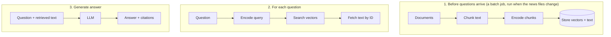
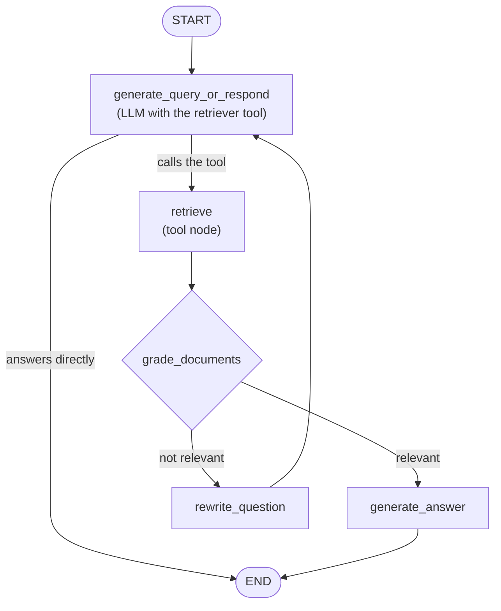
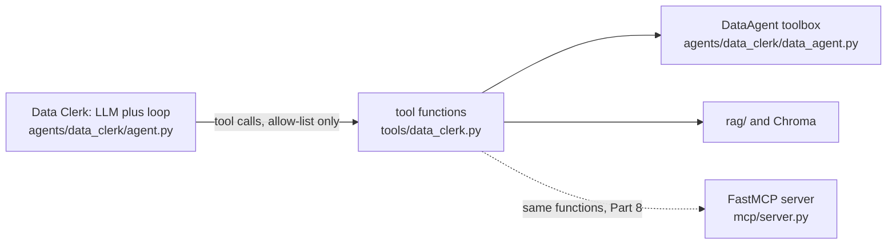
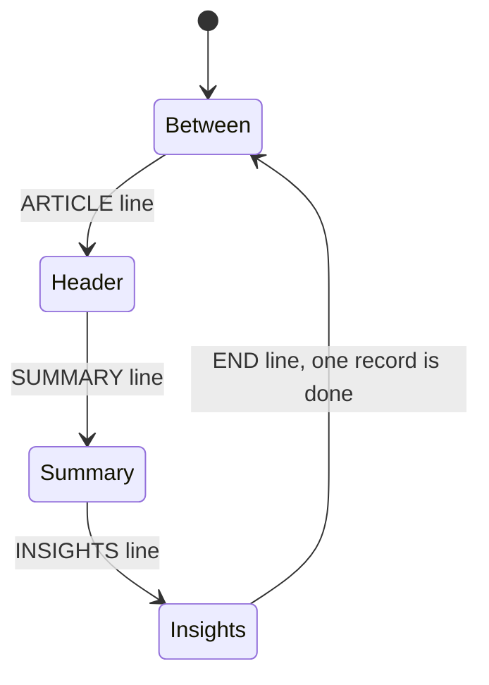

# How to do LangChain RAG (working guide for Prometheus)

We build the news RAG one small step at a time. Every part says what we do, why, how to check that it worked, and where the decision is recorded in `docs/design_choices.md`. Outputs shown here are real, from this machine on 2026-10-24.

References we follow:

- [Build a custom RAG agent with LangGraph](https://docs.langchain.com/oss/python/langgraph/agentic-rag): the agentic RAG graph (Parts 6 and 7).
- [Build a semantic search engine with LangChain](https://docs.langchain.com/oss/python/langchain/knowledge-base): loading, chunking, Chroma and retrievers (Parts 3 to 5).
- [Retrieval](https://docs.langchain.com/oss/python/langchain/retrieval): the 2-Step, Agentic and Hybrid RAG architectures (section 0.6).
- Your class slide "Retrieval-augmented generation": the shape of the pipeline we build (section 0.3).

## Roadmap

| Part | What we do | Status |
|---|---|---|
| 0 | The big picture: what RAG is and how the pieces fit | done |
| 1 | Install the stack and prove it works | done |
| 2 | Where the code lives | done |
| 3 | Look at the data, then load it into LangChain `Document`s | done |
| 4 | Chunk, embed and store: ingest AAPL into Chroma | **next** |
| 5 | Retrieve by hand on real data: search vectors, fetch text by ID, filters, scores, "no supporting text" | |
| 6 | Tools and the chat model: `retrieve_news` and the DataAgent tools as plain functions, numbered sources, the citation check | |
| 7 | The Data Clerk agent: a LangGraph where the LLM decides whether to retrieve or fetch, and the answer cites its sources | |
| 8 | FastMCP: serve the same tool functions; tests; the evidence for the week 3 submission (with and without retrieval) | |

How we work:

- **Who writes the code:** the AI writes it into the repo and explains every piece here. Jacob runs and reviews each step. (Agreed 2026-10-24. This replaces the "Jacob writes all code" rule in `design/week3_notes.md`.)
- One part at a time. Each ends with a check you can run and a design choice written down.
- Plain retrieval works by hand (Parts 3 to 5) before any LLM is involved. When something is wrong we can then tell a retrieval problem from an LLM problem.
- Examples and checks use real data only.

Later, not tonight: the market-wide store `news/market/*.jsonl` (3,561 articles, 152 of them CNBC) is the real corpus for Case 2, a trend search with no symbol up front. It uses the same pipeline with a second loader.

---

## Part 0: The big picture

### 0.1 What RAG is

An LLM knows its training data and whatever you paste into the prompt. It has never seen this morning's Apple news. Retrieval-Augmented Generation fixes that in three moves:

1. **Retrieve** the few passages that matter for the question.
2. **Augment** the prompt by pasting those passages in.
3. **Generate** the answer from them.

Your class slide says it in one line: *retrieval changes the evidence in the prompt, and the model weights stay fixed.* Nothing is retrained.

### 0.2 Why Prometheus needs it

From the week 3 submission:

- The model does not know current text: today's news, press releases and SEC filings must be fetched.
- Case 2 ("AI memory shortage") is a question about meaning, not a ticker lookup. Relevant articles use different words, so keyword matching misses them.
- The text is too large for one prompt, and it goes stale. Retrieval returns only the few relevant chunks, which keeps token cost down.

Retrieval is for text only. Prices and metrics stay in Parquet or Postgres, accounts and trades in Postgres, quote caching in Redis. Those need exact answers, which embeddings cannot give.

### 0.3 The pipeline from the class slide

This is the style of RAG we build: your class slide, redrawn. It has three stages.



The store built in stage 1 is what stage 2 searches, and the text fetched in stage 2 is what stage 3 hands to the LLM. Three things to notice:

- **The same model encodes both sides.** The question must be encoded with the same model as the chunks, otherwise the numbers mean nothing. This is why Part 4 puts the model's name into the collection name. ("Encode" is the slide's word; LangChain says "embed".)
- **"Search vectors" returns ids, and "fetch text by ID" looks the text up.** Chroma stores the text next to the vector and does both in one call, so each hit comes back with its id, text and metadata. That is also what a citation needs (design choices entry 15).
- **In Prometheus the LLM decides whether stage 2 runs at all.** The LLM is the Data Clerk, and retrieval is a tool it may call (section 0.6).

### 0.4 Embeddings in one paragraph

An embedding model turns text into a list of numbers (384 for ours) so that texts with similar meaning get similar lists. Searching means embedding the question and finding the nearest stored lists. Our check in Part 1 shows it working: the query "new folding smartphone sales" scored 0.62 and 0.56 against the two Apple foldable-iPhone articles and 0.21 against an unrelated Apple article. The second-best match shares no word at all with the query. That is the gap in `DataAgent.search`, which matches whole words only (see design choices entry 1: "weight loss pills" will not find "GLP-1").

**Try it: the smallest example.** This one is from your class slide. It stores two texts with hand-made two-number "embeddings" and asks for the one nearest to a query vector. The vectors are synthetic, so there is no model to download.

```python
import chromadb
c = chromadb.Client()
col = c.create_collection("demo", embedding_function=None)
col.add(ids=["refund", "login"],
        documents=["Refunds: 30 days.", "Reset using email."],
        embeddings=[[1.0, 0.0], [0.0, 1.0]])
print(col.query(query_embeddings=[[1.0, 0.0]], n_results=1)["documents"])
```

It runs unchanged on our `chromadb` 1.5.9 and prints `[['Refunds: 30 days.']]`. The double brackets are there because `query` takes several query vectors at once and returns one list of results per vector. What each line does:

- `chromadb.Client()` is an in-memory database that disappears when the program ends. Prometheus will use a `PersistentClient`, which is a folder on disk.
- `embedding_function=None` means "I bring my own vectors", so Chroma embeds nothing.
- `col.add(...)` stores each text under an id, together with its vector.
- `col.query(...)` returns the stored text whose vector is nearest to `[1.0, 0.0]`. The refund vector is identical to it, so that text wins.

A real embedding model does by machine what the slide does by hand: it turns each text into a vector, so you never write vectors yourself. The file `labs/module3_rag/chroma_demo.py` runs the slide and then two short extensions. None of them needs a download:

```bash
python labs/module3_rag/chroma_demo.py
```

```text
1) class slide
   [['Refunds: 30 days.']]
2) distances
   Chroma default metric: [('refund', 0.0), ('login', 2.0)]
   cosine metric        : [('refund', 0.0), ('login', 1.0)]
3) the same through LangChain: relevance of each text to 'Can I get a refund?' (higher is closer)
UserWarning: Relevance scores must be between 0 and 1, got [..., -0.4142135623730949)]
   default metric: refund=+1.00  login=-0.41
   cosine metric : refund=+1.00  login=+0.00
```

- **Step 2 shows how "near" is measured.** The same query, with the distance of each result (lower is closer). The two metrics give different numbers for the same data: 2.0 against 1.0 for the unrelated text. A raw distance is hard to read (is 2.0 far?), so Prometheus uses cosine and reports a relevance of `1 - cosine distance`.
- **Step 3 is the same demo the way Prometheus does it.** LangChain's `Chroma` wrapper needs an *embeddings object* with two methods, `embed_documents` and `embed_query`. A real one is `HuggingFaceEmbeddings`. The file uses a toy one that only looks for the word "refund", and builds the store twice. With Chroma's default metric the unrelated text scores **-0.41**, and LangChain itself warns that scores must be between 0 and 1. With cosine it scores 0.00. The metric is chosen when the collection is created and cannot be changed afterwards (design choices entry 10).

Raw Chroma against what Prometheus will use:

| Raw Chroma (the slide) | LangChain `Chroma` (Prometheus) |
|---|---|
| you pass the vectors yourself | the embeddings object computes them from the text |
| `col.add(ids=..., documents=..., embeddings=...)` | `store.add_documents(docs, ids=...)` |
| `col.query(query_embeddings=[[...]], n_results=1)` | `store.similarity_search("question", k=1)` |
| returns nested lists | returns a list of `Document`s |

### 0.5 Vocabulary

| Term | Plain meaning | In Prometheus |
|---|---|---|
| Document | text plus metadata (LangChain's `Document` has `page_content`, `metadata` and an optional `id`) | one news article, later its chunks |
| Chunk | a piece of a Document, small enough to embed well | Part 4 |
| Embedding | the list of numbers for a text (the slide says "encode") | 384 numbers from `all-MiniLM-L6-v2` |
| Vector store | a database of embeddings that you search by nearness | Chroma, a folder on disk |
| Retriever | takes a question and returns the best Documents | what the LangGraph tool will call |
| Metadata filter | limits the search by facts about the chunk | the work order's symbol and time period |
| Tool | a function an LLM may ask to run | `fetch_news`, `retrieve_news` |
| Citation | a pointer from a statement in the answer to the chunk it came from | `[1]` markers that we check against the retrieved chunks (Part 7) |
| State, node, edge | LangGraph: shared data, one step, which step runs next | Part 7 |

### 0.6 Who decides whether to retrieve: the Data Clerk LLM

In the slide, stage 2 happens for each question. In Prometheus the **LLM decides** whether it does. The LLM is the Data Clerk agent, and retrieval is one of its tools, next to the DataAgent's fetch tools. LangChain calls this **Agentic RAG**. Its retrieval docs compare three architectures:

| Architecture | What it means | Control | Flexibility | LLM calls |
|---|---|---|---|---|
| 2-Step RAG | retrieval always happens before generation | high | low | one, capped |
| Agentic RAG | an LLM-powered agent decides when and how to retrieve | low | high | variable |
| Hybrid | adds query rewriting, retrieval checks and answer checks | medium | medium | variable |

We chose Agentic RAG because the Data Clerk is not only a search box. Its actions in the week 2 design are search news, fetch a quote, search socials and calculate financials, and most requests need no stored text at all. It also has to choose between stored text (retrieve) and fresh data (fetch). The cost is at least two LLM calls for a question that retrieves (decide, then answer). Design choices entry 15 has the full reasoning.

The first version is the simple loop. The LLM calls a tool, reads the result, and then either calls another tool or answers with citations:


The LangChain "custom RAG agent" guide adds two steps after retrieval: a grader that checks whether the retrieved text is relevant, and a rewriter that rewrites the question and retries when it is not. That is the Hybrid form. We add them only if plain retrieval fails on real questions, so we can tell whether they earn their cost.



Our version swaps that guide's in-memory store and OpenAI embeddings for Chroma and local embeddings, and puts the DataAgent's fetch tools next to the retriever.

### 0.7 One agent, one toolbox

There is one data agent: the **Data Clerk** from the week 2 design. It is an LLM with tools and a loop, and it lives in `prometheus/agents/data_clerk/`. There is no Data Clerk code yet, only the design, so there was nothing to merge the DataAgent into.

`DataAgent` (`data_agent.py`, in the same folder) is **not** a second agent. It has no LLM and no loop. It is the Data Clerk's toolbox: plain Python that fetches, syncs and searches. The Data Clerk decides which tool to call, and the toolbox does the work. We kept them as separate layers on purpose, and gave them one folder and one name (design choices entry 13).



"The DataAgent is a callable node" (your request 3) is Part 7. The Data Clerk's graph has a tool node that runs the calls the LLM asks for, such as `fetch_news(symbol)`, and a step after the fetch loads the new text into Chroma.

Where your five requests land:

| Your request | Where |
|---|---|
| 1. Install ChromaDB, pick a version that works with LangChain | Part 1 and design choices entry 10 |
| 2. RAG for the news files | Parts 3 to 5 |
| 3. LangGraph with the DataAgent as a callable node | Parts 6 and 7 |
| 4. Where the code goes | Part 2 and entries 12 to 14 |
| 5. This guide | grows with every part |

---

## Part 1: Install the stack and prove it works

### 1.1 Which ChromaDB?

Short answer: `chromadb` 1.5.9 with `langchain-chroma` 1.1.0.

You do not pick the Chroma version directly. LangChain talks to Chroma through the `langchain-chroma` package, and that package declares which Chroma versions it accepts. We read it from PyPI:

- `langchain-chroma` 0.2.0 to 0.2.3 (early 2025) accepted Chroma 0.4 to 0.6.
- From 0.2.4 on, it requires Chroma 1.x.
- 1.1.0 (December 2025, the latest) requires `chromadb>=1.3.5,<2`, and pairs with the LangChain 1.x line we use.

The full table, the options we rejected and the consequences are in design choices entry 10.

### 1.2 Install

```bash
conda activate cmu
cd /run/media/jpyrett/980pro/CMU-AgenticAI/capstone
pip install -r requirements.txt
pip check          # expect: No broken requirements found.
```

What the new lines in `requirements.txt` are for:

| Package | Tested | Job |
|---|---|---|
| `langchain` | 1.4.7 | `@tool`, `init_chat_model`, message classes |
| `langgraph` | 1.2.17 | the graph: state, nodes, edges, `ToolNode` |
| `langchain-text-splitters` | 1.1.3 | cut text into chunks |
| `langchain-huggingface` | 1.2.3 | `HuggingFaceEmbeddings`: runs `sentence-transformers` locally |
| `langchain-chroma` | 1.1.0 | the Chroma vector store and retriever |
| `chromadb` | 1.5.9 | the vector database itself |
| `langchain-openai` | 1.7.2 | chat-model client (OpenRouter now, a local server later) |
| `pyarrow` | 26.0.0 | already imported by `data_agent.py`, but missing from the env |

The install added 60 packages, mostly dependencies of `chromadb` (onnxruntime, grpc, opentelemetry, a Kubernetes client). We checked that nothing you already had changed: `torch`, `transformers`, `sentence-transformers`, `numpy`, `pydantic`, `mcp` and `fastmcp` are the same versions as before. Why this package set, and what we left out on purpose: entry 11.

### 1.3 Prove it works

```bash
python labs/module3_rag/check_install.py
```

The script indexes five real headlines into a throw-away Chroma folder and checks the whole loop. Its core is five operations, which are also the five things every RAG system does:

```python
# 1. Embeddings: text -> 384 numbers, computed on this machine
emb = HuggingFaceEmbeddings(
    model_name="sentence-transformers/all-MiniLM-L6-v2",
    encode_kwargs={"normalize_embeddings": True},  # unit-length vectors: cosine behaves well
)

# 2. A persistent vector store (a folder on disk), telemetry off, cosine distance
client = chromadb.PersistentClient(path=tmp, settings=Settings(anonymized_telemetry=False))
store = Chroma(
    client=client,
    collection_name="smoke_test",
    embedding_function=emb,
    collection_configuration={"hnsw": {"space": "cosine"}},  # relevance = 1 - cosine distance
)

# 3. Index: embed each document and store it (same ids twice just overwrites)
store.add_documents(docs, ids=ids)

# 4. Search by meaning
store.similarity_search_with_relevance_scores("new folding smartphone sales", k=3)

# 5. Search with metadata filters (the work order's subject and time period)
store.similarity_search(
    "iPhone", k=5,
    filter={"$and": [{"symbol": "AAPL"}, {"published_ts": {"$gte": since}}]},
)
```

Real output (abbreviated):

```text
1) embeddings
  ok   vector length is 384 -> model load + first embed 14.3s, device=cuda:0
2) Chroma store
  ok   telemetry is off
3) index
  ok   5 documents added twice are stored once each (re-ingest is safe) -> count=5
4) semantic search
     query: 'new folding smartphone sales'  (score = relevance, higher is better)
          0.617  aapl-3  Apple's iPhone Duo shows encouraging early demand signals, with ...
          0.564  aapl-1  The iPhone Duo Launch Kicks Off a Crucial Few Weeks for Apple. A...
          0.208  aapl-2  Apple Named Qnity as a New Domestic Manufacturing Partner. Qnity...
     query: 'AI cloud company worried about its debt'
          0.368  nvda-1  CoreWeave Is Projected to Have a 6.3x Gross Leverage Ratio by Ye...
          0.214  tsla-1  Tesla Gives Up On Cybertruck In Australia. Company Says It Will ...
  ok   relevance == 1 - distance (cosine) -> distance=0.383, relevance=0.617
5) metadata filters
  ok   filter symbol == TSLA returns only TSLA
  ok   filter published_ts >= 18:00 drops the 17:22 article
  ok   symbol AND date filters combine
6) retriever
  ok   retriever honours k and filter
7) persistence
  ok   a new process sees the 5 stored documents -> 5
ALL CHECKS PASSED: LangChain + Chroma + local embeddings work on this machine.
```

What each check proves for Prometheus:

| Check | What it proves |
|---|---|
| vector length 384 | embeddings run locally: no API key, no cost, and the text stays on this machine |
| telemetry is off | nothing about our usage leaves the machine through Chroma |
| added twice, stored once | ingestion can be re-run safely, so we can run it whenever news changes |
| the foldable-iPhone query | search by meaning works where `DataAgent.search` keyword matching cannot |
| relevance equals 1 minus distance | we know which way the scores point, so they can go on the work order as evidence |
| symbol, date and combined filters | the work order's subject and time period can limit the search itself (week 3, section 5) |
| retriever honours `k` and the filter | the object the LangGraph tool will call works |
| a new process sees the data | the index survives restarts: it is just a folder |

The first run downloads the embedding model (88 MB) into `~/.cache/huggingface`. After that it also works with `HF_HUB_OFFLINE=1`. On the first run it picked your GPU (`cuda:0`). We re-ran it on the CPU and got identical scores (distance 0.383, relevance 0.617), so results do not depend on the device. In Part 4 the device becomes an explicit setting.

### 1.4 What this step taught us

1. **`pyarrow` was missing from `cmu`.** `data_agent.py` imports it at module level, so `import data_agent` failed. It is now in `requirements.txt`.
2. **Chroma reports usage by default.** `Settings().anonymized_telemetry` is `True`. We pass `Settings(anonymized_telemetry=False)` when we create the client.
3. **There are two score flavours and they point in opposite directions.** `similarity_search_with_score` returns a *distance* (lower is closer). `similarity_search_with_relevance_scores` returns a *relevance* (higher is closer). LangChain picks the relevance formula from the collection's metric. With `collection_configuration={"hnsw": {"space": "cosine"}}` it is `1 - cosine distance`, which reads as a plain similarity. With Chroma's default metric the scores still work, but unrelated text can score *negative* (tested: -0.41). Chroma refuses to change the metric afterwards, so choose cosine when the collection is created.
4. **Range filters compare numbers only, but lists are fine.** A date filter needs `published_ts` as epoch seconds (a text date is rejected). A list such as `tickers` can stay a list and be filtered with `$contains`. We first assumed lists had to be flattened to text. Testing showed that was wrong (entry 10).
5. **Collection names are strict.** 3 to 512 characters from `[a-zA-Z0-9._-]`, so a model name containing `/` must be cleaned first.

### 1.5 If something fails

| Symptom | Likely cause | Fix |
|---|---|---|
| `ModuleNotFoundError` for a package listed above | wrong Python, env not active | `conda activate cmu`, check that `which python` ends in `/envs/cmu/bin/python`, then `pip install -r requirements.txt` |
| the first run fails while downloading the model | no internet | run it once with internet; later runs can use `HF_HUB_OFFLINE=1` |
| `Warning: You are sending unauthenticated requests to the HF Hub` | no Hugging Face token | harmless, ignore it |
| `cannot import name 'StateGraph' from 'langgraph.graph'`, or `import langgraph` loads the wrong thing | you ran Python from inside `prometheus/`, where a folder is named like the library | run from the repo root and never put `prometheus/` on `PYTHONPATH` (entry 12) |

---

## Part 2: Where the code lives

This follows your README ("put new code in the folder that matches its job"): `agents/` holds the five agents, one folder each, `tools/` holds local Python tools, `mcp/` holds FastMCP servers, and `langgraph/` wires agents into a graph.

```text
prometheus/
  agents/data_clerk/       the Data Clerk, the one data agent
    data_agent.py            its toolbox: DataAgent, plain Python. Vendored copy, not edited.
    agent.py                 the LLM agent: the agentic-RAG graph (Part 7)
  tools/data_clerk.py      the Data Clerk's tool functions: plain, typed, documented (Part 6)
  mcp/server.py            serves the same functions as MCP tools (Part 8)
  rag/                     RAG library, shared by agents: files -> Documents -> Chroma -> retriever
    config.py                paths and model names (from .env, with defaults)
    loaders.py               news/<SYMBOL>.txt -> LangChain Documents
    store.py                 embeddings + persistent Chroma (the only file that names either)
    ingest.py                load -> split -> embed -> upsert;  python -m prometheus.rag.ingest AAPL
    retriever.py             filtered search -> chunks + scores
    citations.py             numbered sources for the prompt; checks that every citation points at a retrieved chunk
  models/chat.py           chat-model factory (OpenRouter now, local later); llm.py (local HF) stays
  prompts/data_clerk.py    grader, rewrite and answer prompts
  langgraph/desk.py        later: wires the five agents into one graph
labs/module3_rag/          this guide and check_install.py
```

Today `agents/data_clerk/` (the toolbox and its two test scripts) and `rag/` with `config.py` and `loaders.py` exist. Each remaining file appears in the part that needs it: `store.py` and `ingest.py` in Part 4, `retriever.py` in Part 5, `citations.py`, `tools/data_clerk.py` and `models/chat.py` in Part 6, `agent.py` and `prompts/` in Part 7, `mcp/server.py` in Part 8.

The rules behind it (full reasoning in entries 12 to 14):

1. **One folder per agent under `agents/`,** named after its role. The Data Clerk and its toolbox share a folder. The toolbox (`DataAgent`) has no LLM and no LangChain import, and raises on any error.
2. **`rag/` reads files and never imports `DataAgent`.** The record format in `docs/DataAgent.md` (`<<<ARTICLE>>>` to `<<<END>>>`) is the contract, so either side can change alone.
3. **One module per reason to change.** The file format (loaders), the embedding model and vector DB (store) and the search strategy (retriever) change independently, so each can be tested alone.
4. **`tools/` holds plain functions.** LangChain and MCP each read the same name, docstring and typed arguments, so one function serves both (see the Part 6 preview).
5. **`langgraph/` wires agents together.** The Data Clerk's own loop lives in its folder.

Two practical notes:

- **Always run from the repo root.** `prometheus/langgraph`, `prometheus/langchain` and `prometheus/mcp` have the same names as the libraries they use. That is safe while `prometheus/` is not on `sys.path`.
- **Create the toolbox with the repo root as its base folder.** Its default is the folder holding `data_agent.py`, which was the old layout.

```python
from pathlib import Path
from prometheus.agents.data_clerk.data_agent import DataAgent

toolbox = DataAgent(base_dir=Path.cwd())  # run from the repo root: news/, data/ and .env are found there
```

We tested this after the rename: the news folder resolves to `<repo>/news`, and `data_agent.py` needed no edit. If you re-copy `data_agent.py` from the standalone project, copy it into `agents/data_clerk/`.

---

## Part 3: Look at the data, then load it (done)

Stage 1 of the slide starts here, with its first box: **Documents**. We read the DataAgent's news files and turn each article into a LangChain `Document`. Nothing is embedded yet. You can run everything in this part yourself (sections 3.5 and 3.6).

### 3.1 What the DataAgent wrote

| File | Articles | Dates | Finnhub / Polygon | Over 1,000 characters |
|---|---|---|---|---|
| `news/AAPL.txt` | 74 | Oct 17 to 24 | 60 / 14 | 13 (18%) |
| `news/META.txt` | 20 | Oct 22 to 24 | 18 / 2 | 1 (5%) |
| `news/NVDA.txt` | 181 | Oct 17 to 24 | 64 / 117 | 102 (56%) |
| `news/TSLA.txt` | 13 | Oct 20 to 23 | 6 / 7 | 5 (38%) |
| **Total** | **288** | | **148 / 140** | **121 (42%)** |

("Characters" counts headline, summary and insights together.) Every article has a summary. Only Polygon articles have insights: one `TICKER | sentiment | reasoning` line per ticker, which is where the "why" lives.

Four things to notice:

- **Most Polygon articles are long, and Finnhub ones are short.** That is why NVDA (mostly Polygon) has a median of 1,218 characters and AAPL (mostly Finnhub) only 255.
- **An article can sit in more than one symbol file, and `tickers` means two different things.** 7 of the 288 appear in two files (for example AAPL and NVDA). For **Finnhub** articles `tickers` is only the symbol that was asked for: all 148 are exactly `[the file's symbol]`, so the same article is `["AAPL"]` in one file and `["NVDA"]` in the other (3 of the 7 duplicates). For **Polygon** articles it is the article's real list of companies (122 of 140 name more than one) and it is identical in both files. A file's own symbol is always in the list (288 of 288), so we do not store it separately. We keep one row per article and **merge the two lists when an article is stored a second time** (Part 4), so a filter on any ticker finds it. The CoreWeave article in `news/NVDA.txt` has `tickers: CRWV, MSFT, META, NVDA`, so a filter on any of the four finds it.
- **There are repeated headlines.** NVDA has 7. Keep an eye on them in Part 5 (MMR, see below).
- **The embedder cannot read all of it.** See the Part 4 preview.

### 3.2 What one record becomes

One article becomes one LangChain `Document`. This is the first AAPL record:

```text
page_content:
  The iPhone Duo Launch Kicks Off a Crucial Few Weeks for Apple

  Apple's foldable iPhone goes on sale ahead of an expected touchscreen MacBook launch and fiscal
  fourth-quarter earnings.

metadata:
  article_id     finnhub:143136906
  headline       The iPhone Duo Launch Kicks Off a Crucial Few Weeks for Apple
  tickers        ["AAPL"]
  published_utc  2026-10-23T19:03:00Z
  published_ts   1792782180
  publisher      Yahoo
  api            finnhub
  url            https://finnhub.io/api/news?id=d785...f1b1
```

The Document's `id` is the article id, so the same article read from two files is one row after ingestion (with its ticker lists merged). `headline`, `publisher`, `published_utc` and `url` are the citation fields: they are what the answer shows next to a source, so every chunk carries them (design choices entry 15).

### 3.3 The decisions we made

| # | Question | Decision | Why |
|---|---|---|---|
| 1 | What is one Document? | one article | the unit we de-duplicate, filter and cite; chunks come from splitting it in Part 4 |
| 2 | What goes into `page_content`? | headline, summary, then the insight lines, separated by blank lines | the insights carry the reasoning the Advisor needs |
| 3 | Which metadata? | the fields above: `tickers` stays a list, `published_ts` is a number | filters need them, and the headline, publisher, date and url are what a citation shows; Chroma filters a list with `$contains` and a date only as a number (both tested) |
| 4 | How do we read the files? | one plain function, `load_news(path) -> list[Document]` | both LangChain guides do the same (`load_pdf_pages`, `load_web_page`) instead of loader classes |
| 5 | One collection or one per symbol? | one collection, one row per article, filtered with `tickers` and `$contains`, ticker lists merged when an article is stored again | Case 2 has no symbol up front and must search across companies, and 7 articles sit in two symbol files and must not be stored twice |

### 3.4 The code

Two small files. Neither knows about Chroma or an LLM.

**`prometheus/rag/config.py`** says where things are. A setting comes from the environment, then from `.env`, then from a default, so you can move the news folder without touching code. For now there is one: `NEWS_OUTPUT_DIR` (the DataAgent's own setting name), default `news/` at the repo root. A relative path is resolved against the repo root. The settings are functions, not constants, so nothing is read when the module is imported and a test can override one. Part 4 adds the vector store path and the embedding model here.

**`prometheus/rag/loaders.py`** has three pieces:

| Piece | Job |
|---|---|
| `load_news(path)` | read one news file and return one `Document` per article |
| `news_file(symbol)` | turn `AAPL` into `<news dir>/AAPL.txt`, after checking the symbol |
| `python -m prometheus.rag.loaders AAPL` | a viewer, so you can look at what the Documents are |

A news file is a series of records, and a record has four parts: header lines, a summary, insights and an end line. `load_news` reads it with a small state machine that moves on each time it sees a marker line:



- In **Header**, every line is `name: value`. The reader splits at the **first** colon only, because values contain colons: the headline "Meta Vs. Apple: Divergent Edge AI ..." and every url.
- In **Summary** and **Insights**, every line is text and is collected as it is.
- On the END line the record is handed on and the reader goes back to **Between**.

Each record then becomes one `Document`:

```python
    return Document(
        id=head["id"],
        page_content="\n\n".join(part for part in (head["headline"], summary, insights) if part),
        metadata={
            "article_id": head["id"],
            "headline": head["headline"],
            "tickers": tickers,
            "published_utc": head["published_utc"],
            "published_ts": int(published.timestamp()),  # a number: Chroma range filters take numbers only
            "publisher": head.get("publisher", ""),
            "api": head.get("api", ""),
            "url": head["url"],
        },
    )
```

The text is the headline, the summary and the insight lines exactly as the DataAgent wrote them, so it can always be rebuilt from the file.

**Errors stop the load**, which is the DataAgent's own policy. The reader raises a `ValueError` that names the file and the line for anything the DataAgent would not have written: a record with no END line, a new record starting inside an unfinished one, an unknown `<<<` marker, a header line without a colon, a missing `id`, `headline`, `published_utc` or `url`, a bad date, or text outside a record. The vendored DataAgent's own reader (`_read_records`) does the opposite: when a new record starts it silently drops an unfinished one. An interrupted fetch can leave exactly that, and a quietly missing article is worse for a trading system than an error you can see and fix.

**Symbols are checked before they become a file name.** `news_file` accepts letters, digits, `.` and `-`, at most 10 characters. A symbol will come from an LLM's tool call, and a prompt-injected `../../.env` must not walk out of the news folder. The vendored DataAgent only strips and uppercases the symbol, so the tool wrapper in Part 6 has to validate symbols as well.

### 3.5 Run it

```bash
python -m prometheus.rag.loaders AAPL
```

It prints a summary line, then the first two Documents and the first one that has insights. Real output, shortened:

```text
news/AAPL.txt
74 articles | 2026-10-17T19:47:00Z to 2026-10-24T14:51:41Z | 14 with insights | 74 distinct ids

--- Document 1 of 74 ---
id: finnhub:143136906
page_content (183 characters):
  The iPhone Duo Launch Kicks Off a Crucial Few Weeks for Apple

  Apple’s foldable iPhone goes on sale ahead of an expected touchscreen MacBook launch and fiscal fourth-quarter earnings.
metadata:
  {
    "article_id": "finnhub:143136906",
    "headline": "The iPhone Duo Launch Kicks Off a Crucial Few Weeks for Apple",
    "tickers": [
      "AAPL"
    ],
    "published_utc": "2026-10-23T19:03:00Z",
    "published_ts": 1792782180,
    "publisher": "Yahoo",
    "api": "finnhub",
    "url": "https://finnhub.io/api/news?id=d785010198f95cde7609b110185876b490a53c6cc083289353e226aeb037f1b1"
  }

...

--- Document 61 of 74 ---
id: polygon:9f6e9edaa696ae2fb1a8cf3c77c8ad933844036f7754bf764559759e22145571
page_content (1062 characters):
  Apple's Market Value Grew From $350 Billion to $5 Trillion During Tim Cook's 15 Years as CEO. ...
  (the headline, then the summary, then the insight lines)
```

The summary lines for the other three files:

```text
news/META.txt 20 articles | 2026-10-22T09:10:34Z to 2026-10-24T00:07:10Z | 2 with insights | 20 distinct ids
news/NVDA.txt 181 articles | 2026-10-17T21:30:00Z to 2026-10-24T15:35:00Z | 117 with insights | 181 distinct ids
news/TSLA.txt 13 articles | 2026-10-20T11:30:00Z to 2026-10-23T11:40:46Z | 7 with insights | 13 distinct ids
```

That is 288 articles and 281 distinct ids: the 7 duplicates from section 3.1. A damaged file is reported with its place, and nothing is half-loaded. This one is `head -n 19 news/AAPL.txt`, which cuts off the END line of the first record:

```text
$ python -m prometheus.rag.loaders /tmp/damaged_AAPL.txt
ERROR: /tmp/damaged_AAPL.txt:1: the record has no <<<END>>>
```

### 3.6 Tests

```bash
pytest tests/test_rag_loaders.py -q
```

```text
.......................................                                  [100%]
39 passed in 0.06s
```

What they cover:

| Group | What it checks |
|---|---|
| Real records | `tests/fixtures/news_sample.txt` holds three real records copied word for word from your files: a Finnhub article, the CoreWeave article (four tickers, four insight lines) and one with a colon in its headline. The tests check exact text, exact metadata and the epoch timestamps (worked out by hand) |
| Errors | every case in section 3.4 raises, with the right file and line |
| Symbols and settings | `../../.env`, `$AAPL`, and an empty or too long symbol are refused; the order environment, then `.env`, then default holds |
| Your real files | every file in `news/` loads, the file's symbol is in every article's `tickers`, and an article that sits in two files differs only in `tickers` (skipped when there are no files) |

To be sure the tests can fail, we broke the loader five ways on purpose: split headers on every colon, shift the timestamp by a second, ignore a missing END line, accept any symbol, and drop the insight lines. The tests caught all five (14, 2, 1, 8 and 2 failing tests), and the original file was restored and compared byte for byte.

### 3.7 What we found along the way

- **Finnhub's `tickers` is only the symbol that was asked for.** The same article is `["AAPL"]` in one file and `["NVDA"]` in another. Part 4 merges the lists when it stores an article a second time. A test guards the assumption this relies on: copies of an article differ only in `tickers`.
- **Your tests only found `prometheus` by accident.** `PYTHONPATH` in your shell ends with a colon (it is set by the Pleora eBUS SDK), and Python reads that empty entry as "the current folder". With `PYTHONPATH` cleared, the existing tests failed with `No module named 'prometheus'`. One line in `pytest.ini` (`pythonpath = .`) fixes it, and the old tests pass either way.
- **`.env.example` was out of step with the DataAgent.** It listed `MASSIVE_API_KEY`, which no code reads, and not `POLYGON_API_KEY`, which the DataAgent needs. It now lists both and documents `NEWS_OUTPUT_DIR`.
- **`keywords` are left out of the text for now** (140 of 288 articles have them). Adding them is an experiment for Part 5, where we can compare search results with and without.

The decisions are recorded in design choices entry 16.

### Next: Part 4

Chunk, encode and store: `rag/store.py` (the embedding model and the Chroma collection) and `rag/ingest.py` (load, split, embed, upsert, merging ticker lists). Then `python -m prometheus.rag.ingest AAPL`, and we look at what Chroma holds.

---

## Part 4 preview: chunk, embed and store

This is where the knowledge-base tutorial applies. It uses `RecursiveCharacterTextSplitter(chunk_size=1000, chunk_overlap=200, add_start_index=True)` and says why: "a page is often too coarse for retrieval. Split pages further so relevant passages are not diluted by surrounding text." For us there is a second, harder reason. Our embedding model reads at most 256 tokens (about 1,178 characters of this news at 4.6 characters per token) and silently ignores the rest:

- 101 of the 288 articles (35%) are over the limit.
- 23% of all tokens (12,848 of 57,005) would never be embedded without chunking.

We tested the tutorial's defaults and three variants on the 288 real articles:

| `chunk_size` / `chunk_overlap` | Chunks | Articles split | Chunks over 256 tokens | ...with the headline added back |
|---|---|---|---|---|
| no splitting | 288 | 0 | 101 | 101 |
| 1000 / 200 (tutorial) | 489 | 133 | 1 | 3 |
| 1000 / 100 | 487 | 133 | 1 | 3 |
| 800 / 100 | 557 | 146 | 0 | 0 |
| 600 / 100 | 669 | 152 | 0 | 0 |

How to read it:

- The tutorial's defaults are a good start. The 101 over-limit articles become 489 chunks and only one is still too long (263 tokens against 256).
- 800 / 100 leaves nothing over the limit, even after the headline is added back, for about 14% more chunks.
- Overlap costs almost nothing here (1.00x to 1.03x the original text). News text breaks at paragraph boundaries first, and overlap only acts inside a long paragraph. It will matter for 10-K sections, which is what the tutorial's own example is (107 pages became 516 chunks).
- A chunk that does not start its article loses the headline, so "negative | Stock declined 11.91% due to..." would no longer say what it is about. We plan to prefix such chunks with the headline.

Decisions for Part 4: the size and overlap, the headline prefix, `add_start_index=True` (it records each chunk's character offset, which helps trace a chunk back), the embedding model and its device as a setting, the collection name with the model name inside, whether re-ingestion skips chunks already stored or overwrites everything, and how an article that is stored a second time merges its `tickers` with the stored list (the Part 3 finding, entry 16).

Two comparisons with the tutorial's Chroma snippet:

- Its `Chroma(collection_name=..., embedding_function=..., persist_directory=...)` is the short form. Ours passes a `PersistentClient` so telemetry can be switched off, and sets the cosine metric at creation (entry 10).
- Its HuggingFace example uses `all-mpnet-base-v2`, a larger model. Swapping the model is a one-line change, and our corpus is tiny. We can index with two models into two collections and compare them on the same queries. That settles the week 3 submission's "confirm the embedder on real chunks" item with evidence.

## Part 5 preview: retrieve

Stage 2 of the slide is *search vectors*, then *fetch text by ID*. Chroma does both in one call, so each hit comes back with its id, text and metadata. We keep on every hit what a citation needs: id, headline, publisher, date, url and score.

The tutorial lists three search types for `as_retriever(search_type=...)`:

- `"similarity"`: the nearest chunks.
- `"similarity_score_threshold"`: only chunks that score above a bar. This is the tool for the week 3 rule "if the filtered search finds nothing relevant, report 'no supporting text' and do not guess".
- `"mmr"`: maximum marginal relevance, which trades similarity for diversity. We only add it if real results show near-duplicate chunks (NVDA's repeated headlines are the suspect).

Two cautions we already have evidence for:

- **Scores are only comparable within one query.** In the Part 1 check, the correct answer for "AI cloud company worried about its debt" scored 0.37, while an unrelated chunk scored 0.21 for the same query and the best answer to another query scored 0.62. A fixed threshold needs tuning on real queries, and the grader step in Part 7 (an LLM judging relevance) is the guide's answer to the same problem.
- **A date window changes every day.** "The last 7 days" must be turned into a `published_ts` bound at call time. We will do that in one small search function (the tutorial's `@chain` retriever has the same shape), and that function becomes the LangChain tool in Part 6.

## Part 6 preview: tools

The Data Clerk's tools are plain Python functions in `prometheus/tools/data_clerk.py`. LangChain and MCP read the same three things from a function: its name, its description (the docstring) and its typed arguments. So one function serves both (design choices entry 14).

What a LangChain tool needs, tested on the installed versions:

| Need | What we found |
|---|---|
| A name and a description | the function name and its docstring. A function without a docstring is rejected |
| Typed arguments | they become the schema the model sees. `parse_docstring=True` turns the `Args:` section into per-argument descriptions. Keep the types simple: text, numbers, lists of text |
| A return the model can read | a dict becomes JSON text. For big results use `response_format="content_and_artifact"`: short text for the model, the full objects for the application (this is how chunk ids and scores can reach the work order) |

What happens when something goes wrong inside a `ToolNode` (tested):

| Situation | Default | With `handle_tool_errors=True` |
|---|---|---|
| The model forgets or mistypes an argument | an error message goes back to the model, which can fix it | same |
| The model invents a tool name | a message listing the valid names | same |
| The tool itself raises, like a DataAgent API error | **the whole run crashes** | an error message for the model |

The DataAgent raises on every error, so the Data Clerk needs `handle_tool_errors` with a message of our own (entry 14). Two testing notes: unit-test the plain functions directly, and test `ToolNode` through a small graph, because calling `ToolNode.invoke(...)` by hand fails in LangGraph 1.x.

Which toolbox methods become tools (the allow-list, settled in Part 6):

| Toolbox method | LLM tool? | Note |
|---|---|---|
| `fetch_news`, `fetch_press_releases`, `fetch_filings` | yes | network calls that refresh the text files |
| `search`, `discover` | yes | keyword search over the stored text; `discover` finds tickers for a trend phrase |
| `financials.get`, `performance_summary` | yes | `performance_summary` without its 61-point bell curve (that is for the UI chart) |
| `retrieve_news` (new, from `rag/`) | yes | search by meaning, with filters |
| `sync_market_news`, `sync_cnbc_news` | no | scheduled refresh jobs; `discover` already refreshes when it needs to |
| `init_aws_cli`, `fetch_historical_data`, `convert_to_parquet`, `export_project` | never | install software, download over 100 GB, run rsync to any path |

**What `retrieve_news` returns.** This is stage 2 of the slide, handed to the LLM. The text the model sees lists the hits as numbered sources, for example `[1] Yahoo, 2026-10-23: The iPhone Duo Launch Kicks Off ...`. The full hits (id, text, headline, publisher, date, url, score) travel as the tool's *artifact*, so they reach the work order without filling the prompt. The model cites by number, because a short number is easier to copy than an id like `polygon:44a8...`. A small check in `rag/citations.py` then confirms that every `[n]` in the answer points at a chunk that was really retrieved, and turns the numbers back into ids and urls. When nothing clears the relevance bar, the tool says "no supporting text" and the Data Clerk must say so too.

**MCP.** FastMCP serves the same functions to other hosts (Part 8), which is the week 2 "the Data Clerk calls its own MCP". Your existing FastMCP tools already work with LangChain through a hand-made bridge of about 15 lines (tested with `fetch_quote`). LangChain's official bridge, `langchain-mcp-adapters`, cannot be installed here: it needs `mcp<2` and FastMCP 4 needs `mcp>=2`. And `print()` inside an MCP tool is safe on this stack (tested), so the DataAgent's progress bars are not a problem. If you want the Data Clerk to call through MCP from day one, the bridge makes that a small change.

## Part 7 preview: the Data Clerk agent

The graph is the simple loop from section 0.6, with the DataAgent behind its tool node. For a question like "what is happening with META?" the LLM can answer from stored text (call `retrieve_news`), or first refresh the text (call `fetch_news`, which also loads the new articles into Chroma, then `retrieve_news`). For a greeting it answers directly. The system prompt tells it to retrieve for any question about a company's news, to cite sources as `[n]`, and to say so when there is no supporting text. We test two things with real data: that it retrieves when it should (and not for a greeting), and that every citation in its answer is valid.

---

## Decision log

| Part | Entry in `docs/design_choices.md` |
|---|---|
| 1 | 10 (Chroma and the version that works with LangChain), 11 (the LangChain 1.x package set) |
| 2 | 12 (where the code lives), 13 (one data agent: the Data Clerk and its toolbox) |
| 5 to 7 | 15 (RAG style: the class-slide pipeline, with the Data Clerk LLM deciding whether to retrieve, and citations) |
| 6 and 8 | 14 (tools: plain functions, LangChain now, MCP next) |
| 3 | 16 (loading the news files into Documents; the Finnhub `tickers` finding) |
| 4 and later | added as we make them |
